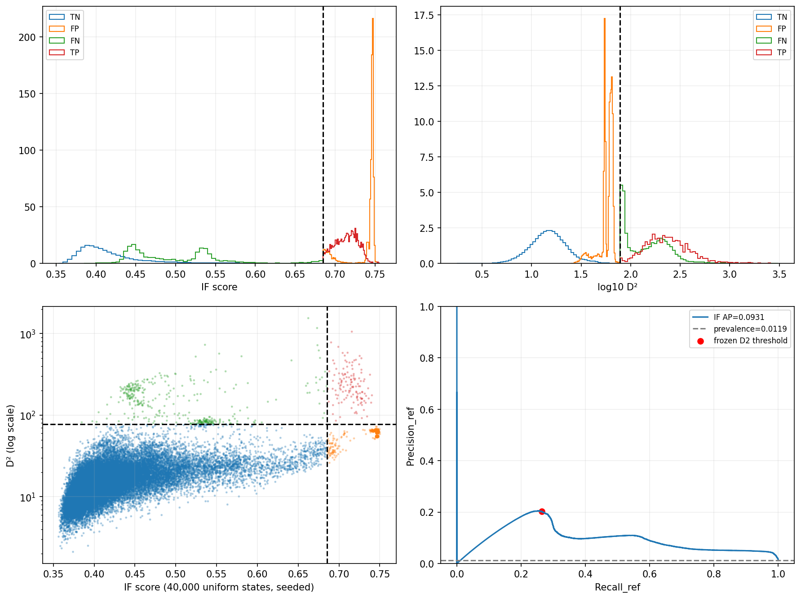
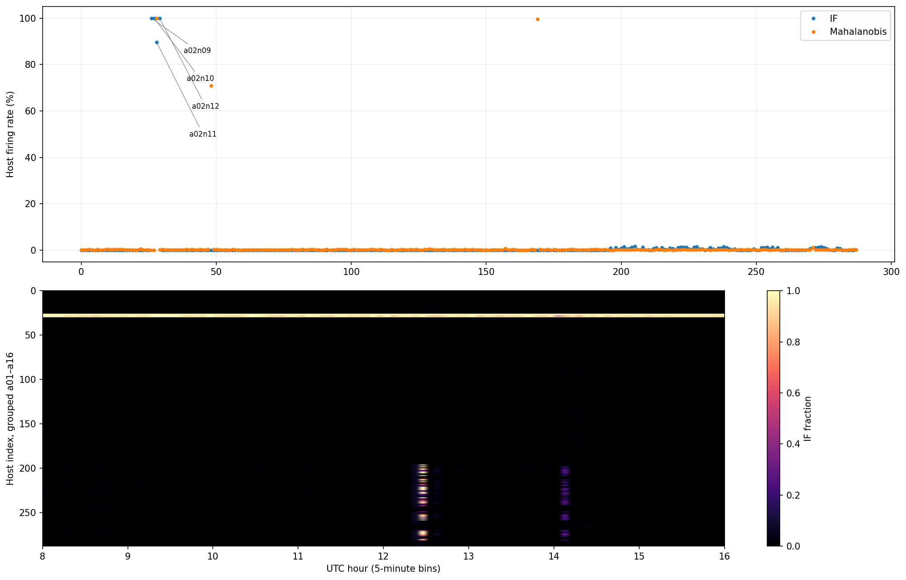
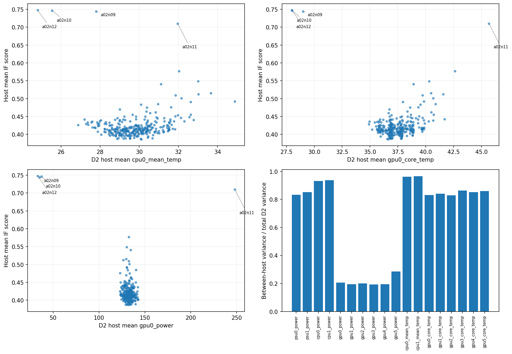
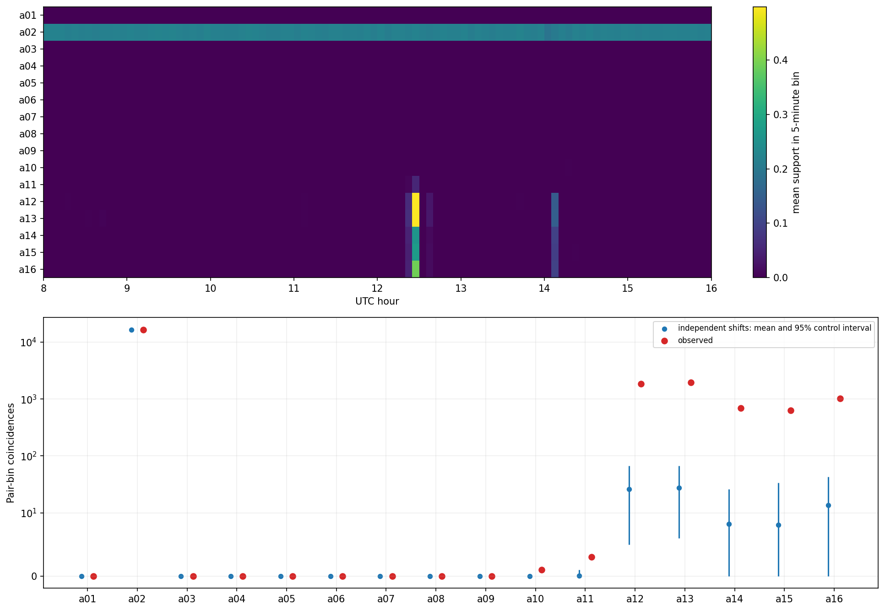
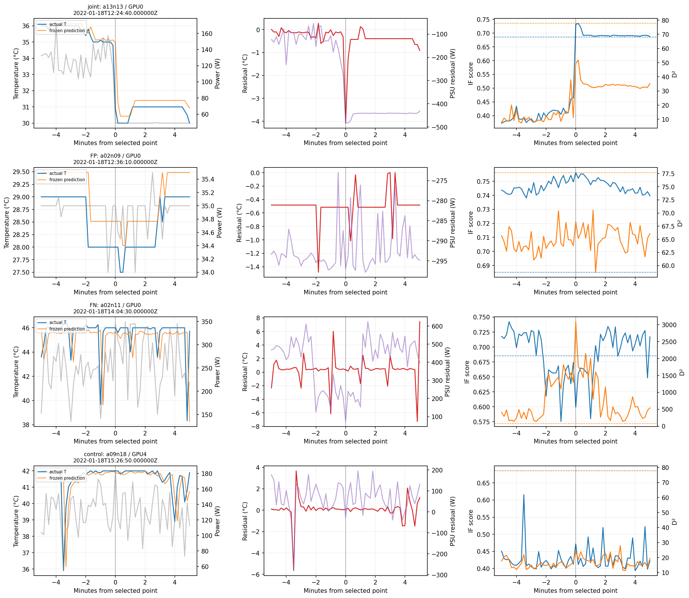

# Диагностика локальных и совместных аномалий на D2

Исследование мини-ТЗ №4.1. Дата расчётов: 13.10.2026. Основной вывод: **рекомендуется вариант B — сохранить общее ядро, но до утверждения группового детектора отдельно проверить влияние контекста хоста и режима нагрузки на локальную нетипичность**. Это рекомендация к следующему согласованию; изменений моделей в этой ветке нет.

IF ранжирует состояния лучше случайного ранжирования относительно Mahalanobis, однако 87,33% бинарных срабатываний приходятся на четыре хоста. В пяти группах наблюдается избыточная кратковременная синхронность относительно независимых циклических сдвигов. Один подробно изученный совместный интервал сопровождается падением мощности и охлаждением всех 18 хостов группы; является ли это нарушением, а не нормальной сменой нагрузки, **не установлено**. Доказательства обнаружения аппаратных отказов не получены.

## 1. Исходные данные и проверка воспроизводимости

Ветка `research/d2-anomaly-diagnostics` создана от обновлённого `main`, SHA `1dfb7c1f8b011b64a8fdebe4de4cdaafc3438940`. Прочитаны README, архитектура `internal/analysis`, `internal/experiment`, `internal/replayer`, тесты и отчёты этапов A–D. Исследовательский экспорт вызывает существующие загрузчики и методы Go; код детектора, Master/GroupWorker, БД и профили не менялись.

Проверена актуальная РПЗ `НИР7_Буторов_РПЗ_07_10_2026_компонентная_модель.docx`, SHA256 `8f982d8852e8d79ec3b7a40d8a519eaf6da0a73b98f6ee7bbf16bb2e511be510`, §§2.3–2.8 и 3.1–3.8. Сохранены F18, робастная нормализация, статистический контроль, единый IF и компонентные физические прогнозы. Описанную ранее схему трёх календарных дней интерпретируем по согласованному ТЗ: один день 18.01.2022, D1=[00:00,08:00), D2=[08:00,16:00), D3=[16:00,24:00). РПЗ не редактировалась. Эксперименты с групповой поддержкой являются диагностикой положений о совместных отклонениях, а не реализацией следующих этапов.

Подготовленный файл `data/prepared/summit-D1-pilot/D1.parquet` содержит полный день, несмотря на имя. Анализируются только 829 440 состояний D2: 288 хостов × 2880 отметок с шагом 10 с. Все состояния пригодны, все 18 хостов каждой из 16 групп доступны на каждой отметке. Последняя отметка — 15:59:50. D1 используется только как сохранённые параметры, D3 не используется. Существующий последовательный WindowReader пропускает префикс D1; это не обучение и не вычисление диагностик на D1.

В манифесте `assumed_timezone=UTC`, `timezone_verified=false`. Внутренние окна соблюдены точно, но независимое подтверждение абсолютной временной зоны исходного набора отсутствует. Группы a01–a16 определены существующим манифестом и префиксом hostname по 18 узлов; это не проверенная модель всех связей сети/охлаждения/планировщика Summit.

### Идентичность входов

Версии: `statistical-v1`, `isolation-forest-v1`, `physical-v1`, `isolation-calibration-v1`. IF: 100 деревьев, sample_size=256, max_depth=8, seed=42. D1 содержит 829 440 обучающих состояний. Нормализация `(x−median_D1)/effective_scale_D1`, где scale включает согласованный множитель MAD и защиту вырожденных координат. Ни нормализация, ни лес не подстраиваются под D2.

| Вход | SHA256 |
| --- | --- |
| `data/prepared/summit-D1-pilot/D1.parquet` | `cf3fa634448b7147209bebf3b1c20a1a031be5c047678083adda10581ff562e7` |
| `data/prepared/summit-D1-pilot/manifest.json` | `6d603a5445d1a76be24408eed84933e96a4a10af6c3bfd32471d93ca7dd9f291` |
| `results/isolation-20220118-v1.json` | `6aa1ca4f2f76b56418aafaa1ea25e6812a3b9fdcc0d309aeed44dc1db03f2da3` |
| `results/isolation-calibration-20220118-v1.json` | `3c73c85bd121df6bfaade9fa3b37ec517d5546cc520c666e04de2e5f6c61a150` |
| `results/physical-20220118-v1.json` | `66f3ae9220c00e68d97541ba3b1a5a4bf269008e7aafe0d0e5148efc45225b59` |
| `results/statistical-20220118-8h-v1.json` | `36da27a4a4f485baa4b1b1b899c26a36efc15401327fd85abc3d63ea3c1ade80` |
| `data/raw/20220118.parquet` | `7b6bcb905616865312fdd620d0f3aac9c82b1fcb23dfc1f547d068233cd18934` |

Хеши шести входов экспорта проверены до и после Go-сканирования и повторно независимым аудитом после анализа. Экспорт `d2-research-export-v1`: 829440 строк по 176 байт, всего 145 981 440 байт; SHA256 бинарного экспорта `8b2e710257ed4a1e5cf2d6aa95de8381b29940a9fa448f077dbbea920e92e65c`. Это локальный производный файл, исключённый из Git.

Бинаризация фиксирована: `IF > 0.6850838848387528`; `D² > 77.70489690680702`. TP/FP/FN/TN далее определены **относительно статистических псевдометок**, не истинных отказов. Precision_ref=TP/(TP+FP), Recall_ref=TP/(TP+FN), F1_ref=2TP/(2TP+FP+FN).

| Метрика | Повторный результат |
| --- | --- |
| Состояния | 829440 |
| Mahalanobis+ | 9880 |
| IF+ | 12847 |
| TP | 2607 |
| FP | 10240 |
| FN | 7273 |
| TN | 809320 |
| Precision_ref | 0.20292675332762514 |
| Recall_ref | 0.2638663967611336 |
| F1_ref | 0.2294187530250363 |

Числа совпали с этапом D без расхождений. Независимая реализация Python обошла сохранённые деревья на 1033 состояниях (1024 случайных без возвращения, seed=123, плюс девять характерных): максимальная разность score Go/Python 4.44e-16. Поправка листа `c(n)=2H_(n−1)−2(n−1)/n`, c(0)=c(1)=0, score=2^(−mean_path/c(256)). D² независимо пересчитан NumPy на **всех 829 440** состояниях: максимальная абсолютная разность 3.64e-12. Прогнозные остатки независимо воспроизвели опубликованные D2 MAE этапа B с допусками 1e−12 °C и 1e−10 Вт.

### Воспроизведение и стоимость

Из корня репозитория:

```powershell
go run ./tools/diagnostics/export -output results/d2-diagnostics-v1
python tools/diagnostics/analyze_d2.py --repeats 1999 --seed 42
python tools/diagnostics/inspect_raw_labels.py --output results/d2-diagnostics-v1/raw-annotations-v2.json
python tools/diagnostics/audit_d2.py
python tools/diagnostics/write_report.py
python -m pytest tools/diagnostics/tests -q -p no:cacheprovider
go test ./...
go build ./...
go vet ./...
```

Python должен иметь пакеты из `tools/diagnostics/requirements.txt`; разрешена установка в отдельное локальное окружение. В этом запуске использованы Go 1.27.2 windows/amd64, NumPy 2.3.5, matplotlib 3.10.8, PyArrow 26.0.0, pytest 9.1.1. Для последовательной линейной алгебры `OPENBLAS_NUM_THREADS=1`. Новых Go-зависимостей нет. Matplotlib добавлен только для научных графиков в исключённый локальный каталог.

Go-экспорт занял 8.566 с (загрузка, хеши, D2 score/D² и запись). Полный Python-анализ с контролями и пятью рисунками — 67.044 с. Проверка сырых меток — 5.422 с; это дополнительное чтение выбранных колонок существующего файла, не скачивание. Это время данного компьютера и текущего состояния дискового кэша, не benchmark детектора. Пиковая память этого исследовательского процесса **не измерена**; не подменяем её размером бинарного файла. Экспорт потоковый, Python использует read-only memmap и производные массивы D2. Большие JSON/NPZ/CSV и бинарный экспорт остаются в игнорируемом `results/`.

Проверки этого diff завершились без ошибок: `go test ./...`, `go build ./...`, `go vet ./...`; 48 unit-тестов исследовательской статистики прошли (ранги/ties, AP, нулевые случаи, интервалы, сдвиги, p-value, Holm). Тесты не создают нового промышленного группового детектора.

## 2. Причины расхождения IF и Mahalanobis

### Распределения и ранжирование

Ниже std — популяционное стандартное отклонение; квантили всей диагностики вычислены как обратная эмпирическая CDF (`inverted_cdf`), без предположения о нормальности. Корреляции рассчитаны на всём D2; Spearman использует средние ранги одинаковых значений. Не приводим IID p-value для автокоррелированных повторных состояний.

| Оценка | min | mean | std | q01 | q25 | q50 | q75 | q95 | q99 | max |
| --- | --- | --- | --- | --- | --- | --- | --- | --- | --- | --- |
| IF score | 0.353199 | 0.424864 | 0.061697 | 0.365674 | 0.389518 | 0.406871 | 0.435322 | 0.540429 | 0.740678 | 0.756295 |
| D² | 1.7581 | 18.9551 | 27.736 | 5.39864 | 11.3542 | 14.9891 | 19.8201 | 35.9806 | 84.5965 | 3085.89 |

| Показатель | Значение |
| --- | --- |
| pearson | 0.408729 |
| spearman | 0.626761 |
| pearson_log1p_distance | 0.622149 |
| AP (ступенчатая площадь PR) | 0.0930813 |
| Трапецеидальная площадь PR | 0.0929752 |
| Доля Mahalanobis+ | 0.0119117 |
| AP / доля положительных | 7.81431 |
| Случайный AP, среднее 20 повторов | 0.0119225 |
| Случайный AP, min–max | 0.0116547, 0.0121598 |

AP определён как `sum((Recall_j−Recall_(j−1))*Precision_j)` после включения **целого блока одинаковых score** при сортировке по убыванию. Это оценка ранжирования, а не повторная настройка theta_IF. В PR-точках добавлены состояния равные соответствующему score; рабочая бинаризация остаётся строго `> theta_IF`. Неопределённый AP при отсутствии положительных возвращает None, но здесь 9880 положительных. Случайный контроль: 20 независимых непрерывных случайных оценок при неизменных псевдометках, NumPy PCG64 seed=42. Его ожидаемый практический масштаб близок доле положительных; 20 повторов — иллюстрация масштаба, не строгий тест независимого качества.



Scatter использует 40 000 равновероятно выбранных состояний без возвращения с фиксированным RNG; метрики используют весь D2. Цвета TN/FP/FN/TP совпадают с гистограммами. Ось D² логарифмическая, PR без сглаживания. IF содержит полезную связь с псевдометками (AP в 7,81 раза выше их доли), но порядок крайних оценок существенно отличается. Самые высокие IF score часто принадлежат FP, поэтому AP остаётся низким даже при положительной общей корреляции.

| Категория | n | score mean | score median | score q95 | D² mean | D² median | D² q95 | median max|z| | mean доли трёх малых мод |
| --- | --- | --- | --- | --- | --- | --- | --- | --- | --- |
| TN | 809320 | 0.419289 | 0.405893 | 0.513953 | 16.294 | 14.807 | 30.2626 | 2.60161 | 0.148825 |
| FP | 10240 | 0.737942 | 0.746016 | 0.74883 | 57.9286 | 61.0701 | 66.4854 | 8.96108 | 0.00444812 |
| FN | 7273 | 0.500623 | 0.488372 | 0.619756 | 168.524 | 139.906 | 323.334 | 6.57848 | 0.173519 |
| TP | 2607 | 0.714341 | 0.715263 | 0.73574 | 274.71 | 227.344 | 566.971 | 12.2496 | 0.496894 |

### Наблюдаемая геометрия расхождения

Mahalanobis учитывает ковариацию и усиливает отклонения вдоль малодисперсных линейных комбинаций. IF оценивает лёгкость случайной осевой изоляции, не имеет такой же квадратичной метрики и использует ограниченные подвыборки по 256 состояний. Совпадение двух понятий нетипичности математически не гарантируется. Сравнение с Mahalanobis не является независимым эталоном качества IF.

У FP медиана max|z|=8,96, но малая доля D² связана с тремя наиболее узкими ковариационными направлениями (в среднем 0,00445). У TP эта доля 0,497, у FN 0,174, но распределение FN неоднородно: медиана только 0,0398. Следовательно, нельзя объяснить **каждый** FN одним ковариационным направлением. Малые собственные значения 0,05072; 0,05089; 0,06190 соответствуют главным образом контрастам мощностей GPU, тогда как наибольшее значение 15,93139. Общий сдвиг связанных температур/мощностей может быть выраженным по координатам и изолироваться IF, но менее экстремальным в ковариационной геометрии; необычный дисбаланс GPU может вести к обратному результату. Это непосредственно вычисленные свойства сохранённой D1-ковариации и D2-состояний, а не гипотеза о поломках.

| Собственное значение | Главные нагрузки (знак произволен) |
| --- | --- |
| 0.0507158 | gpu1_power=0.66265; gpu0_power=-0.623207; gpu3_power=0.294065; gpu2_power=-0.210482; gpu4_power=-0.162613 |
| 0.0508861 | gpu3_power=-0.699509; gpu4_power=0.558905; gpu0_power=-0.294718; gpu1_power=0.242317; gpu2_power=0.204863 |
| 0.0619031 | gpu2_power=-0.750398; gpu4_power=0.603304; gpu3_power=0.192706; gpu0_power=0.101723; gpu2_core_temp=0.0904115 |

### Характерные реальные наблюдения

Отбор автоматический, без просмотра физических остатков: для TP максимальный score, затем максимальный D² и ближайший к медиане категории score; для FP максимальный score, максимальная разность рангов IF и D², затем медианный score; для FN максимальный D², минимальный score, затем медианный D². Точки внутри категории различны, ties разрешаются исходным порядком timestamp/host. Они иллюстрируют крайние и центральные случаи, не заменяют частотные выводы по полному D2.

Векторы ниже в порядке F18: **мощности Вт** `[PSU0, PSU1, CPU0, CPU1, GPU0,…,GPU5]`; **температуры °C** `[CPU0, CPU1, GPU0,…,GPU5]`. Группа — первые три символа hostname. z рассчитан сохранённой нормализацией D1; перечислены пять наиболее выраженных координат. Это не причинная атрибуция IF и не доказательство неисправного компонента.

**TP / maximum — 2022-01-18T12:36:00.000000Z, a02n12, группа a02**. score=0.7554433306; D²=77.96571658.

P=[427, 374, 23.5, 31, 33, 33, 33, 33.5, 33, 33.5].

T=[23, 26.6429, 26, 29, 28, 27, 27, 30].

Нормированные отклонения: gpu0_core_temp z=-10.8882 (raw=26); gpu2_core_temp z=-8.6335 (raw=28); gpu4_core_temp z=-8.0939 (raw=27); gpu3_core_temp z=-7.4194 (raw=27); gpu5_core_temp z=-7.4194 (raw=30).

**TP / disagreement — 2022-01-18T12:30:40.000000Z, a02n11, группа a02**. score=0.6870425314; D²=2586.87280471.

P=[1001, 1024, 56, 56, 346, 323, 69, 312, 52, 357].

T=[32.3636, 29.5714, 47, 46, 52, 47, 41, 57].

Нормированные отклонения: gpu5_core_temp z=+10.7919 (raw=57); gpu5_power z=+9.7757 (raw=357); gpu0_power z=+9.3509 (raw=346); gpu0_core_temp z=+9.3465 (raw=47); psu0_power z=+9.2797 (raw=1001).

**TP / category_median — 2022-01-18T09:59:40.000000Z, a02n11, группа a02**. score=0.7152628226; D²=104.07968864.

P=[1112.2, 1130.4, 54.3, 54.4, 246.5, 254, 233.4, 216.8, 248, 281.7].

T=[31.8364, 28.3619, 46, 48, 51.1, 46, 50.1, 56.1].

Нормированные отклонения: psu0_power z=+12.3040 (raw=1112.2); gpu5_core_temp z=+10.1848 (raw=56.1); gpu0_core_temp z=+8.3829 (raw=46); gpu4_core_temp z=+7.4868 (raw=50.1); psu1_power z=+7.2959 (raw=1130.4).

**FP / maximum — 2022-01-18T12:36:10.000000Z, a02n09, группа a02**. score=0.7562953560; D²=68.34645271.

P=[438.667, 419.667, 24.3333, 25, 35, 35.6667, 33.6667, 34.6667, 35.3333, 33].

T=[26, 24, 28, 28, 29.6667, 27, 27, 29].

Нормированные отклонения: gpu0_core_temp z=-8.9611 (raw=28); gpu4_core_temp z=-8.0939 (raw=27); gpu5_core_temp z=-8.0939 (raw=29); gpu2_core_temp z=-7.5093 (raw=29.6667); gpu1_core_temp z=-7.4194 (raw=28).

**FP / disagreement — 2022-01-18T12:37:50.000000Z, a15n03, группа a15**. score=0.6862705723; D²=24.83637567.

P=[375, 396.5, 41, 43.5, 55, 57, 57.5, 55, 58.5, 59].

T=[27.381, 28.5909, 32.5, 32.5, 33.5, 32.5, 33.5, 35.5].

Нормированные отклонения: psu0_power z=-7.7458 (raw=375); gpu2_core_temp z=-4.9238 (raw=33.5); psu1_power z=-4.6320 (raw=396.5); gpu0_core_temp z=-4.6251 (raw=32.5); gpu1_core_temp z=-4.3842 (raw=32.5).

**FP / category_median — 2022-01-18T08:00:40.000000Z, a02n10, группа a02**. score=0.7460164275; D²=55.79636656.

P=[415.7, 401.6, 24.5, 40.2, 37.3, 38, 34, 35, 34.5, 38].

T=[25.7714, 27, 28, 29, 30, 27, 29, 30].

Нормированные отклонения: gpu0_core_temp z=-8.9611 (raw=28); gpu3_core_temp z=-7.4194 (raw=27); gpu5_core_temp z=-7.4194 (raw=30); gpu2_core_temp z=-7.2845 (raw=30); gpu4_core_temp z=-6.7449 (raw=29).

**FN / maximum — 2022-01-18T14:04:30.000000Z, a02n11, группа a02**. score=0.5995043899; D²=3085.89043259.

P=[765, 796, 47, 48, 345, 50, 138, 310, 52, 52].

T=[32, 27.8095, 46, 34, 50, 45, 41, 39].

Нормированные отклонения: gpu0_power z=+9.3071 (raw=345); gpu0_core_temp z=+8.3829 (raw=46); gpu3_power z=+7.7829 (raw=310); gpu2_core_temp z=+6.2053 (raw=50); gpu3_core_temp z=+4.7214 (raw=45).

**FN / disagreement — 2022-01-18T14:06:10.000000Z, a08n18, группа a08**. score=0.3848172392; D²=81.60781294.

P=[655.667, 679, 51, 51.3333, 144.667, 144, 138.333, 80.6667, 137, 125].

T=[29.7302, 29.4127, 37, 38, 40.3333, 37, 39, 40].

Нормированные отклонения: gpu3_power z=-2.2614 (raw=80.6667); gpu3_core_temp z=-0.6745 (raw=37); gpu1_core_temp z=-0.6745 (raw=38); gpu5_core_temp z=-0.6745 (raw=40); cpu0_power z=-0.6063 (raw=51).

**FN / category_median — 2022-01-18T14:08:00.000000Z, a10n08, группа a10**. score=0.4574918750; D²=139.90572956.

P=[649.25, 827, 53.5, 49.5, 158, 160, 159, 157.5, 153, 284.5].

T=[30.2738, 28.7024, 37, 39, 39.5, 36, 37.25, 39.5].

Нормированные отклонения: gpu5_power z=+6.6004 (raw=284.5); psu1_power z=+2.3648 (raw=827); gpu3_core_temp z=-1.3490 (raw=36); gpu4_core_temp z=-1.1804 (raw=37.25); gpu1_power z=+1.1709 (raw=160).

Особенно показателен FN `a08n18` 14:06:10: D²≈81,61 при score≈0,3848 и максимальном |z|≈2,26. Mahalanobis видит нетипичное сочетание, хотя отдельные координаты не экстремальны. FP `a02n09` имеет холодные GPU и низкую мощность практически весь D2; отдельный максимальный score не обозначает начало нового события.

## 3. Распределение аномалий по хостам, группам и признакам

### Концентрация и устойчивые уровни

IF хотя бы раз сработал на 99 из 288 хостов. `a02n09`, `a02n10`, `a02n12` срабатывают на **всех 2880** отметках D2; `a02n11` — на 2579. Первые три дают 67,25%, первые четыре 87,33%, первые десять 89,38% всех IF+. Топ-4 дают 8634/10240=84,32% FP и 2585/2607=99,16% TP. На остальных 284 хостах при неизменном пороге TP=22, FP=1606, FN=6972, TN=809320, F1_ref≈0,00510. Это разложение результата для диагностики, **не предложение исключить хосты или изменить метки**.

Доля дисперсии score между средними хостов равна 0,53026, для D² — 0,58468. Определение при равном числе состояний: eta²=Var_h(mean_t X_th)/Var_(t,h)(X_th). Это описательная декомпозиция D2; она не оценивает причинность и не создаёт нормализацию на D2.

| Хост | IF+ | IF % | Maha+ | TP | FP | FN | mean score | mean GPU0 P | mean GPU0 T |
| --- | --- | --- | --- | --- | --- | --- | --- | --- | --- |
| a02n09 | 2880 | 100 | 0 | 0 | 2880 | 0 | 0.743961 | 35.0105 | 28.992 |
| a02n10 | 2880 | 100 | 0 | 0 | 2880 | 0 | 0.746592 | 37.2351 | 28.0092 |
| a02n12 | 2880 | 100 | 6 | 6 | 2874 | 0 | 0.747601 | 33.0869 | 27.9794 |
| a02n11 | 2579 | 89.5486 | 2880 | 2579 | 0 | 301 | 0.70985 | 248.004 | 45.6838 |
| a12n08 | 48 | 1.66667 | 6 | 0 | 48 | 6 | 0.436499 | 124.087 | 36.7673 |
| a14n05 | 45 | 1.5625 | 6 | 0 | 45 | 6 | 0.450204 | 123.466 | 36.748 |
| a12n04 | 44 | 1.52778 | 7 | 0 | 44 | 7 | 0.441762 | 127.113 | 36.8575 |
| a13n13 | 44 | 1.52778 | 5 | 0 | 44 | 5 | 0.415339 | 123.115 | 35.6027 |
| a16n05 | 42 | 1.45833 | 4 | 0 | 42 | 4 | 0.41547 | 130.17 | 37.5058 |
| a15n03 | 41 | 1.42361 | 7 | 0 | 41 | 7 | 0.402786 | 124.471 | 36.8167 |
| a12n07 | 40 | 1.38889 | 7 | 0 | 40 | 7 | 0.397839 | 126.298 | 36.734 |
| a13n08 | 40 | 1.38889 | 10 | 0 | 40 | 10 | 0.415417 | 130.508 | 36.6808 |

У трёх постоянно срабатывающих хостов GPU0 в среднем ≈28–29 °C и ≈33–37 Вт; у `a02n11` ≈45,68 °C и ≈248 Вт. Таким образом, IF помечает редкие холодные и горячие режимы общей популяции. Постоянство этих режимов **внутри D2 установлено**. Что его вызвало — особенности оборудования, охлаждения, распределение задач, сенсорное смещение или другой фактор — **не установлено**. Все `allocation_id=0` в сыром D2 нельзя интерпретировать как доказательство отсутствия задач: авторский pipeline заполняет нулём неполный join журналов.





В таблице ниже rho_host — Spearman между средним признаком хоста и его средним score (288 точек); r_within — Pearson между признаком и score после вычитания собственных средних хостов (весь D2). Слабая или умеренная монотонная rho_host не исключает крайние хосты: IF реагирует на оба хвоста. Отрицательные внутрихостовые корреляции GPU-температур со score порядка −0,66…−0,67 показывают, что есть и временная составляющая, связанная с охлаждением. Поэтому утверждение «IF выявляет только идентичность хоста» чрезмерно; **бинарный результат преимущественно обусловлен устойчивыми режимами четырёх хостов, а непрерывная оценка содержит временные изменения**.

| Признак | min mean_host | max mean_host | eta² | rho_host | r_within |
| --- | --- | --- | --- | --- | --- |
| psu0_power | 415.069 | 1092.14 | 0.832267 | 0.0820312 | -0.709811 |
| psu1_power | 376.924 | 1112.09 | 0.852239 | 0.0281257 | -0.708315 |
| cpu0_power | 23.9863 | 74.798 | 0.930342 | 0.0987812 | -0.00801091 |
| cpu1_power | 25.6018 | 73.0818 | 0.936617 | 0.133371 | 0.158258 |
| gpu0_power | 33.0869 | 248.004 | 0.206105 | -0.119629 | -0.337976 |
| gpu1_power | 33.8622 | 233.15 | 0.193745 | -0.0332658 | -0.335739 |
| gpu2_power | 33.2091 | 236.307 | 0.201234 | -0.0712844 | -0.340388 |
| gpu3_power | 33.9986 | 227.957 | 0.192628 | -0.0891948 | -0.337315 |
| gpu4_power | 33.1106 | 233.068 | 0.193931 | -0.113201 | -0.340511 |
| gpu5_power | 33.5836 | 283.002 | 0.285578 | -0.0735761 | -0.34212 |
| cpu0_mean_temp | 24.8033 | 34.8832 | 0.9611 | 0.206082 | -0.0240699 |
| cpu1_mean_temp | 25.6768 | 33.6407 | 0.964471 | 0.290663 | 0.0386888 |
| gpu0_core_temp | 27.9794 | 45.6838 | 0.829826 | 0.210068 | -0.672237 |
| gpu1_core_temp | 28.8958 | 47.8926 | 0.840757 | 0.26982 | -0.664627 |
| gpu2_core_temp | 29.5972 | 51.3628 | 0.829205 | 0.214083 | -0.665544 |
| gpu3_core_temp | 26.9871 | 50.3219 | 0.86328 | 0.208436 | -0.67137 |
| gpu4_core_temp | 28.9578 | 49.8069 | 0.851768 | 0.194503 | -0.664949 |
| gpu5_core_temp | 29.9905 | 55.619 | 0.859258 | 0.260179 | -0.657222 |

Для каждой категории посчитана самая большая по модулю нормированная координата (ties — первая F18). Сумма столбца равна размеру категории; физические остатки в признаки IF не добавлялись.

| F18 | TN | FP | FN | TP |
| --- | --- | --- | --- | --- |
| psu0_power | 299300 | 1451 | 871 | 2572 |
| psu1_power | 107080 | 2 | 58 | 0 |
| cpu0_power | 35319 | 21 | 37 | 0 |
| cpu1_power | 40261 | 4 | 35 | 0 |
| gpu0_power | 14239 | 0 | 202 | 1 |
| gpu1_power | 12687 | 0 | 228 | 0 |
| gpu2_power | 13580 | 0 | 216 | 0 |
| gpu3_power | 11510 | 0 | 167 | 0 |
| gpu4_power | 11264 | 0 | 156 | 0 |
| gpu5_power | 11915 | 0 | 2982 | 0 |
| cpu0_mean_temp | 42049 | 0 | 43 | 0 |
| cpu1_mean_temp | 18915 | 0 | 12 | 0 |
| gpu0_core_temp | 73694 | 8692 | 111 | 6 |
| gpu1_core_temp | 10980 | 6 | 14 | 0 |
| gpu2_core_temp | 27113 | 20 | 13 | 0 |
| gpu3_core_temp | 15671 | 2 | 2050 | 0 |
| gpu4_core_temp | 26566 | 0 | 16 | 0 |
| gpu5_core_temp | 37177 | 42 | 62 | 28 |

| Час UTC | Состояния | IF+ | IF % | Maha+ |
| --- | --- | --- | --- | --- |
| 8 | 103680 | 1425 | 1.37442 | 995 |
| 9 | 103680 | 1420 | 1.3696 | 960 |
| 10 | 103680 | 1408 | 1.35802 | 1013 |
| 11 | 103680 | 1409 | 1.35899 | 1006 |
| 12 | 103680 | 2676 | 2.58102 | 2071 |
| 13 | 103680 | 1403 | 1.3532 | 933 |
| 14 | 103680 | 1704 | 1.64352 | 1894 |
| 15 | 103680 | 1402 | 1.35224 | 1008 |

### Все группы

Знаменатель доли каждой группы — 51 840 состояний. Эти доли не являются окончательными порогами группового детектора.

| Группа | IF+ | IF % | Maha+ | support q99 | support max |
| --- | --- | --- | --- | --- | --- |
| a01 | 1 | 0.00192901 | 154 | 0 | 0.0555556 |
| a02 | 11220 | 21.6435 | 2992 | 0.222222 | 0.277778 |
| a03 | 0 | 0 | 2181 | 0 | 0 |
| a04 | 0 | 0 | 115 | 0 | 0 |
| a05 | 0 | 0 | 133 | 0 | 0 |
| a06 | 2 | 0.00385802 | 145 | 0 | 0.0555556 |
| a07 | 0 | 0 | 136 | 0 | 0 |
| a08 | 4 | 0.00771605 | 162 | 0 | 0.0555556 |
| a09 | 1 | 0.00192901 | 132 | 0 | 0.0555556 |
| a10 | 3 | 0.00578704 | 2982 | 0 | 0.111111 |
| a11 | 35 | 0.0675154 | 152 | 0.0555556 | 0.111111 |
| a12 | 407 | 0.785108 | 123 | 0.5 | 1 |
| a13 | 412 | 0.794753 | 111 | 0.444444 | 1 |
| a14 | 229 | 0.441744 | 108 | 0.222222 | 0.833333 |
| a15 | 233 | 0.44946 | 118 | 0.277778 | 0.722222 |
| a16 | 300 | 0.578704 | 136 | 0.333333 | 0.833333 |

Полная таблица 288 хостов приведена в приложении к этому единому отчёту. Сохранённый локально `hosts.csv` содержит дополнительно средний D², часовые доли, std score и длиннейшую серию IF+.

## 4. Временная и топологическая согласованность с контрольным экспериментом

Для каждой группы g и отметки t: A_gt=18 доступных хостов; K_gt=sum IF_flag; поддержка S_gt=K_gt/A_gt. Четыре исследовательские характеристики: Q_g=sum_t C(K_gt,2) (число пар совместно сработавших хостов × временные отсчёты), B2_g=sum 1[K≥2], B3_g=sum 1[K≥3], L2_g — максимальная длина последовательной серии K≥2 в отсчётах. Это фиксированные в скрипте характеристики диагностики, не подобранный групповой порог. Исследование разведочное: внешней предрегистрации и независимой репликации нет. Длительность серии — число последовательных 10-секундных ячеек ×10, интервал полуоткрытый; события на границах D2 цензурированы, первая и последняя серии не склеиваются.

Первичный контроль: **1999 повторов, seed=42, NumPy PCG64**, каждому из 288 хостов независимо выбирается целочисленный сдвиг из 0…2879; ряд циклически сдвигается внутри D2. Сохраняются число срабатываний и круговая временная структура каждого ряда. Нулевая фаза допустима. Повторный независимый контроль: **499 повторов, seed=43**. Круговая автокорреляция сохраняется; линейные серии у границы могут разрезаться/соединиться.

Эффект: actual−mean_control и actual/mean_control (при нулевом среднем отношение не определено). Контрольный интервал — эмпирические квантили 2,5%/97,5% **распределения контрольных повторов**, не доверительный интервал неизвестного эффекта. Односторонний p=(1+число control≥actual)/(R+1), минимальный p=0,0005 при R=1999; результат p=0 не допускается. Для 16×4 групповых сравнений выполнена Holm-коррекция по семейству из 64 p-value. Это диагностические сравнения на D2, а не независимое финальное подтверждение гипотезы.

| Общая характеристика | Факт | Контроль mean | 95% интервал | Разность | Отношение | p |
| --- | --- | --- | --- | --- | --- | --- |
| pair_bins | 22515 | 16464.4 | [16420, 16526] | 6050.62 | 1.3675 | 0.0005 |
| bins_ge2 | 3094 | 2957.8 | [2918, 3008] | 136.203 | 1.04605 | 0.0005 |
| bins_ge3 | 3080 | 2882.73 | [2880, 2894] | 197.267 | 1.06843 | 0.0005 |
| longest_ge2_bins | 2880 | 2880 | [2880, 2880] | 0 | 1 | 1 |

Для первых трёх общих характеристик суммируются 16 групп, для L2 используется максимум по группам (единица L2 — отсчёт, 2880=28 800 с). В a02 минимум три постоянно помеченных хоста дают восьмичасовую совместную серию при любых сдвигах: максимальная длительность не свидетельствует об избыточной синхронизации.

| Группа | Q факт | Q mean_control | 95% контроль | эффект Q | Q ratio | p Q | Holm64 Q | ровно2 | ровно3 | B2 | B3 | серий ≥2 | max с |
| --- | --- | --- | --- | --- | --- | --- | --- | --- | --- | --- | --- | --- | --- |
| a01 | 0 | 0 | [0, 0] | 0 | не определено | 1 | 1 | 0 | 0 | 0 | 0 | 0 | 0 |
| a02 | 16381 | 16380.9 | [16380, 16381] | 0.112556 | 1.00001 | 0.8875 | 1 | 0 | 301 | 2880 | 2880 | 1 | 28800 |
| a03 | 0 | 0 | [0, 0] | 0 | не определено | 1 | 1 | 0 | 0 | 0 | 0 | 0 | 0 |
| a04 | 0 | 0 | [0, 0] | 0 | не определено | 1 | 1 | 0 | 0 | 0 | 0 | 0 | 0 |
| a05 | 0 | 0 | [0, 0] | 0 | не определено | 1 | 1 | 0 | 0 | 0 | 0 | 0 | 0 |
| a06 | 0 | 0 | [0, 0] | 0 | не определено | 1 | 1 | 0 | 0 | 0 | 0 | 0 | 0 |
| a07 | 0 | 0 | [0, 0] | 0 | не определено | 1 | 1 | 0 | 0 | 0 | 0 | 0 | 0 |
| a08 | 0 | 0.00150075 | [0, 0] | -0.00150075 | 0 | 1 | 1 | 0 | 0 | 0 | 0 | 0 | 0 |
| a09 | 0 | 0 | [0, 0] | 0 | не определено | 1 | 1 | 0 | 0 | 0 | 0 | 0 | 0 |
| a10 | 1 | 0.00050025 | [0, 0] | 0.9995 | 1999 | 0.001 | 0.052 | 1 | 0 | 1 | 0 | 1 | 10 |
| a11 | 3 | 0.0545273 | [0, 1] | 2.94547 | 55.0183 | 0.0095 | 0.437 | 3 | 0 | 3 | 0 | 1 | 30 |
| a12 | 1844 | 26.1711 | [5, 67] | 1817.83 | 70.4594 | 0.0005 | 0.032 | 3 | 1 | 44 | 41 | 6 | 310 |
| a13 | 1960 | 27.3527 | [6, 67] | 1932.65 | 71.6566 | 0.0005 | 0.032 | 3 | 2 | 45 | 42 | 6 | 310 |
| a14 | 687 | 8.2066 | [0, 26] | 678.793 | 83.7131 | 0.0005 | 0.032 | 0 | 10 | 39 | 39 | 4 | 170 |
| a15 | 625 | 8.05753 | [0, 34] | 616.942 | 77.5672 | 0.0005 | 0.032 | 3 | 1 | 41 | 38 | 3 | 310 |
| a16 | 1014 | 13.6493 | [0, 43] | 1000.35 | 74.2894 | 0.0005 | 0.032 | 1 | 0 | 41 | 40 | 3 | 310 |

| Группа | B2 p/Holm | B3 p/Holm | L2 p/Holm | Длительности ≥2, min/median/max с | Q seed43 mean / p |
| --- | --- | --- | --- | --- | --- |
| a01 | 1 / 1 | 1 / 1 | 1 / 1 | 0, 0, 0 | 0 / 1 |
| a02 | 1 / 1 | 1 / 1 | 1 / 1 | 28800, 28800, 28800 | 16380.9 / 0.91 |
| a03 | 1 / 1 | 1 / 1 | 1 / 1 | 0, 0, 0 | 0 / 1 |
| a04 | 1 / 1 | 1 / 1 | 1 / 1 | 0, 0, 0 | 0 / 1 |
| a05 | 1 / 1 | 1 / 1 | 1 / 1 | 0, 0, 0 | 0 / 1 |
| a06 | 1 / 1 | 1 / 1 | 1 / 1 | 0, 0, 0 | 0 / 1 |
| a07 | 1 / 1 | 1 / 1 | 1 / 1 | 0, 0, 0 | 0 / 1 |
| a08 | 1 / 1 | 1 / 1 | 1 / 1 | 0, 0, 0 | 0.00200401 / 1 |
| a09 | 1 / 1 | 1 / 1 | 1 / 1 | 0, 0, 0 | 0 / 1 |
| a10 | 0.001 / 0.052 | 1 / 1 | 0.001 / 0.052 | 10, 10, 10 | 0 / 0.002 |
| a11 | 0.0095 / 0.437 | 1 / 1 | 0.0095 / 0.437 | 30, 30, 30 | 0.0440882 / 0.006 |
| a12 | 0.0945 / 1 | 0.0005 / 0.032 | 0.012 / 0.516 | 10, 10, 310 | 25.6393 / 0.002 |
| a13 | 0.092 / 1 | 0.0005 / 0.032 | 0.015 / 0.63 | 10, 10, 310 | 29.1503 / 0.002 |
| a14 | 0.0005 / 0.032 | 0.0005 / 0.032 | 0.0005 / 0.032 | 10, 80, 170 | 7.92986 / 0.002 |
| a15 | 0.0065 / 0.3055 | 0.0005 / 0.032 | 0.001 / 0.052 | 20, 80, 310 | 7.97595 / 0.002 |
| a16 | 0.0165 / 0.6765 | 0.0005 / 0.032 | 0.0055 / 0.264 | 20, 80, 310 | 14.0982 / 0.002 |

Дополнительные контрольные интервалы и эффекты для B2/B3/L2 всех групп. L2 в этой таблице переведён в секунды; B2/B3 — число 10-секундных ячеек. p-value и коррекция приведены выше.

| Группа | Метрика | Факт | Контроль mean | 95% контроль | Разность | Отношение |
| --- | --- | --- | --- | --- | --- | --- |
| a01 | bins_ge2 | 0 | 0 | 0, 0 | 0 | не определено |
| a01 | bins_ge3 | 0 | 0 | 0, 0 | 0 | не определено |
| a01 | longest_ge2_bins | 0 | 0 | 0, 0 | 0 | не определено |
| a02 | bins_ge2 | 2880 | 2880 | 2880, 2880 | 0 | 1 |
| a02 | bins_ge3 | 2880 | 2880 | 2880, 2880 | 0 | 1 |
| a02 | longest_ge2_bins | 28800 | 28800 | 28800, 28800 | 0 | 1 |
| a03 | bins_ge2 | 0 | 0 | 0, 0 | 0 | не определено |
| a03 | bins_ge3 | 0 | 0 | 0, 0 | 0 | не определено |
| a03 | longest_ge2_bins | 0 | 0 | 0, 0 | 0 | не определено |
| a04 | bins_ge2 | 0 | 0 | 0, 0 | 0 | не определено |
| a04 | bins_ge3 | 0 | 0 | 0, 0 | 0 | не определено |
| a04 | longest_ge2_bins | 0 | 0 | 0, 0 | 0 | не определено |
| a05 | bins_ge2 | 0 | 0 | 0, 0 | 0 | не определено |
| a05 | bins_ge3 | 0 | 0 | 0, 0 | 0 | не определено |
| a05 | longest_ge2_bins | 0 | 0 | 0, 0 | 0 | не определено |
| a06 | bins_ge2 | 0 | 0 | 0, 0 | 0 | не определено |
| a06 | bins_ge3 | 0 | 0 | 0, 0 | 0 | не определено |
| a06 | longest_ge2_bins | 0 | 0 | 0, 0 | 0 | не определено |
| a07 | bins_ge2 | 0 | 0 | 0, 0 | 0 | не определено |
| a07 | bins_ge3 | 0 | 0 | 0, 0 | 0 | не определено |
| a07 | longest_ge2_bins | 0 | 0 | 0, 0 | 0 | не определено |
| a08 | bins_ge2 | 0 | 0.00150075 | 0, 0 | -0.00150075 | 0 |
| a08 | bins_ge3 | 0 | 0 | 0, 0 | 0 | не определено |
| a08 | longest_ge2_bins | 0 | 0.0150075 | 0, 0 | -0.0150075 | 0 |
| a09 | bins_ge2 | 0 | 0 | 0, 0 | 0 | не определено |
| a09 | bins_ge3 | 0 | 0 | 0, 0 | 0 | не определено |
| a09 | longest_ge2_bins | 0 | 0 | 0, 0 | 0 | не определено |
| a10 | bins_ge2 | 1 | 0.00050025 | 0, 0 | 0.9995 | 1999 |
| a10 | bins_ge3 | 0 | 0 | 0, 0 | 0 | не определено |
| a10 | longest_ge2_bins | 10 | 0.0050025 | 0, 0 | 9.995 | 1999 |
| a11 | bins_ge2 | 3 | 0.0545273 | 0, 1 | 2.94547 | 55.0183 |
| a11 | bins_ge3 | 0 | 0 | 0, 0 | 0 | не определено |
| a11 | longest_ge2_bins | 30 | 0.545273 | 0, 10 | 29.4547 | 55.0183 |
| a12 | bins_ge2 | 44 | 23.9815 | 5, 56 | 20.0185 | 1.83475 |
| a12 | bins_ge3 | 41 | 1.05253 | 0, 8 | 39.9475 | 38.9539 |
| a12 | longest_ge2_bins | 310 | 100.25 | 20, 290 | 209.75 | 3.09227 |
| a13 | bins_ge2 | 45 | 25.2036 | 6, 56 | 19.7964 | 1.78546 |
| a13 | bins_ge3 | 42 | 1.02851 | 0, 7.05 | 40.9715 | 40.8356 |
| a13 | longest_ge2_bins | 310 | 101.601 | 20, 300 | 208.399 | 3.05116 |
| a14 | bins_ge2 | 39 | 7.89545 | 0, 24 | 31.1046 | 4.93956 |
| a14 | bins_ge3 | 39 | 0.154077 | 0, 2 | 38.8459 | 253.12 |
| a14 | longest_ge2_bins | 170 | 37.0535 | 0, 110 | 132.946 | 4.58796 |
| a15 | bins_ge2 | 41 | 7.72036 | 0, 30 | 33.2796 | 5.31063 |
| a15 | bins_ge3 | 38 | 0.161081 | 0, 2 | 37.8389 | 235.907 |
| a15 | longest_ge2_bins | 310 | 43.8919 | 0, 140 | 266.108 | 7.0628 |
| a16 | bins_ge2 | 41 | 12.94 | 0, 37 | 28.06 | 3.16848 |
| a16 | bins_ge3 | 40 | 0.336668 | 0, 4 | 39.6633 | 118.811 |
| a16 | longest_ge2_bins | 310 | 65.0175 | 0, 270 | 244.982 | 4.76795 |

После Holm64 именно **a12–a16** имеют значимый избыток парных совпадений Q (скорректированное p=0,032). a02 имеет Q=16381, контроль mean≈16380,89, p=0,8875: концентрация постоянных хостов сама по себе не является доказательством синхронного события. Для B2 не все группы значимы: например a13 p=0,092; это согласуется с тем, что реальная синхронность увеличивает число одновременно сработавших хостов, но не обязана увеличивать количество занятых временных ячеек. Следует различать эти характеристики. Полные p по всем четырём характеристикам приведены выше, без выбора только удачных тестов.

Повтор seed=43 даёт для общей Q отношение ≈1,36738 и p=0,002; эффекты пяти динамических групп сохраняются. Минимальный p=0,002 при 499 повторах не позволяет повторно утверждать прохождение Holm64 по той же схеме: это проверка устойчивости размера эффекта и общей статистики, а не дополнительное независимое доказательство.

| Группа | Распределение K: K=0…18 (число временных ячеек) |
| --- | --- |
| a01 | 2879, 1, 0, 0, 0, 0, 0, 0, 0, 0, 0, 0, 0, 0, 0, 0, 0, 0, 0 |
| a02 | 0, 0, 0, 301, 2578, 1, 0, 0, 0, 0, 0, 0, 0, 0, 0, 0, 0, 0, 0 |
| a03 | 2880, 0, 0, 0, 0, 0, 0, 0, 0, 0, 0, 0, 0, 0, 0, 0, 0, 0, 0 |
| a04 | 2880, 0, 0, 0, 0, 0, 0, 0, 0, 0, 0, 0, 0, 0, 0, 0, 0, 0, 0 |
| a05 | 2880, 0, 0, 0, 0, 0, 0, 0, 0, 0, 0, 0, 0, 0, 0, 0, 0, 0, 0 |
| a06 | 2878, 2, 0, 0, 0, 0, 0, 0, 0, 0, 0, 0, 0, 0, 0, 0, 0, 0, 0 |
| a07 | 2880, 0, 0, 0, 0, 0, 0, 0, 0, 0, 0, 0, 0, 0, 0, 0, 0, 0, 0 |
| a08 | 2876, 4, 0, 0, 0, 0, 0, 0, 0, 0, 0, 0, 0, 0, 0, 0, 0, 0, 0 |
| a09 | 2879, 1, 0, 0, 0, 0, 0, 0, 0, 0, 0, 0, 0, 0, 0, 0, 0, 0, 0 |
| a10 | 2878, 1, 1, 0, 0, 0, 0, 0, 0, 0, 0, 0, 0, 0, 0, 0, 0, 0, 0 |
| a11 | 2848, 29, 3, 0, 0, 0, 0, 0, 0, 0, 0, 0, 0, 0, 0, 0, 0, 0, 0 |
| a12 | 2830, 6, 3, 1, 0, 0, 1, 1, 6, 19, 6, 1, 0, 2, 1, 1, 1, 0, 1 |
| a13 | 2832, 3, 3, 2, 1, 1, 0, 2, 10, 7, 7, 4, 3, 1, 1, 0, 0, 0, 3 |
| a14 | 2834, 7, 0, 10, 6, 7, 6, 3, 1, 3, 0, 0, 1, 0, 1, 1, 0, 0, 0 |
| a15 | 2836, 3, 3, 1, 3, 19, 6, 5, 1, 0, 0, 2, 0, 1, 0, 0, 0, 0, 0 |
| a16 | 2836, 3, 1, 0, 1, 4, 7, 12, 9, 3, 2, 1, 0, 0, 0, 1, 0, 0, 0 |

Точная хронология всех последовательных интервалов K≥2 (не объединяем через разрывы):

| Группа | Начало, UTC по манифесту | Конец исключён | Длительность с |
| --- | --- | --- | --- |
| a02 | 2022-01-18T08:00:00.000000 | 2022-01-18T16:00:00.000000 | 28800 |
| a10 | 2022-01-18T14:17:10.000000 | 2022-01-18T14:17:20.000000 | 10 |
| a11 | 2022-01-18T12:24:40.000000 | 2022-01-18T12:25:10.000000 | 30 |
| a12 | 2022-01-18T08:18:30.000000 | 2022-01-18T08:18:40.000000 | 10 |
| a12 | 2022-01-18T11:05:50.000000 | 2022-01-18T11:06:00.000000 | 10 |
| a12 | 2022-01-18T12:24:40.000000 | 2022-01-18T12:29:50.000000 | 310 |
| a12 | 2022-01-18T12:37:50.000000 | 2022-01-18T12:38:10.000000 | 20 |
| a12 | 2022-01-18T13:42:10.000000 | 2022-01-18T13:42:20.000000 | 10 |
| a12 | 2022-01-18T14:05:50.000000 | 2022-01-18T14:07:10.000000 | 80 |
| a13 | 2022-01-18T08:34:30.000000 | 2022-01-18T08:34:40.000000 | 10 |
| a13 | 2022-01-18T08:42:40.000000 | 2022-01-18T08:42:50.000000 | 10 |
| a13 | 2022-01-18T11:05:50.000000 | 2022-01-18T11:06:00.000000 | 10 |
| a13 | 2022-01-18T12:24:40.000000 | 2022-01-18T12:29:50.000000 | 310 |
| a13 | 2022-01-18T12:37:50.000000 | 2022-01-18T12:38:10.000000 | 20 |
| a13 | 2022-01-18T14:05:40.000000 | 2022-01-18T14:07:10.000000 | 90 |
| a14 | 2022-01-18T12:24:40.000000 | 2022-01-18T12:26:50.000000 | 130 |
| a14 | 2022-01-18T12:27:00.000000 | 2022-01-18T12:29:50.000000 | 170 |
| a14 | 2022-01-18T12:38:00.000000 | 2022-01-18T12:38:10.000000 | 10 |
| a14 | 2022-01-18T14:05:50.000000 | 2022-01-18T14:07:10.000000 | 80 |
| a15 | 2022-01-18T12:24:40.000000 | 2022-01-18T12:29:50.000000 | 310 |
| a15 | 2022-01-18T12:37:50.000000 | 2022-01-18T12:38:10.000000 | 20 |
| a15 | 2022-01-18T14:05:50.000000 | 2022-01-18T14:07:10.000000 | 80 |
| a16 | 2022-01-18T12:24:40.000000 | 2022-01-18T12:29:50.000000 | 310 |
| a16 | 2022-01-18T12:37:50.000000 | 2022-01-18T12:38:10.000000 | 20 |
| a16 | 2022-01-18T14:05:50.000000 | 2022-01-18T14:07:10.000000 | 80 |

Независимый аналитический контроль среднего Q: при равномерных независимых фазах E[Q_g]=2880×sum_(i<j) p_i p_j, где p_i — доля IF+ хоста. Суммарно **16464.88159722**, Монте-Карло mean=16464.38119060. Отдельная проверка прямым суммированием пар и свёрткой распределения Poisson-binomial совпала до 1.07e-14. Это проверяет реализацию контроля, но не его пригодность как модели нормальной нагрузки.

Дополнительный контроль топологии: 499 случайных разбиений 288 неизменных рядов на 16 групп по 18 хостов, seed=42 (общий исследовательский RNG после случайного PR-контроля). Синхронность времени сохраняется, состав групп разрушается. Общая Q=22515, mean=3266.433, интервал [2036.35, 5616.15], ratio=6.893, p=0.002; аналитическое ожидание 3275.610. Это показывает концентрацию на существующей топологии, но включает вклад четырёх постоянных хостов a02, поэтому не доказывает именно аномальную синхронизацию.



**Ограничение контроля:** независимые фазы разрушают и совместную нормальную динамику задач, электропитания и охлаждения. В нестационарном восьмичасовом окне циклическая перестановка соединяет несовместимые режимы на границе. Превышение контроля доказывает связь рядов относительно выбранной нулевой модели, а не отказ и не причинное влияние топологии. Устойчивые временные связи a12–a16 установлены; патологический характер этих связей **не установлен**.

## 5. Физическая интерпретация конкретных реальных состояний

Существующие прогнозы без переобучения: T_hat(k+1)=a T(k)+b P(k)+c отдельно CPU/GPU; e_T=T_actual−T_hat; e_PSU=P_PSU0+P_PSU1−(beta0+beta1 sum P_CPU/GPU). Предыдущая мощность относится к k, не k+1. Первое состояние D2 не имеет теплового прогноза, переход из D1 не заимствуется. Число CPU-переходов 1 658 304, GPU-переходов 4 974 912; энергетических остатков 829 440.

Сохранённые коэффициенты CPU: a=0,9924147302007917; b=0,0006909712858921436; c=0,18873383022899715. GPU: a=0,9682184113439363; b=−0,0015945930509708747; c=1,4600248978877695. PSU beta0=1046,6423560783119 Вт, beta1=0,42326998613496647. Коэффициент b_GPU отрицателен, поэтому регрессия не даёт физически убедительного объяснения причинной реакции температуры на мощность.

| Компонент | mean e, °C | MAE, °C | RMSE, °C | MAE persistence, °C |
| --- | --- | --- | --- | --- |
| CPU0 | -4.06969e-05 | 0.11992 | 0.159435 | 0.120111 |
| CPU1 | 0.000394914 | 0.118209 | 0.157135 | 0.118384 |
| GPU0 | -0.0583362 | 0.279136 | 0.662862 | 0.246306 |
| GPU1 | -0.0112245 | 0.286723 | 0.694406 | 0.260436 |
| GPU2 | 0.0476431 | 0.315928 | 0.735925 | 0.277034 |
| GPU3 | -0.0464725 | 0.279323 | 0.669469 | 0.247691 |
| GPU4 | -0.000532737 | 0.294373 | 0.701191 | 0.267812 |
| GPU5 | 0.061775 | 0.32059 | 0.737509 | 0.27252 |

Средние MAE CPU=0.1190648552 °C, GPU=0.2960123576 °C, PSU=127.7270335894 Вт. CPU улучшает persistence лишь на ≈0,153%, GPU хуже persistence примерно на 13%. Ранее в этапе B межкомпонентная неоднородность объясняла 93,05% дисперсии GPU-температур D1; новый fit в этом исследовании не выполнялся. У холодного a02n09 глобальная GPU-модель стабильно завышает прогноз примерно на 0,5 °C, поэтому такие остатки нельзя автоматически трактовать как отказ охлаждения.

| Категория | mean |e CPU| °C | mean |e GPU| °C | mean |e PSU| Вт |
| --- | --- | --- | --- |
| TN | 0.117909 | 0.290358 | 123.967 |
| FP | 0.193893 | 0.527278 | 344.634 |
| FN | 0.145721 | 0.3706 | 105.242 |
| TP | 0.10971 | 0.93482 | 505.751 |

Интервалы выбраны воспроизводимо до просмотра остатков: самая ранняя внутренняя отметка максимального K и самый высокий score её сработавшего хоста; максимум FP score; максимум FN D²; случайный тихий интервал фиксированного RNG. Внутренние точки отстоят от границы минимум на 300 с. Тихий контроль требует всех 61 состояний выбранного хоста с обеими отрицательными метками и **ни одного IF+ во всей его группе** в том же окне. Из восьми температур для графика выбрана самая большая по |z_D1| в точке. Полные остатки всех компонентов приведены ниже, чтобы выбор координаты не скрывал остальные.



Чёрная вертикаль — выбранная точка, не обязательно начало события. Слева фактическая/прогнозная T и мощность на правой оси, в центре тепловой/PSU остатки с разными единицами, справа IF/D² и фиксированные пороги. Окно [t−300,t+300], 61 отметка; «до» — 30 отметок, «после» включает выбранную и 30 последующих, 31 отметку. Средние не являются парными оценками причинного эффекта.

**joint: 2022-01-18T12:24:40.000000Z, a13n13, GPU0, группа a13**. В точке K=18, IF=0.731203350, D²=49.42332271.

| Параметр | mean до | mean после | min–max после |
| --- | --- | --- | --- |
| temperature | 35.6215 | 30.7643 | 30, 31 |
| power | 127.792 | 49.043 | 49, 49.5 |
| thermal_residual | -0.158352 | -0.550563 | -4.08048, 0.127113 |
| psu_residual | -126.18 | -444.331 | -482.971, -431.337 |

| Компонент | e в точке °C | mean e до | mean e после | MAE до | MAE после |
| --- | --- | --- | --- | --- | --- |
| CPU0 | -1.77936 | -0.0243028 | 0.0240155 | 0.132886 | 0.26229 |
| CPU1 | -2.05161 | -0.0141859 | 0.0205065 | 0.126622 | 0.266483 |
| GPU0 | -4.08048 | -0.158352 | -0.550563 | 0.182433 | 0.560947 |
| GPU1 | -4.28929 | -0.0992841 | -0.530648 | 0.154802 | 0.532568 |
| GPU2 | -4.89142 | -0.00690724 | -0.495827 | 0.131961 | 0.539161 |
| GPU3 | -4.60201 | -0.0901026 | -0.505262 | 0.162372 | 0.505262 |
| GPU4 | -4.41379 | -0.101605 | -0.533737 | 0.175427 | 0.561884 |
| GPU5 | -4.36267 | -0.048921 | -0.500301 | 0.0682307 | 0.500301 |

| В точке | P факт Вт | T факт °C | T прогноз °C |
| --- | --- | --- | --- |
| CPU0 | 24 | 26.1534 | 27.9328 |
| CPU1 | 30 | 27.4339 | 29.4855 |
| GPU0 | 49 | 30.8889 | 34.9694 |
| GPU1 | 50.2222 | 32.2222 | 36.5115 |
| GPU2 | 52 | 34.3333 | 39.2247 |
| GPU3 | 49 | 32.1111 | 36.7131 |
| GPU4 | 49 | 32.1111 | 36.5249 |
| GPU5 | 48.2222 | 34.1111 | 38.4738 |

PSU в точке: фактическая сумма мощностей 714.666687 Вт; прогноз 1195.398240 Вт; остаток -480.731553 Вт.

**FP: 2022-01-18T12:36:10.000000Z, a02n09, GPU0, группа a02**. В точке K=4, IF=0.756295356, D²=68.34645271.

| Параметр | mean до | mean после | min–max после |
| --- | --- | --- | --- |
| temperature | 28.6333 | 28.3871 | 27.5, 29 |
| power | 34.9486 | 34.8975 | 34, 35.5 |
| thermal_residual | -0.526557 | -0.470958 | -1.01497, 0.00156114 |
| psu_residual | -293.329 | -290.99 | -297.846, -276.116 |

| Компонент | e в точке °C | mean e до | mean e после | MAE до | MAE после |
| --- | --- | --- | --- | --- | --- |
| CPU0 | -0.0324199 | -0.0555441 | 0.0665763 | 0.348485 | 0.221923 |
| CPU1 | -0.449283 | -0.0617668 | 0.0200607 | 0.245495 | 0.319904 |
| GPU0 | -0.51433 | -0.526557 | -0.470958 | 0.526557 | 0.471108 |
| GPU1 | -0.51433 | -0.553545 | -0.467339 | 0.555768 | 0.498673 |
| GPU2 | -0.78729 | -0.465035 | -0.413151 | 0.465035 | 0.48166 |
| GPU3 | -1.51433 | -0.527897 | -0.478179 | 0.560275 | 0.546574 |
| GPU4 | -1.51274 | -0.525435 | -0.475413 | 0.525435 | 0.536184 |
| GPU5 | -0.485737 | -0.496077 | -0.448605 | 0.496077 | 0.482701 |

| В точке | P факт Вт | T факт °C | T прогноз °C |
| --- | --- | --- | --- |
| CPU0 | 24.3333 | 26 | 26.0324 |
| CPU1 | 25 | 24 | 24.4493 |
| GPU0 | 35 | 28 | 28.5143 |
| GPU1 | 35.6667 | 28 | 28.5143 |
| GPU2 | 33.6667 | 29.6667 | 30.454 |
| GPU3 | 34.6667 | 27 | 28.5143 |
| GPU4 | 35.3333 | 27 | 28.5127 |
| GPU5 | 33 | 29 | 29.4857 |

PSU в точке: фактическая сумма мощностей 858.333313 Вт; прогноз 1155.281654 Вт; остаток -296.948341 Вт.

**FN: 2022-01-18T14:04:30.000000Z, a02n11, GPU0, группа a02**. В точке K=3, IF=0.599504390, D²=3085.89043259.

| Параметр | mean до | mean после | min–max после |
| --- | --- | --- | --- |
| temperature | 45.6056 | 45.5756 | 38.3333, 46 |
| power | 239.302 | 269.383 | 150.889, 349.5 |
| thermal_residual | 0.361151 | 0.409224 | -7.28363, 7.44034 |
| psu_residual | 378.114 | 419.656 | 73.3103, 623.985 |

| Компонент | e в точке °C | mean e до | mean e после | MAE до | MAE после |
| --- | --- | --- | --- | --- | --- |
| CPU0 | 0.561799 | -0.00393358 | 0.0390993 | 0.117474 | 0.156432 |
| CPU1 | -0.352886 | -0.0197571 | 0.0187094 | 0.118056 | 0.157022 |
| GPU0 | 0.356326 | 0.361151 | 0.409224 | 1.09012 | 1.1231 |
| GPU1 | -0.299323 | -0.322394 | 0.596912 | 1.0051 | 1.33407 |
| GPU2 | 0.744643 | 0.475068 | 0.486625 | 1.12522 | 1.36261 |
| GPU3 | -0.546005 | 0.371221 | 0.327777 | 0.845727 | 0.982514 |
| GPU4 | -8.67249 | 0.516751 | 0.488363 | 0.727784 | 1.1289 |
| GPU5 | -0.137225 | -0.131964 | 0.971429 | 1.20344 | 1.29464 |

| В точке | P факт Вт | T факт °C | T прогноз °C |
| --- | --- | --- | --- |
| CPU0 | 47 | 32 | 31.4382 |
| CPU1 | 48 | 27.8095 | 28.1624 |
| GPU0 | 345 | 46 | 45.6437 |
| GPU1 | 50 | 34 | 34.2993 |
| GPU2 | 138 | 50 | 49.2554 |
| GPU3 | 310 | 45 | 45.546 |
| GPU4 | 52 | 41 | 49.6725 |
| GPU5 | 52 | 39 | 39.1372 |

PSU в точке: фактическая сумма мощностей 1561.000000 Вт; прогноз 1487.689682 Вт; остаток 73.310318 Вт.

**control: 2022-01-18T15:26:50.000000Z, a09n18, GPU4, группа a09**. В точке K=0, IF=0.471598736, D²=24.29334550.

| Параметр | mean до | mean после | min–max после |
| --- | --- | --- | --- |
| temperature | 41.5586 | 41.5976 | 38.9, 42 |
| power | 128.788 | 129.867 | 73.2, 183.2 |
| thermal_residual | 0.0669516 | 0.0665973 | -1.48648, 2.06683 |
| psu_residual | 68.1689 | 68.1013 | -38.4475, 195.871 |

| Компонент | e в точке °C | mean e до | mean e после | MAE до | MAE после |
| --- | --- | --- | --- | --- | --- |
| CPU0 | 0.242563 | -0.000554204 | 0.00449364 | 0.0901693 | 0.137392 |
| CPU1 | -0.151155 | 0.00627948 | 0.0123568 | 0.110608 | 0.148604 |
| GPU0 | -0.0256837 | -0.0236821 | -0.0307962 | 0.317041 | 0.296727 |
| GPU1 | 0.00163306 | 0.0074506 | 0.0114738 | 0.395687 | 0.330973 |
| GPU2 | 0.124179 | 0.122339 | 0.10562 | 0.581357 | 0.487809 |
| GPU3 | 0.00785198 | 0.0123742 | 0.0163174 | 0.371977 | 0.302495 |
| GPU4 | 0.073807 | 0.0669516 | 0.0665973 | 0.468942 | 0.408129 |
| GPU5 | 0.414199 | 0.0931121 | 0.119323 | 0.543183 | 0.476712 |

| В точке | P факт Вт | T факт °C | T прогноз °C |
| --- | --- | --- | --- |
| CPU0 | 53.9 | 30.1136 | 29.8711 |
| CPU1 | 46 | 30.2714 | 30.4226 |
| GPU0 | 155.2 | 39 | 39.0257 |
| GPU1 | 166.4 | 40 | 39.9984 |
| GPU2 | 182.6 | 43.6 | 43.4758 |
| GPU3 | 185.5 | 40 | 39.9921 |
| GPU4 | 183.2 | 42 | 41.9262 |
| GPU5 | 188.4 | 43.3 | 42.8858 |

PSU в точке: фактическая сумма мощностей 1510.400024 Вт; прогноз 1538.143459 Вт; остаток -27.743435 Вт.

**Совместный интервал a13:** GPU0 выбранного хоста охлаждается с mean 35,62 до 30,76 °C, мощность падает с 127,79 до 49,04 Вт. У всех 18 хостов группы одновременно снижаются GPU0-мощность и температура: средние изменения −81,68 Вт и −5,086 °C, диапазоны −89,65…−71,62 Вт и −5,93…−4,22 °C. Большой отрицательный одношаговый остаток в точке (GPU0 −4,08 °C) соответствует резкому переходу. Это физически согласованная смена режима с охлаждением, а не перегрев. Связь с завершением задач правдоподобна, но без сопоставленных job logs **не установлена**. Доказательства отказа отсутствуют.

**FP a02n09:** мощность ≈35 Вт и температура ≈28–29 °C уже до выбранной точки; IF высокий всё D2. Изменение средних GPU0 температуры −0,246 °C и мощности −0,051 Вт не превращает максимум score в новое эксплуатационное событие. Остатки GPU около −0,5 °C и PSU около −291…−293 Вт во всём окне согласуются с систематическим несоответствием глобальных регрессий этому режиму; независимой идентификации аппаратной причины нет.

**FN a02n11:** в точке мощности GPU `[345,50,138,310,52,52]` Вт; это сильный межкомпонентный дисбаланс, который ковариационная метрика усиливает. Средняя GPU0 температура почти неизменна ≈45,6 °C при изменении нагрузки и больших разнонаправленных остатков. В соседних точках тот же хост часто IF+, но в выбранной точке score≈0,5995 ниже порога. Следовательно, локальная статическая оценка может пропускать нетипичное сочетание, не соответствующее простому экстремуму температуры. Аппаратный отказ **не установлен**.

**Контроль a09n18:** обе метки отрицательны во всех 61 состояниях, группа без IF+. Температура/мощность всё равно меняются и имеются отдельные тепловые остатки. Сам по себе прогнозный скачок не является доказательством аномального отказа. Контроль помогает избежать вывода «всякая заметная динамика на графике — ошибка системы».

Физические остатки информативны как пояснение переходов и систематических смещений, но текущая общая GPU-регрессия не даёт надёжной независимой валидации IF. Отсутствие большого остатка также не опровергает статистическую нетипичность.

## 6. Независимая валидация: реальные события и контролируемые аномалии

### A. Доступные эксплуатационные аннотации

Официальные источники различают [телеметрию Summit power/thermal, DOI 10.13139/OLCF/1861393](https://doi.ccs.ornl.gov/dataset/086578e9-8a9f-56b1-a657-0ed8b7393deb) и [GPU snapshots/DBE, DOI 10.13139/OLCF/1970187](https://doi.ccs.ornl.gov/dataset/56c244d2-d273-5222-8f4b-f2324282fab8). [Статья авторов ICS'24](https://www.christian-engelmann.info/publications/oles24understanding.pdf) описывает сопоставление ошибок и системных журналов; наличие такого источника не означает, что локальная телеметрия уже содержит полную подтверждённую разметку всех отказов.

В существующем сыром `data/raw/20220118.parquet` сохранены `label`, `xid`, `node_state`, `allocation_id`, отсутствующие в F18. Read-only проверка ограничена D2 и теми же 288 хостами: label=1 и xid=31 у 72 строк; label=0 и xid=−1 у 829 368. Все node_state=`Powered On`, allocation_id=0. Положительных XID48 нет. Наличие label=0 не доказывает исправность; −1 — отсутствие сопоставленного XID, не код ошибки.

В [авторском коде ClusterWise](https://github.com/YiyangLu/hpc_dataset/blob/master/src/generate_olcf.py) ошибки объединяются с телеметрией по hostname ближайшим timestamp с допуском 60 с; пропуски заполняются label=0, xid=−1, job id=0. Код также снимает timezone. Точная ревизия pipeline, применённая к нашей копии, независимо не подтверждена. Наблюдаемые двенадцать последовательных строк на хост совместимы с такой временной разметкой и не означают двенадцать независимых отказов.

По [официальной документации NVIDIA XID](https://docs.nvidia.com/deploy/xid-errors/archive/index.html) XID31 относится к MMU/page fault и может иметь причину в приложении, драйвере либо аппаратуре; XID48 — необратимая ошибка ECC (DBE). Их нельзя отождествлять. DBE также не является эталоном всех возможных температурных, нагрузочных и групповых нарушений.

Все 72 строки точно сопоставлены с D2 по timestamp и hostname **при общей временной интерпретации манифеста**. Это шесть блоков по 12 строк 12:29:50–12:31:40:

| Хост | Строк | IF+ | Maha+ | score min–max | D² min–max |
| --- | --- | --- | --- | --- | --- |
| a01n01 | 12 | 0 | 0 | 0.376121, 0.662083 | 8.30118, 37.8254 |
| a01n04 | 12 | 0 | 0 | 0.378106, 0.664482 | 5.85411, 33.9649 |
| a01n08 | 12 | 0 | 0 | 0.376126, 0.640095 | 5.26927, 52.8363 |
| a02n18 | 12 | 0 | 1 | 0.382504, 0.64775 | 12.1539, 88.3602 |
| a04n14 | 12 | 0 | 0 | 0.380674, 0.630627 | 11.2865, 38.4975 |
| a15n08 | 12 | 0 | 1 | 0.377871, 0.581524 | 7.67427, 259.479 |

IF не пометил ни одну из этих 72 строк; Mahalanobis пометил две. Это **проверенный отрицательный результат внутреннего сопоставления**, а не F1 по истинным отказам и не доказательство пропуска 72 аппаратных отказов. Он ограничивает утверждение о чувствительности текущей телеметрической методики к наблюдаемым XID31-аннотациям.

Исходного `failures.csv` с точными временем/кодом/локализацией ошибки в проекте нет. [Публичный каталог ClusterWise](https://huggingface.co/datasets/MachaParfait/ClusterWise/tree/main) содержит месячные данные и документацию; отдельно доступный малый журнал ошибок там не подтверждён. Внешняя проверка истинного времени, GPU index, числа независимых событий, timezone и полноты разметки **не выполнена**. Возможность надёжной DBE-валидации именно выбранных хостов D2 **не установлена**. Для неё нужен оригинальный журнал и документированный join с оценкой временной погрешности. Новая фиктивная разметка не создавалась, большие внешние данные не скачивались.

### B. Проект контролируемого эксперимента (без реализации)

Синтетический тест нужен как проверка чувствительности к заранее определённым классам возмущений, а не как заменитель доказательства реальных отказов. Предлагается отдельная согласованная копия телеметрии или независимый стенд/другой день. На данном этапе генератор не создан, исходные данные и D3 не используются.

Пусть u(t) задаёт импульс или плавное окно, P'=P+ΔP u(t), ΔP ограничен документированными диапазонами устройства. Физически согласованная температурная реакция: δT_(k+1)=r δT_k+Rθ(1−r)δP_k, r=exp(−10/τ), T'=T+δT; Rθ>0, τ>0 задаются независимо от IF/Mahalanobis и проверяются по внешним данным либо стенду. Отрицательный b текущей GPU-регрессии **не применять** как физический эталон генератора.

Предварительная сетка дизайна, ещё не утверждённые характеристики Summit: CPU ΔP=5/15/30 Вт, GPU ΔP=15/40/80 Вт; τ=60/180/600 с; дрейф T=2/5/10 °C. До реализации эти диапазоны необходимо сверить с эксплуатационными пределами и разрешением сенсоров, не считать автоматически допустимыми TDP. Амплитуды следует задавать и в физических единицах, и относительно независимых D1-scale, без оптимизации по полученному F1.

Семейства:

1. Локальное изменение нагрузки с согласованным тепловым откликом — **контроль допустимого режима**, если нет нарушения ограничений. Изменение PSU согласовать δP_PSU,total=δP_components/η при заранее заданном η≈0,8…0,95 и распределении между PSU; η — проектное предположение до внешней проверки.
2. Ухудшение охлаждения: дополнительный δT(t)=A(1−exp(−(t−t0)/τ)) при неизменной мощности, с плавным восстановлением после окончания. Это другая гипотеза, чем рост мощности. Локальный сенсорный bias/ramp отдельно маркировать как измерительное отклонение, не как физическое выделение тепла.
3. Нетипичная комбинация: повышенная мощность и подавленный/запаздывающий температурный отклик либо дополнительная температура при прежней мощности. Не нарушать энергетический баланс произвольным независимым изменением всех каналов. Причина возмущения должна задаваться генератором, а не угадываться по Mahalanobis.
4. Групповой тест: согласованное возмущение 2/3/6/9 хостов одной группы, с задержками 0/10/30 с, длительностями 60/300/900 с. Отдельно длительная смена режима ≥30 мин. Парный отрицательный контроль с теми же индивидуальными амплитудами и длительностями, но асинхронными временами и/или разными группами. Общая нормальная смена задач не должна заранее объявляться аномалией только за синхронность.

Защита от утечки: зафиксировать модели, пороги, генератор, классы, интенсивности, seeds, правило выбора хостов/интервалов и критерии до просмотра score. Не выбирать направления вдоль градиента IF/D² или наиболее удачные для детектора координаты. Стратифицировать интервалы по независимо заданным режимам нагрузки, включить разные хосты и сложные отрицательные контроли. Исходные записи сохранять неизменными; возмущать только отдельную будущую копию, не обучать/калибровать на тестовых внедрениях. Отложенные семейства возмущений должны быть скрыты при разработке. D2, уже использованный для выбора IF-порога и этой диагностики, не выдавать за независимый итоговый тест.

Метрики: state Precision/Recall/F1 по **меткам генератора**, отдельно локальные/групповые классы и интенсивности; event Precision/Recall по заранее определённому пересечению интервалов и допуску, например ±60 с (утвердить заранее), задержка обнаружения, ложные сигналы на host-hour/group-hour и продолжительность ложных интервалов. Один длинный сигнал не считать многими успешными событиями. Неопределённые знаменатели сообщать явно; доверительные интервалы получать блоками времени/хостов, а не IID-bootstrap отдельных 10-секундных состояний. Промышленная реализация групповой агрегации нужна отдельным решением, здесь лишь дизайн оценки.

Реальные журналы дают внешнюю достоверность, но покрывают ограниченные типы событий и имеют ошибки временного join; синтетика позволяет измерить чувствительность и групповой эффект при известной истине, но её правдоподобие зависит от генератора. Оба подхода нужны и взаимно не заменяют друг друга. Высокий синтетический F1 не доказывает выявление реальных эксплуатационных отказов.

## 7. Ограничения методики

- Восемь часов одного дня и предварительно выбранные 288 хостов не дают обобщения на весь Summit/другие дни. Состояния и наблюдения внутри хоста автокоррелированы.
- Mahalanobis — псевдоэталон, а theta_IF уже максимизировался на том же D2. F1_ref на D2 оптимистичен как оценка будущего согласования и не является точностью обнаружения отказов. Новый подбор не выполнялся.
- Постоянство холодных/горячих режимов измерено только в D2. Называть его доказанной конструктивной особенностью устройств нельзя. Отсутствие job context не позволяет отделить нормальный idle от нежелательной потери нагрузки.
- Самая большая |z| — описание состояния, не IF feature importance и не причинный анализ. Общие корреляции, eigen-моды и физические остатки не идентифицируют первопричину события.
- Циклический контроль предполагает пригодность перестановки фаз в данном окне; он разрывает общую нормальную динамику и создаёт искусственную границу. Есть Holm64, но конечное число повторов ограничивает разрешение p; повторный seed не является новой экспериментальной выборкой.
- Наличие синхронности не доказывает неисправность. Общие задания, электропитание и охлаждение могут давать тот же эффект. Манифестная группа не заменяет полную эксплуатационную топологию.
- Выбранные иллюстрации воспроизводимы, но отбор экстремумов подчёркивает видимые различия. Частотные выводы основаны на всём D2; нельзя переносить описание одного графика на все события.
- Общая GPU-модель имеет отрицательный b, систематические смещения и худший D2 MAE, чем persistence. PSU-остаток также зависит от режима и не является независимым сигналом подтверждённого отказа.
- Временная зона сырых timestamp не подтверждена, первичный failure log отсутствует, отрицательные label не гарантируют здоровье. Найдены XID31, а не DBE. Пиковая память исследования не измерена.
- Выводы D2 диагностические. D3 оставлен нетронутым, РПЗ не менялась, предложения не реализованы.

## 8. Итоговая рекомендация A/B/C с аргументацией

### Ответы на шесть научных вопросов

1. **Что выявляет глобальный IF?** Редкость состояния относительно смешанной популяции F18: устойчивые крайние режимы отдельных хостов и некоторые временные переходы, преимущественно охлаждение/снижение мощности в выбранных совместных интервалах. Бинарные IF+ на 87,33% концентрируются в четырёх хостах. Универсальное обнаружение отказов не установлено.
2. **Почему F1_ref≈0,229?** Разные геометрии нетипичности и неоднородность популяции проявляются непосредственно: высокие score холодных постоянных хостов дают 84,32% FP; почти все TP сосредоточены в тех же четырёх хостах; ковариационно редкие GPU-дисбалансы могут иметь умеренные осевые значения и низкий IF. AP≈0,093>baseline≈0,0119 показывает связь, но её недостаточно для взаимозаменяемости методов. Ограниченная выборка IF и объём деревьев могут влиять на оценку, однако их причинный вклад **не установлен**, поскольку обучение и абляции запрещены. Реализационная численная ошибка проверками не обнаружена.
3. **Есть ли содержательные совместные отклонения?** a12–a16 имеют избыточные парные совпадения относительно независимых фаз (Holm64 p=0,032); результат устойчив по размеру эффекта при другом seed. Совместное изменение мощности и температур реально. Что это аномальный отказ, а не допустимая смена режима, не установлено. a02 даёт постоянную поддержку без избыточной фазовой синхронности.
4. **Физика или неоднородность?** Преобладающая доля бинарных срабатываний относится к устойчиво различным температурным/мощностным уровням. Есть отдельная временная физически согласованная динамика. Аппаратная природа неоднородности неизвестна. Общая GPU-регрессия ограничивает достоверность интерпретации её остатков.
5. **Можно ли убедительно защищать НИР?** Да как воспроизводимое исследование методов нетипичности и их ограничений, со статистическими псевдометками, контролем синхронности и честным отрицательным результатом по XID31. Утверждение о подтверждённом высококачественном обнаружении аппаратных групповых отказов текущими данными защитить нельзя. Если именно оно является основной заявленной целью, нужны независимые данные/валидация и уточнение постановки до финальной защиты.
6. **Что менять при недостатке доказательств?** Сначала уточнить операционное определение нарушения, собрать первичные события/job context и проверить отделение временной нетипичности от популяционных уровней. Не менять модель ради увеличения согласования с Mahalanobis. Замена IF на тот же псевдоэталон дала бы тавтологию, а не независимое доказательство качества.

### Сравнение вариантов

| Вариант | Основание | Риск | Влияние на НИР/КР и объём |
| --- | --- | --- | --- |
| A. Сохранить модель, перейти к агрегации | Есть ранжирование выше случайного и реальная синхронность a12–a16 | Постоянные хосты a02 превращаются в постоянное групповое событие; normal workload принимается за сбой; агрегирование не исправляет локальный псевдоэталон | Малый дополнительный код следующих этапов, но недостаточно оснований для заявления об отказах. Допустимо только как исследование режимов с явными ограничениями |
| B. Сохранить ядро, минимально уточнить представление/оценку | Установлены сильная концентрация и различие уровней; есть временной сигнал, который стоит сохранить | Контекстное центрирование может скрыть реальный устойчивый дефект, если он уже присутствует в D1; неизвестен масштаб эффекта будущих изменений | Умеренный исследовательский объём: отдельные D1-only альтернативы признаков/контекста, независимая валидация, затем согласованное уточнение формул и эксперимента. Интерфейсы и общая архитектура могут сохраниться |
| C. Пересмотреть постановку | Если независимая проверка покажет, что power/thermal F18 недостаточны для заявленных типов нарушений | Значительное изменение цели/математической модели, сроков и объёма КР | Большой объём: дополнительные признаки ECC/XID/jobs, режимы/временная модель и новая независимая разметка. Сейчас принципиальная несостоятельность любого IF по этим данным не доказана |

**Рекомендация B.** До следующего этапа согласовать небольшой отдельный эксперимент, разделяющий абсолютную популяционную редкость и временную нетипичность относительно контекста хоста/нагрузки. Кандидаты — центрирование по D1-хосту/компоненту либо независимый контекст нагрузки, динамические изменения вместо исключительно абсолютных уровней; это будущие альтернативы, не новые модели этой ветки. Один общий детектор может сохраняться. Абсолютный канал нужен как контроль, чтобы не нормализовать реальный устойчивый дефект. Ни одну альтернативу не выбирать по F1_ref на D2; критерий — независимая физическая/эксплуатационная содержательность, отрицательные контроли и проверка переноса.

Отдельная математическая оговорка: обычный осевой IF с равномерным split по min–max **инвариантен к общей положительной аффинной трансформации каждой координаты** при одинаковых подвыборках/RNG, кроме округления. Если y_j=a_j x_j+b_j, a_j>0, то transformed split=a_j split+b_j; выбор стороны и наборы потомков сохраняются индукцией. Поэтому смена только общего множителя MAD не устраняет неоднородность хостов и не является обоснованным вариантом B. Хост-зависимое преобразование либо другой контекст меняет относительное расположение наблюдений и требует отдельного исследования. Осевой принцип и стандартный score описаны в [оригинальной статье Isolation Forest](https://cs.nju.edu.cn/zhouzh/zhouzh.files/publication/icdm08b.pdf); вывод об инвариантности здесь математический, а не результат подбора нормализации.

A можно выбрать лишь после решения, что цель — обнаружение редких совместных режимов, с явным ограничением смысла результата. C понадобится, если независимые события/контролируемые тесты подтвердят недостаточность текущего измерительного представления для требуемого класса нарушений. **Сейчас не установлено**, что основная идея обязательно должна быть полностью отвергнута; установлено, что текущий D2 F1_ref и статистическая синхронность сами по себе не подтверждают заявляемое качество обнаружения отказов.

Работа остановлена на диагностике. Ни предлагаемые преобразования, ни генератор, ни GroupResult/GroupEvent, ни следующий этап не реализованы.

### Приложение: все 288 хостов D2

Каждый хост имеет 2880 пригодных состояний. Группа определяется префиксом имени. Доли в процентах; числа TP/FP/FN/TN — относительно Mahalanobis. Суммы таблицы совпадают с исходной матрицей.

| Хост | Группа | IF+ | IF % | Maha+ | Maha % | TP | FP | FN | TN | mean score | max IF серия с |
| --- | --- | --- | --- | --- | --- | --- | --- | --- | --- | --- | --- |
| a01n01 | a01 | 0 | 0 | 7 | 0.243056 | 0 | 0 | 7 | 2873 | 0.403989 | 0 |
| a01n02 | a01 | 0 | 0 | 4 | 0.138889 | 0 | 0 | 4 | 2876 | 0.421772 | 0 |
| a01n03 | a01 | 0 | 0 | 6 | 0.208333 | 0 | 0 | 6 | 2874 | 0.42458 | 0 |
| a01n04 | a01 | 0 | 0 | 10 | 0.347222 | 0 | 0 | 10 | 2870 | 0.425664 | 0 |
| a01n05 | a01 | 0 | 0 | 8 | 0.277778 | 0 | 0 | 8 | 2872 | 0.414833 | 0 |
| a01n06 | a01 | 0 | 0 | 2 | 0.0694444 | 0 | 0 | 2 | 2878 | 0.40813 | 0 |
| a01n07 | a01 | 0 | 0 | 11 | 0.381944 | 0 | 0 | 11 | 2869 | 0.441549 | 0 |
| a01n08 | a01 | 0 | 0 | 3 | 0.104167 | 0 | 0 | 3 | 2877 | 0.401082 | 0 |
| a01n09 | a01 | 0 | 0 | 8 | 0.277778 | 0 | 0 | 8 | 2872 | 0.464016 | 0 |
| a01n10 | a01 | 0 | 0 | 13 | 0.451389 | 0 | 0 | 13 | 2867 | 0.437593 | 0 |
| a01n11 | a01 | 0 | 0 | 12 | 0.416667 | 0 | 0 | 12 | 2868 | 0.409236 | 0 |
| a01n12 | a01 | 1 | 0.0347222 | 9 | 0.3125 | 0 | 1 | 9 | 2870 | 0.440603 | 10 |
| a01n13 | a01 | 0 | 0 | 12 | 0.416667 | 0 | 0 | 12 | 2868 | 0.40262 | 0 |
| a01n14 | a01 | 0 | 0 | 14 | 0.486111 | 0 | 0 | 14 | 2866 | 0.427235 | 0 |
| a01n15 | a01 | 0 | 0 | 10 | 0.347222 | 0 | 0 | 10 | 2870 | 0.408928 | 0 |
| a01n16 | a01 | 0 | 0 | 11 | 0.381944 | 0 | 0 | 11 | 2869 | 0.413085 | 0 |
| a01n17 | a01 | 0 | 0 | 7 | 0.243056 | 0 | 0 | 7 | 2873 | 0.41228 | 0 |
| a01n18 | a01 | 0 | 0 | 7 | 0.243056 | 0 | 0 | 7 | 2873 | 0.412498 | 0 |
| a02n01 | a02 | 0 | 0 | 7 | 0.243056 | 0 | 0 | 7 | 2873 | 0.402724 | 0 |
| a02n02 | a02 | 0 | 0 | 7 | 0.243056 | 0 | 0 | 7 | 2873 | 0.42935 | 0 |
| a02n03 | a02 | 1 | 0.0347222 | 3 | 0.104167 | 0 | 1 | 3 | 2876 | 0.409194 | 10 |
| a02n04 | a02 | 0 | 0 | 7 | 0.243056 | 0 | 0 | 7 | 2873 | 0.433303 | 0 |
| a02n05 | a02 | 0 | 0 | 18 | 0.625 | 0 | 0 | 18 | 2862 | 0.398795 | 0 |
| a02n06 | a02 | 0 | 0 | 5 | 0.173611 | 0 | 0 | 5 | 2875 | 0.404701 | 0 |
| a02n07 | a02 | 0 | 0 | 7 | 0.243056 | 0 | 0 | 7 | 2873 | 0.426128 | 0 |
| a02n08 | a02 | 0 | 0 | 7 | 0.243056 | 0 | 0 | 7 | 2873 | 0.433489 | 0 |
| a02n09 | a02 | 2880 | 100 | 0 | 0 | 0 | 2880 | 0 | 0 | 0.743961 | 28800 |
| a02n10 | a02 | 2880 | 100 | 0 | 0 | 0 | 2880 | 0 | 0 | 0.746592 | 28800 |
| a02n11 | a02 | 2579 | 89.5486 | 2880 | 100 | 2579 | 0 | 301 | 0 | 0.70985 | 650 |
| a02n12 | a02 | 2880 | 100 | 6 | 0.208333 | 6 | 2874 | 0 | 0 | 0.747601 | 28800 |
| a02n13 | a02 | 0 | 0 | 10 | 0.347222 | 0 | 0 | 10 | 2870 | 0.44159 | 0 |
| a02n14 | a02 | 0 | 0 | 8 | 0.277778 | 0 | 0 | 8 | 2872 | 0.411896 | 0 |
| a02n15 | a02 | 0 | 0 | 8 | 0.277778 | 0 | 0 | 8 | 2872 | 0.4279 | 0 |
| a02n16 | a02 | 0 | 0 | 6 | 0.208333 | 0 | 0 | 6 | 2874 | 0.406163 | 0 |
| a02n17 | a02 | 0 | 0 | 5 | 0.173611 | 0 | 0 | 5 | 2875 | 0.423993 | 0 |
| a02n18 | a02 | 0 | 0 | 8 | 0.277778 | 0 | 0 | 8 | 2872 | 0.406373 | 0 |
| a03n01 | a03 | 0 | 0 | 5 | 0.173611 | 0 | 0 | 5 | 2875 | 0.40824 | 0 |
| a03n02 | a03 | 0 | 0 | 6 | 0.208333 | 0 | 0 | 6 | 2874 | 0.399444 | 0 |
| a03n03 | a03 | 0 | 0 | 7 | 0.243056 | 0 | 0 | 7 | 2873 | 0.400243 | 0 |
| a03n04 | a03 | 0 | 0 | 11 | 0.381944 | 0 | 0 | 11 | 2869 | 0.396343 | 0 |
| a03n05 | a03 | 0 | 0 | 8 | 0.277778 | 0 | 0 | 8 | 2872 | 0.408021 | 0 |
| a03n06 | a03 | 0 | 0 | 10 | 0.347222 | 0 | 0 | 10 | 2870 | 0.441038 | 0 |
| a03n07 | a03 | 0 | 0 | 9 | 0.3125 | 0 | 0 | 9 | 2871 | 0.398651 | 0 |
| a03n08 | a03 | 0 | 0 | 4 | 0.138889 | 0 | 0 | 4 | 2876 | 0.414629 | 0 |
| a03n09 | a03 | 0 | 0 | 10 | 0.347222 | 0 | 0 | 10 | 2870 | 0.426533 | 0 |
| a03n10 | a03 | 0 | 0 | 7 | 0.243056 | 0 | 0 | 7 | 2873 | 0.43662 | 0 |
| a03n11 | a03 | 0 | 0 | 7 | 0.243056 | 0 | 0 | 7 | 2873 | 0.407706 | 0 |
| a03n12 | a03 | 0 | 0 | 10 | 0.347222 | 0 | 0 | 10 | 2870 | 0.405302 | 0 |
| a03n13 | a03 | 0 | 0 | 2039 | 70.7986 | 0 | 0 | 2039 | 841 | 0.540426 | 0 |
| a03n14 | a03 | 0 | 0 | 12 | 0.416667 | 0 | 0 | 12 | 2868 | 0.449899 | 0 |
| a03n15 | a03 | 0 | 0 | 10 | 0.347222 | 0 | 0 | 10 | 2870 | 0.433376 | 0 |
| a03n16 | a03 | 0 | 0 | 9 | 0.3125 | 0 | 0 | 9 | 2871 | 0.415323 | 0 |
| a03n17 | a03 | 0 | 0 | 9 | 0.3125 | 0 | 0 | 9 | 2871 | 0.413543 | 0 |
| a03n18 | a03 | 0 | 0 | 8 | 0.277778 | 0 | 0 | 8 | 2872 | 0.419805 | 0 |
| a04n01 | a04 | 0 | 0 | 6 | 0.208333 | 0 | 0 | 6 | 2874 | 0.395314 | 0 |
| a04n02 | a04 | 0 | 0 | 3 | 0.104167 | 0 | 0 | 3 | 2877 | 0.395415 | 0 |
| a04n03 | a04 | 0 | 0 | 11 | 0.381944 | 0 | 0 | 11 | 2869 | 0.427203 | 0 |
| a04n04 | a04 | 0 | 0 | 5 | 0.173611 | 0 | 0 | 5 | 2875 | 0.406529 | 0 |
| a04n05 | a04 | 0 | 0 | 5 | 0.173611 | 0 | 0 | 5 | 2875 | 0.418722 | 0 |
| a04n06 | a04 | 0 | 0 | 3 | 0.104167 | 0 | 0 | 3 | 2877 | 0.409875 | 0 |
| a04n07 | a04 | 0 | 0 | 9 | 0.3125 | 0 | 0 | 9 | 2871 | 0.439553 | 0 |
| a04n08 | a04 | 0 | 0 | 4 | 0.138889 | 0 | 0 | 4 | 2876 | 0.430515 | 0 |
| a04n09 | a04 | 0 | 0 | 8 | 0.277778 | 0 | 0 | 8 | 2872 | 0.421201 | 0 |
| a04n10 | a04 | 0 | 0 | 8 | 0.277778 | 0 | 0 | 8 | 2872 | 0.397633 | 0 |
| a04n11 | a04 | 0 | 0 | 8 | 0.277778 | 0 | 0 | 8 | 2872 | 0.412567 | 0 |
| a04n12 | a04 | 0 | 0 | 5 | 0.173611 | 0 | 0 | 5 | 2875 | 0.399957 | 0 |
| a04n13 | a04 | 0 | 0 | 4 | 0.138889 | 0 | 0 | 4 | 2876 | 0.427261 | 0 |
| a04n14 | a04 | 0 | 0 | 6 | 0.208333 | 0 | 0 | 6 | 2874 | 0.401555 | 0 |
| a04n15 | a04 | 0 | 0 | 8 | 0.277778 | 0 | 0 | 8 | 2872 | 0.416284 | 0 |
| a04n16 | a04 | 0 | 0 | 5 | 0.173611 | 0 | 0 | 5 | 2875 | 0.414948 | 0 |
| a04n17 | a04 | 0 | 0 | 9 | 0.3125 | 0 | 0 | 9 | 2871 | 0.433414 | 0 |
| a04n18 | a04 | 0 | 0 | 8 | 0.277778 | 0 | 0 | 8 | 2872 | 0.445398 | 0 |
| a05n01 | a05 | 0 | 0 | 9 | 0.3125 | 0 | 0 | 9 | 2871 | 0.450249 | 0 |
| a05n02 | a05 | 0 | 0 | 6 | 0.208333 | 0 | 0 | 6 | 2874 | 0.417125 | 0 |
| a05n03 | a05 | 0 | 0 | 6 | 0.208333 | 0 | 0 | 6 | 2874 | 0.40935 | 0 |
| a05n04 | a05 | 0 | 0 | 7 | 0.243056 | 0 | 0 | 7 | 2873 | 0.402295 | 0 |
| a05n05 | a05 | 0 | 0 | 7 | 0.243056 | 0 | 0 | 7 | 2873 | 0.430697 | 0 |
| a05n06 | a05 | 0 | 0 | 9 | 0.3125 | 0 | 0 | 9 | 2871 | 0.425247 | 0 |
| a05n07 | a05 | 0 | 0 | 10 | 0.347222 | 0 | 0 | 10 | 2870 | 0.396839 | 0 |
| a05n08 | a05 | 0 | 0 | 7 | 0.243056 | 0 | 0 | 7 | 2873 | 0.418462 | 0 |
| a05n09 | a05 | 0 | 0 | 9 | 0.3125 | 0 | 0 | 9 | 2871 | 0.405248 | 0 |
| a05n10 | a05 | 0 | 0 | 7 | 0.243056 | 0 | 0 | 7 | 2873 | 0.419757 | 0 |
| a05n11 | a05 | 0 | 0 | 12 | 0.416667 | 0 | 0 | 12 | 2868 | 0.429485 | 0 |
| a05n12 | a05 | 0 | 0 | 7 | 0.243056 | 0 | 0 | 7 | 2873 | 0.417571 | 0 |
| a05n13 | a05 | 0 | 0 | 6 | 0.208333 | 0 | 0 | 6 | 2874 | 0.394852 | 0 |
| a05n14 | a05 | 0 | 0 | 11 | 0.381944 | 0 | 0 | 11 | 2869 | 0.40774 | 0 |
| a05n15 | a05 | 0 | 0 | 10 | 0.347222 | 0 | 0 | 10 | 2870 | 0.446065 | 0 |
| a05n16 | a05 | 0 | 0 | 4 | 0.138889 | 0 | 0 | 4 | 2876 | 0.394684 | 0 |
| a05n17 | a05 | 0 | 0 | 5 | 0.173611 | 0 | 0 | 5 | 2875 | 0.421716 | 0 |
| a05n18 | a05 | 0 | 0 | 1 | 0.0347222 | 0 | 0 | 1 | 2879 | 0.404323 | 0 |
| a06n01 | a06 | 0 | 0 | 4 | 0.138889 | 0 | 0 | 4 | 2876 | 0.399583 | 0 |
| a06n02 | a06 | 0 | 0 | 10 | 0.347222 | 0 | 0 | 10 | 2870 | 0.399573 | 0 |
| a06n03 | a06 | 0 | 0 | 3 | 0.104167 | 0 | 0 | 3 | 2877 | 0.392025 | 0 |
| a06n04 | a06 | 1 | 0.0347222 | 9 | 0.3125 | 0 | 1 | 9 | 2870 | 0.422602 | 10 |
| a06n05 | a06 | 1 | 0.0347222 | 6 | 0.208333 | 0 | 1 | 6 | 2873 | 0.410916 | 10 |
| a06n06 | a06 | 0 | 0 | 14 | 0.486111 | 0 | 0 | 14 | 2866 | 0.409829 | 0 |
| a06n07 | a06 | 0 | 0 | 10 | 0.347222 | 0 | 0 | 10 | 2870 | 0.40524 | 0 |
| a06n08 | a06 | 0 | 0 | 11 | 0.381944 | 0 | 0 | 11 | 2869 | 0.412436 | 0 |
| a06n09 | a06 | 0 | 0 | 13 | 0.451389 | 0 | 0 | 13 | 2867 | 0.396109 | 0 |
| a06n10 | a06 | 0 | 0 | 3 | 0.104167 | 0 | 0 | 3 | 2877 | 0.404957 | 0 |
| a06n11 | a06 | 0 | 0 | 9 | 0.3125 | 0 | 0 | 9 | 2871 | 0.39745 | 0 |
| a06n12 | a06 | 0 | 0 | 10 | 0.347222 | 0 | 0 | 10 | 2870 | 0.412871 | 0 |
| a06n13 | a06 | 0 | 0 | 6 | 0.208333 | 0 | 0 | 6 | 2874 | 0.409494 | 0 |
| a06n14 | a06 | 0 | 0 | 7 | 0.243056 | 0 | 0 | 7 | 2873 | 0.424051 | 0 |
| a06n15 | a06 | 0 | 0 | 5 | 0.173611 | 0 | 0 | 5 | 2875 | 0.409986 | 0 |
| a06n16 | a06 | 0 | 0 | 7 | 0.243056 | 0 | 0 | 7 | 2873 | 0.390964 | 0 |
| a06n17 | a06 | 0 | 0 | 8 | 0.277778 | 0 | 0 | 8 | 2872 | 0.397656 | 0 |
| a06n18 | a06 | 0 | 0 | 10 | 0.347222 | 0 | 0 | 10 | 2870 | 0.42995 | 0 |
| a07n01 | a07 | 0 | 0 | 10 | 0.347222 | 0 | 0 | 10 | 2870 | 0.406081 | 0 |
| a07n02 | a07 | 0 | 0 | 9 | 0.3125 | 0 | 0 | 9 | 2871 | 0.415174 | 0 |
| a07n03 | a07 | 0 | 0 | 9 | 0.3125 | 0 | 0 | 9 | 2871 | 0.386476 | 0 |
| a07n04 | a07 | 0 | 0 | 14 | 0.486111 | 0 | 0 | 14 | 2866 | 0.396547 | 0 |
| a07n05 | a07 | 0 | 0 | 8 | 0.277778 | 0 | 0 | 8 | 2872 | 0.394473 | 0 |
| a07n06 | a07 | 0 | 0 | 2 | 0.0694444 | 0 | 0 | 2 | 2878 | 0.420181 | 0 |
| a07n07 | a07 | 0 | 0 | 3 | 0.104167 | 0 | 0 | 3 | 2877 | 0.388989 | 0 |
| a07n08 | a07 | 0 | 0 | 10 | 0.347222 | 0 | 0 | 10 | 2870 | 0.406443 | 0 |
| a07n09 | a07 | 0 | 0 | 3 | 0.104167 | 0 | 0 | 3 | 2877 | 0.400835 | 0 |
| a07n10 | a07 | 0 | 0 | 6 | 0.208333 | 0 | 0 | 6 | 2874 | 0.414409 | 0 |
| a07n11 | a07 | 0 | 0 | 6 | 0.208333 | 0 | 0 | 6 | 2874 | 0.413306 | 0 |
| a07n12 | a07 | 0 | 0 | 10 | 0.347222 | 0 | 0 | 10 | 2870 | 0.415957 | 0 |
| a07n13 | a07 | 0 | 0 | 9 | 0.3125 | 0 | 0 | 9 | 2871 | 0.410502 | 0 |
| a07n14 | a07 | 0 | 0 | 6 | 0.208333 | 0 | 0 | 6 | 2874 | 0.391662 | 0 |
| a07n15 | a07 | 0 | 0 | 11 | 0.381944 | 0 | 0 | 11 | 2869 | 0.437069 | 0 |
| a07n16 | a07 | 0 | 0 | 4 | 0.138889 | 0 | 0 | 4 | 2876 | 0.425232 | 0 |
| a07n17 | a07 | 0 | 0 | 10 | 0.347222 | 0 | 0 | 10 | 2870 | 0.40919 | 0 |
| a07n18 | a07 | 0 | 0 | 6 | 0.208333 | 0 | 0 | 6 | 2874 | 0.401688 | 0 |
| a08n01 | a08 | 0 | 0 | 3 | 0.104167 | 0 | 0 | 3 | 2877 | 0.41805 | 0 |
| a08n02 | a08 | 0 | 0 | 13 | 0.451389 | 0 | 0 | 13 | 2867 | 0.419531 | 0 |
| a08n03 | a08 | 0 | 0 | 14 | 0.486111 | 0 | 0 | 14 | 2866 | 0.436077 | 0 |
| a08n04 | a08 | 0 | 0 | 18 | 0.625 | 0 | 0 | 18 | 2862 | 0.435232 | 0 |
| a08n05 | a08 | 0 | 0 | 13 | 0.451389 | 0 | 0 | 13 | 2867 | 0.419474 | 0 |
| a08n06 | a08 | 0 | 0 | 9 | 0.3125 | 0 | 0 | 9 | 2871 | 0.398561 | 0 |
| a08n07 | a08 | 0 | 0 | 5 | 0.173611 | 0 | 0 | 5 | 2875 | 0.410571 | 0 |
| a08n08 | a08 | 0 | 0 | 6 | 0.208333 | 0 | 0 | 6 | 2874 | 0.389165 | 0 |
| a08n09 | a08 | 0 | 0 | 12 | 0.416667 | 0 | 0 | 12 | 2868 | 0.408343 | 0 |
| a08n10 | a08 | 0 | 0 | 4 | 0.138889 | 0 | 0 | 4 | 2876 | 0.387588 | 0 |
| a08n11 | a08 | 0 | 0 | 6 | 0.208333 | 0 | 0 | 6 | 2874 | 0.388714 | 0 |
| a08n12 | a08 | 0 | 0 | 6 | 0.208333 | 0 | 0 | 6 | 2874 | 0.413589 | 0 |
| a08n13 | a08 | 0 | 0 | 13 | 0.451389 | 0 | 0 | 13 | 2867 | 0.401294 | 0 |
| a08n14 | a08 | 3 | 0.104167 | 9 | 0.3125 | 0 | 3 | 9 | 2868 | 0.425026 | 10 |
| a08n15 | a08 | 1 | 0.0347222 | 9 | 0.3125 | 0 | 1 | 9 | 2870 | 0.426322 | 10 |
| a08n16 | a08 | 0 | 0 | 7 | 0.243056 | 0 | 0 | 7 | 2873 | 0.408057 | 0 |
| a08n17 | a08 | 0 | 0 | 10 | 0.347222 | 0 | 0 | 10 | 2870 | 0.394227 | 0 |
| a08n18 | a08 | 0 | 0 | 5 | 0.173611 | 0 | 0 | 5 | 2875 | 0.388126 | 0 |
| a09n01 | a09 | 0 | 0 | 6 | 0.208333 | 0 | 0 | 6 | 2874 | 0.408983 | 0 |
| a09n02 | a09 | 0 | 0 | 10 | 0.347222 | 0 | 0 | 10 | 2870 | 0.436661 | 0 |
| a09n03 | a09 | 0 | 0 | 9 | 0.3125 | 0 | 0 | 9 | 2871 | 0.410867 | 0 |
| a09n04 | a09 | 1 | 0.0347222 | 9 | 0.3125 | 0 | 1 | 9 | 2870 | 0.408002 | 10 |
| a09n05 | a09 | 0 | 0 | 7 | 0.243056 | 0 | 0 | 7 | 2873 | 0.394953 | 0 |
| a09n06 | a09 | 0 | 0 | 3 | 0.104167 | 0 | 0 | 3 | 2877 | 0.387401 | 0 |
| a09n07 | a09 | 0 | 0 | 6 | 0.208333 | 0 | 0 | 6 | 2874 | 0.403687 | 0 |
| a09n08 | a09 | 0 | 0 | 2 | 0.0694444 | 0 | 0 | 2 | 2878 | 0.41568 | 0 |
| a09n09 | a09 | 0 | 0 | 9 | 0.3125 | 0 | 0 | 9 | 2871 | 0.430062 | 0 |
| a09n10 | a09 | 0 | 0 | 7 | 0.243056 | 0 | 0 | 7 | 2873 | 0.414695 | 0 |
| a09n11 | a09 | 0 | 0 | 6 | 0.208333 | 0 | 0 | 6 | 2874 | 0.406708 | 0 |
| a09n12 | a09 | 0 | 0 | 4 | 0.138889 | 0 | 0 | 4 | 2876 | 0.413401 | 0 |
| a09n13 | a09 | 0 | 0 | 7 | 0.243056 | 0 | 0 | 7 | 2873 | 0.43447 | 0 |
| a09n14 | a09 | 0 | 0 | 20 | 0.694444 | 0 | 0 | 20 | 2860 | 0.483863 | 0 |
| a09n15 | a09 | 0 | 0 | 8 | 0.277778 | 0 | 0 | 8 | 2872 | 0.419516 | 0 |
| a09n16 | a09 | 0 | 0 | 5 | 0.173611 | 0 | 0 | 5 | 2875 | 0.418782 | 0 |
| a09n17 | a09 | 0 | 0 | 10 | 0.347222 | 0 | 0 | 10 | 2870 | 0.434306 | 0 |
| a09n18 | a09 | 0 | 0 | 4 | 0.138889 | 0 | 0 | 4 | 2876 | 0.42324 | 0 |
| a10n01 | a10 | 0 | 0 | 3 | 0.104167 | 0 | 0 | 3 | 2877 | 0.422104 | 0 |
| a10n02 | a10 | 0 | 0 | 3 | 0.104167 | 0 | 0 | 3 | 2877 | 0.411124 | 0 |
| a10n03 | a10 | 1 | 0.0347222 | 2 | 0.0694444 | 0 | 1 | 2 | 2877 | 0.437572 | 10 |
| a10n04 | a10 | 0 | 0 | 1 | 0.0347222 | 0 | 0 | 1 | 2879 | 0.404956 | 0 |
| a10n05 | a10 | 0 | 0 | 8 | 0.277778 | 0 | 0 | 8 | 2872 | 0.38902 | 0 |
| a10n06 | a10 | 1 | 0.0347222 | 11 | 0.381944 | 0 | 1 | 11 | 2868 | 0.412141 | 10 |
| a10n07 | a10 | 1 | 0.0347222 | 7 | 0.243056 | 0 | 1 | 7 | 2872 | 0.413911 | 10 |
| a10n08 | a10 | 0 | 0 | 2868 | 99.5833 | 0 | 0 | 2868 | 12 | 0.459746 | 0 |
| a10n09 | a10 | 0 | 0 | 12 | 0.416667 | 0 | 0 | 12 | 2868 | 0.408105 | 0 |
| a10n10 | a10 | 0 | 0 | 5 | 0.173611 | 0 | 0 | 5 | 2875 | 0.42626 | 0 |
| a10n11 | a10 | 0 | 0 | 8 | 0.277778 | 0 | 0 | 8 | 2872 | 0.419458 | 0 |
| a10n12 | a10 | 0 | 0 | 13 | 0.451389 | 0 | 0 | 13 | 2867 | 0.414248 | 0 |
| a10n13 | a10 | 0 | 0 | 3 | 0.104167 | 0 | 0 | 3 | 2877 | 0.39582 | 0 |
| a10n14 | a10 | 0 | 0 | 12 | 0.416667 | 0 | 0 | 12 | 2868 | 0.399842 | 0 |
| a10n15 | a10 | 0 | 0 | 9 | 0.3125 | 0 | 0 | 9 | 2871 | 0.407229 | 0 |
| a10n16 | a10 | 0 | 0 | 3 | 0.104167 | 0 | 0 | 3 | 2877 | 0.419708 | 0 |
| a10n17 | a10 | 0 | 0 | 6 | 0.208333 | 0 | 0 | 6 | 2874 | 0.408888 | 0 |
| a10n18 | a10 | 0 | 0 | 8 | 0.277778 | 0 | 0 | 8 | 2872 | 0.397549 | 0 |
| a11n01 | a11 | 0 | 0 | 8 | 0.277778 | 0 | 0 | 8 | 2872 | 0.417904 | 0 |
| a11n02 | a11 | 0 | 0 | 12 | 0.416667 | 0 | 0 | 12 | 2868 | 0.390204 | 0 |
| a11n03 | a11 | 1 | 0.0347222 | 10 | 0.347222 | 0 | 1 | 10 | 2869 | 0.424645 | 10 |
| a11n04 | a11 | 0 | 0 | 4 | 0.138889 | 0 | 0 | 4 | 2876 | 0.4059 | 0 |
| a11n05 | a11 | 0 | 0 | 9 | 0.3125 | 0 | 0 | 9 | 2871 | 0.399379 | 0 |
| a11n06 | a11 | 0 | 0 | 7 | 0.243056 | 0 | 0 | 7 | 2873 | 0.425042 | 0 |
| a11n07 | a11 | 0 | 0 | 5 | 0.173611 | 0 | 0 | 5 | 2875 | 0.397111 | 0 |
| a11n08 | a11 | 0 | 0 | 5 | 0.173611 | 0 | 0 | 5 | 2875 | 0.407882 | 0 |
| a11n09 | a11 | 0 | 0 | 8 | 0.277778 | 0 | 0 | 8 | 2872 | 0.44556 | 0 |
| a11n10 | a11 | 1 | 0.0347222 | 11 | 0.381944 | 0 | 1 | 11 | 2868 | 0.426261 | 10 |
| a11n11 | a11 | 0 | 0 | 14 | 0.486111 | 0 | 0 | 14 | 2866 | 0.425077 | 0 |
| a11n12 | a11 | 0 | 0 | 12 | 0.416667 | 0 | 0 | 12 | 2868 | 0.453827 | 0 |
| a11n13 | a11 | 0 | 0 | 9 | 0.3125 | 0 | 0 | 9 | 2871 | 0.416669 | 0 |
| a11n14 | a11 | 0 | 0 | 9 | 0.3125 | 0 | 0 | 9 | 2871 | 0.436655 | 0 |
| a11n15 | a11 | 0 | 0 | 14 | 0.486111 | 0 | 0 | 14 | 2866 | 0.442579 | 0 |
| a11n16 | a11 | 0 | 0 | 9 | 0.3125 | 0 | 0 | 9 | 2871 | 0.407952 | 0 |
| a11n17 | a11 | 30 | 1.04167 | 3 | 0.104167 | 0 | 30 | 3 | 2847 | 0.436984 | 180 |
| a11n18 | a11 | 3 | 0.104167 | 3 | 0.104167 | 0 | 3 | 3 | 2874 | 0.415834 | 30 |
| a12n01 | a12 | 36 | 1.25 | 5 | 0.173611 | 0 | 36 | 5 | 2839 | 0.417636 | 310 |
| a12n02 | a12 | 10 | 0.347222 | 8 | 0.277778 | 0 | 10 | 8 | 2862 | 0.42049 | 30 |
| a12n03 | a12 | 27 | 0.9375 | 8 | 0.277778 | 0 | 27 | 8 | 2845 | 0.41356 | 220 |
| a12n04 | a12 | 44 | 1.52778 | 7 | 0.243056 | 0 | 44 | 7 | 2829 | 0.441762 | 310 |
| a12n05 | a12 | 15 | 0.520833 | 7 | 0.243056 | 0 | 15 | 7 | 2858 | 0.414388 | 70 |
| a12n06 | a12 | 24 | 0.833333 | 9 | 0.3125 | 0 | 24 | 9 | 2847 | 0.433625 | 80 |
| a12n07 | a12 | 40 | 1.38889 | 7 | 0.243056 | 0 | 40 | 7 | 2833 | 0.397839 | 310 |
| a12n08 | a12 | 48 | 1.66667 | 6 | 0.208333 | 0 | 48 | 6 | 2826 | 0.436499 | 310 |
| a12n09 | a12 | 10 | 0.347222 | 10 | 0.347222 | 0 | 10 | 10 | 2860 | 0.417117 | 50 |
| a12n10 | a12 | 6 | 0.208333 | 5 | 0.173611 | 0 | 6 | 5 | 2869 | 0.415254 | 30 |
| a12n11 | a12 | 37 | 1.28472 | 6 | 0.208333 | 0 | 37 | 6 | 2837 | 0.41218 | 240 |
| a12n12 | a12 | 4 | 0.138889 | 5 | 0.173611 | 0 | 4 | 5 | 2871 | 0.431157 | 20 |
| a12n13 | a12 | 4 | 0.138889 | 3 | 0.104167 | 0 | 4 | 3 | 2873 | 0.415192 | 30 |
| a12n14 | a12 | 2 | 0.0694444 | 6 | 0.208333 | 0 | 2 | 6 | 2872 | 0.425575 | 20 |
| a12n15 | a12 | 25 | 0.868056 | 2 | 0.0694444 | 0 | 25 | 2 | 2853 | 0.440471 | 180 |
| a12n16 | a12 | 36 | 1.25 | 14 | 0.486111 | 0 | 36 | 14 | 2830 | 0.492556 | 300 |
| a12n17 | a12 | 4 | 0.138889 | 11 | 0.381944 | 0 | 4 | 11 | 2865 | 0.411171 | 30 |
| a12n18 | a12 | 35 | 1.21528 | 4 | 0.138889 | 0 | 35 | 4 | 2841 | 0.448955 | 140 |
| a13n01 | a13 | 11 | 0.381944 | 3 | 0.104167 | 0 | 11 | 3 | 2866 | 0.411049 | 60 |
| a13n02 | a13 | 4 | 0.138889 | 5 | 0.173611 | 0 | 4 | 5 | 2871 | 0.4147 | 30 |
| a13n03 | a13 | 26 | 0.902778 | 6 | 0.208333 | 0 | 26 | 6 | 2848 | 0.406233 | 70 |
| a13n04 | a13 | 22 | 0.763889 | 2 | 0.0694444 | 0 | 22 | 2 | 2856 | 0.428725 | 80 |
| a13n05 | a13 | 9 | 0.3125 | 8 | 0.277778 | 0 | 9 | 8 | 2863 | 0.406161 | 30 |
| a13n06 | a13 | 31 | 1.07639 | 9 | 0.3125 | 0 | 31 | 9 | 2840 | 0.423191 | 300 |
| a13n07 | a13 | 38 | 1.31944 | 7 | 0.243056 | 0 | 38 | 7 | 2835 | 0.412212 | 310 |
| a13n08 | a13 | 40 | 1.38889 | 10 | 0.347222 | 0 | 40 | 10 | 2830 | 0.415417 | 310 |
| a13n09 | a13 | 39 | 1.35417 | 5 | 0.173611 | 0 | 39 | 5 | 2836 | 0.401663 | 310 |
| a13n10 | a13 | 19 | 0.659722 | 6 | 0.208333 | 0 | 19 | 6 | 2855 | 0.433468 | 70 |
| a13n11 | a13 | 13 | 0.451389 | 6 | 0.208333 | 0 | 13 | 6 | 2861 | 0.403924 | 50 |
| a13n12 | a13 | 38 | 1.31944 | 6 | 0.208333 | 0 | 38 | 6 | 2836 | 0.415828 | 310 |
| a13n13 | a13 | 44 | 1.52778 | 5 | 0.173611 | 0 | 44 | 5 | 2831 | 0.415339 | 310 |
| a13n14 | a13 | 16 | 0.555556 | 8 | 0.277778 | 0 | 16 | 8 | 2856 | 0.410691 | 60 |
| a13n15 | a13 | 17 | 0.590278 | 10 | 0.347222 | 0 | 17 | 10 | 2853 | 0.423666 | 70 |
| a13n16 | a13 | 3 | 0.104167 | 4 | 0.138889 | 0 | 3 | 4 | 2873 | 0.408095 | 30 |
| a13n17 | a13 | 11 | 0.381944 | 8 | 0.277778 | 0 | 11 | 8 | 2861 | 0.405106 | 40 |
| a13n18 | a13 | 31 | 1.07639 | 3 | 0.104167 | 0 | 31 | 3 | 2846 | 0.405672 | 310 |
| a14n01 | a14 | 18 | 0.625 | 9 | 0.3125 | 0 | 18 | 9 | 2853 | 0.414745 | 60 |
| a14n02 | a14 | 6 | 0.208333 | 5 | 0.173611 | 0 | 6 | 5 | 2869 | 0.408111 | 30 |
| a14n03 | a14 | 26 | 0.902778 | 4 | 0.138889 | 0 | 26 | 4 | 2850 | 0.403415 | 110 |
| a14n04 | a14 | 28 | 0.972222 | 5 | 0.173611 | 0 | 28 | 5 | 2847 | 0.40283 | 120 |
| a14n05 | a14 | 45 | 1.5625 | 6 | 0.208333 | 0 | 45 | 6 | 2829 | 0.450204 | 310 |
| a14n06 | a14 | 36 | 1.25 | 9 | 0.3125 | 0 | 36 | 9 | 2835 | 0.400517 | 130 |
| a14n07 | a14 | 16 | 0.555556 | 3 | 0.104167 | 0 | 16 | 3 | 2861 | 0.41471 | 60 |
| a14n08 | a14 | 8 | 0.277778 | 4 | 0.138889 | 0 | 8 | 4 | 2868 | 0.421978 | 40 |
| a14n09 | a14 | 16 | 0.555556 | 4 | 0.138889 | 0 | 16 | 4 | 2860 | 0.440664 | 50 |
| a14n10 | a14 | 3 | 0.104167 | 8 | 0.277778 | 0 | 3 | 8 | 2869 | 0.416244 | 30 |
| a14n11 | a14 | 1 | 0.0347222 | 10 | 0.347222 | 0 | 1 | 10 | 2869 | 0.431877 | 10 |
| a14n12 | a14 | 0 | 0 | 6 | 0.208333 | 0 | 0 | 6 | 2874 | 0.447618 | 0 |
| a14n13 | a14 | 1 | 0.0347222 | 4 | 0.138889 | 0 | 1 | 4 | 2875 | 0.455272 | 10 |
| a14n14 | a14 | 0 | 0 | 10 | 0.347222 | 0 | 0 | 10 | 2870 | 0.451042 | 0 |
| a14n15 | a14 | 1 | 0.0347222 | 7 | 0.243056 | 0 | 1 | 7 | 2872 | 0.512447 | 10 |
| a14n16 | a14 | 18 | 0.625 | 5 | 0.173611 | 0 | 18 | 5 | 2857 | 0.415812 | 100 |
| a14n17 | a14 | 3 | 0.104167 | 7 | 0.243056 | 0 | 3 | 7 | 2870 | 0.438592 | 30 |
| a14n18 | a14 | 3 | 0.104167 | 2 | 0.0694444 | 0 | 3 | 2 | 2875 | 0.412676 | 30 |
| a15n01 | a15 | 33 | 1.14583 | 6 | 0.208333 | 0 | 33 | 6 | 2841 | 0.404435 | 130 |
| a15n02 | a15 | 36 | 1.25 | 12 | 0.416667 | 0 | 36 | 12 | 2832 | 0.40352 | 120 |
| a15n03 | a15 | 41 | 1.42361 | 7 | 0.243056 | 0 | 41 | 7 | 2832 | 0.402786 | 310 |
| a15n04 | a15 | 19 | 0.659722 | 2 | 0.0694444 | 0 | 19 | 2 | 2859 | 0.410906 | 60 |
| a15n05 | a15 | 39 | 1.35417 | 6 | 0.208333 | 0 | 39 | 6 | 2835 | 0.414677 | 310 |
| a15n06 | a15 | 12 | 0.416667 | 6 | 0.208333 | 0 | 12 | 6 | 2862 | 0.410695 | 70 |
| a15n07 | a15 | 35 | 1.21528 | 7 | 0.243056 | 0 | 35 | 7 | 2838 | 0.401381 | 170 |
| a15n08 | a15 | 3 | 0.104167 | 7 | 0.243056 | 0 | 3 | 7 | 2870 | 0.420628 | 30 |
| a15n09 | a15 | 3 | 0.104167 | 3 | 0.104167 | 0 | 3 | 3 | 2874 | 0.418519 | 30 |
| a15n10 | a15 | 1 | 0.0347222 | 10 | 0.347222 | 0 | 1 | 10 | 2869 | 0.411563 | 10 |
| a15n11 | a15 | 3 | 0.104167 | 8 | 0.277778 | 0 | 3 | 8 | 2869 | 0.413925 | 30 |
| a15n12 | a15 | 1 | 0.0347222 | 6 | 0.208333 | 0 | 1 | 6 | 2873 | 0.420574 | 10 |
| a15n13 | a15 | 0 | 0 | 4 | 0.138889 | 0 | 0 | 4 | 2876 | 0.515606 | 0 |
| a15n14 | a15 | 3 | 0.104167 | 8 | 0.277778 | 0 | 3 | 8 | 2869 | 0.576993 | 10 |
| a15n15 | a15 | 0 | 0 | 4 | 0.138889 | 0 | 0 | 4 | 2876 | 0.549003 | 0 |
| a15n16 | a15 | 0 | 0 | 8 | 0.277778 | 0 | 0 | 8 | 2872 | 0.475484 | 0 |
| a15n17 | a15 | 0 | 0 | 6 | 0.208333 | 0 | 0 | 6 | 2874 | 0.509133 | 0 |
| a15n18 | a15 | 4 | 0.138889 | 8 | 0.277778 | 0 | 4 | 8 | 2868 | 0.417374 | 30 |
| a16n01 | a16 | 23 | 0.798611 | 8 | 0.277778 | 0 | 23 | 8 | 2849 | 0.418793 | 80 |
| a16n02 | a16 | 36 | 1.25 | 32 | 1.11111 | 22 | 14 | 10 | 2834 | 0.491024 | 280 |
| a16n03 | a16 | 32 | 1.11111 | 5 | 0.173611 | 0 | 32 | 5 | 2843 | 0.420417 | 310 |
| a16n04 | a16 | 39 | 1.35417 | 5 | 0.173611 | 0 | 39 | 5 | 2836 | 0.396812 | 310 |
| a16n05 | a16 | 42 | 1.45833 | 4 | 0.138889 | 0 | 42 | 4 | 2834 | 0.41547 | 310 |
| a16n06 | a16 | 35 | 1.21528 | 6 | 0.208333 | 0 | 35 | 6 | 2839 | 0.414641 | 80 |
| a16n07 | a16 | 21 | 0.729167 | 7 | 0.243056 | 0 | 21 | 7 | 2852 | 0.401531 | 80 |
| a16n08 | a16 | 8 | 0.277778 | 10 | 0.347222 | 0 | 8 | 10 | 2862 | 0.411744 | 40 |
| a16n09 | a16 | 3 | 0.104167 | 3 | 0.104167 | 0 | 3 | 3 | 2874 | 0.425608 | 30 |
| a16n10 | a16 | 1 | 0.0347222 | 10 | 0.347222 | 0 | 1 | 10 | 2869 | 0.416829 | 10 |
| a16n11 | a16 | 30 | 1.04167 | 4 | 0.138889 | 0 | 30 | 4 | 2846 | 0.444929 | 280 |
| a16n12 | a16 | 23 | 0.798611 | 6 | 0.208333 | 0 | 23 | 6 | 2851 | 0.469792 | 70 |
| a16n13 | a16 | 1 | 0.0347222 | 5 | 0.173611 | 0 | 1 | 5 | 2874 | 0.455427 | 10 |
| a16n14 | a16 | 0 | 0 | 3 | 0.104167 | 0 | 0 | 3 | 2877 | 0.501259 | 0 |
| a16n15 | a16 | 1 | 0.0347222 | 6 | 0.208333 | 0 | 1 | 6 | 2873 | 0.475793 | 10 |
| a16n16 | a16 | 0 | 0 | 7 | 0.243056 | 0 | 0 | 7 | 2873 | 0.441628 | 0 |
| a16n17 | a16 | 0 | 0 | 11 | 0.381944 | 0 | 0 | 11 | 2869 | 0.461793 | 0 |
| a16n18 | a16 | 5 | 0.173611 | 4 | 0.138889 | 0 | 5 | 4 | 2871 | 0.484926 | 40 |
