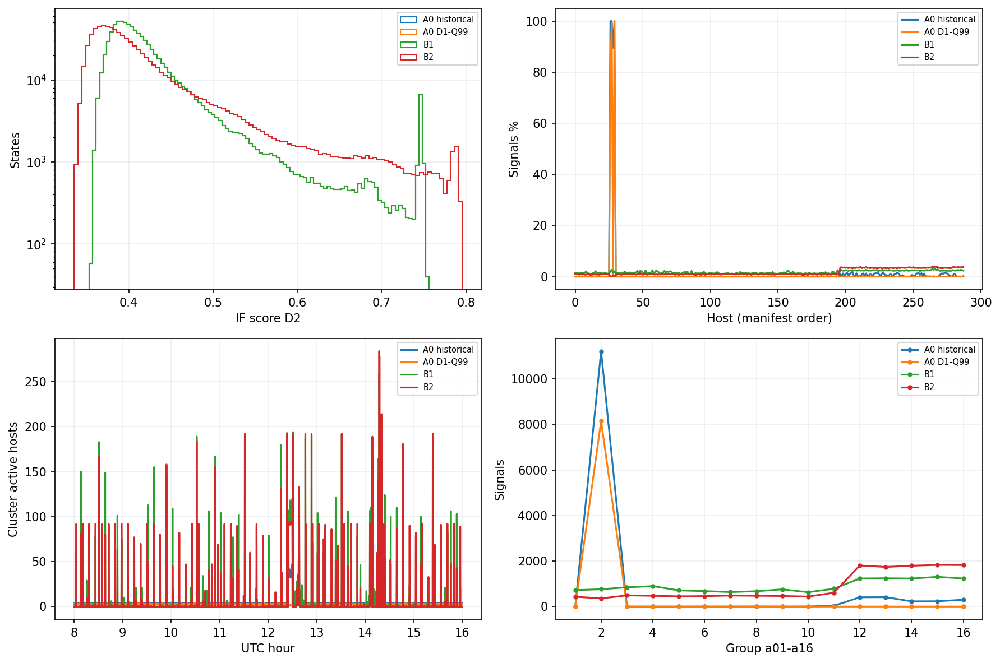
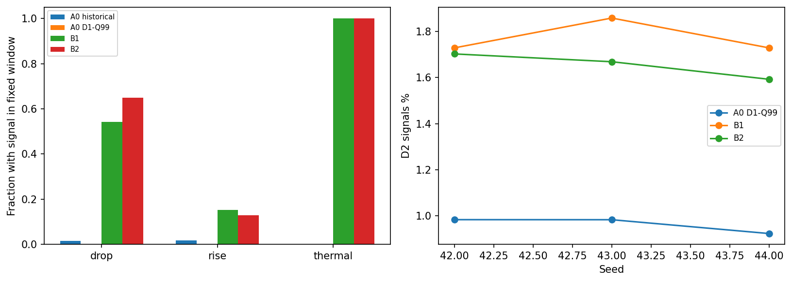
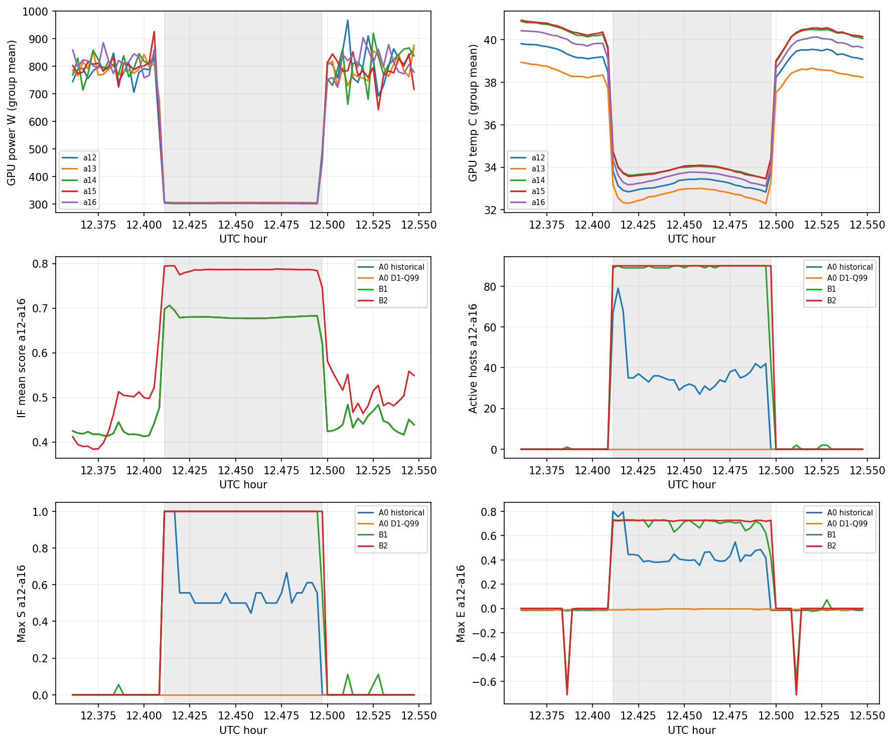
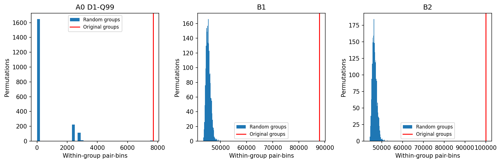

# Контекстный Isolation Forest и топологическая согласованность на Summit D2

Мини-ТЗ №4.2. **Индивидуальный контекст позволяет гораздо яснее выделять изменения
режима, но одновременно подавляет информацию об устойчивом абсолютном крайнем
состоянии. B2 не является однозначным победителем над B1:** направление изменения,
бюджет сигналов и стоимость имеют значение. Обнаружение аппаратных отказов этим
исследованием не доказано. Экспериментальные методы не внедрены в основную систему.

## 1. Цель, гипотезы и экспериментальный протокол

Проверяется отделение редких устойчивых режимов хостов от временных изменений,
а также дополнительная информация исходного разбиения на группы при неизменной
общекластерной активности. Протокол [зафиксирован](context-experiment-protocol.md)
коммитом `3516662` **до обучения альтернатив и просмотра сравнительных результатов**.
Ни параметры, ни seed, ни физические критерии после результатов не подбирались.
Основная конфигурация 100/256/8/42; дополнительные парные seed43,44.

Основное семейство 9 гипотез: три метода × (все внутригрупповые pair-bins,
pair-bins a12–a16, сумма E²). Holm, alpha=.05. Дополнительное семейство 144:
три метода ×16 групп × (max S,pair-bins,max E), отдельно Holm144.
PCG64 seed4202,1999 общих случайных разбиений. Независимый численный audit seed123.
Top-K0.5/1/2% и известный интервал рассматриваются как диагностика.

## 2. Реальные данные и сохранённые модели

`main` обновлён через fetch/ff-only и имеет SHA
`1dfb7c1f8b011b64a8fdebe4de4cdaafc3438940`. Новая ветка создана от него.
№4.1 (`research/d2-anomaly-diagnostics`, `79a1441`) опубликован, но **не merged**.
Используются его отчёт и read-only статистические функции из локального снимка
`results/diagnostics-source`; исходный отчёт доступен
[в commit79a1441](https://github.com/butorovv/cluster-anomaly-detection/blob/79a1441/docs/d2-anomaly-diagnostics.md).
Зависимость не перенесена в main или текущий diff через merge/cherry-pick.

Подготовленный `D1.parquet`, несмотря на имя, содержит весь день 18.01.2022.
Выбраны D1=[00:00,08:00) и D2=[08:00,16:00), по 829440 состояний каждый,
288 хостов ×2880 отметок ×18 F18. Все пригодны, по 18 хостов в каждой группе
a01–a16 на каждой отметке; последняя отметка D2=15:59:50. D3 не используется
для fit, статистики, порогов или scoring. SHA256 полного файла включает все байты,
но не является анализом зарезервированного окна. WindowReader заканчивает чтение
на границе окна; техническое декодирование границы не включается в расчёты.

`assumed_timezone=UTC`, `timezone_verified=false`: абсолютная зона времени не
подтверждена независимо. Группы заданы манифестом/hostname, а не проверенным графом
всех сетевых, энергетических и охлаждающих связей Summit.

Прочитаны архитектура, ядра analysis/experiment, нормализация, Mahalanobis,
компонентная модель CPU/GPU/PSU, отчёты A–D, компонентная и итоговая уточнённая
РПЗ 07.10.2026 (разделы о предобработке, IF и групповых состояниях).
Описание трёх календарных дней в РПЗ отличается от согласованных восьмичасовых
окон этого ТЗ; РПЗ не редактировалась. Изменения действующей математики не выполнялись.
Версии сохранённых входов: statistical-v1, isolation-forest-v1, physical-v1,
isolation-calibration-v1. Порядок F18:2 PSU power,2 CPU power,6 GPU power,
2 CPU temperature,6 GPU temperature. Деревья, MAD, scale, физические коэффициенты
и исторический порог остались прежними.

| Вход | SHA256 |
| --- | --- |
| data/prepared/summit-D1-pilot/D1.parquet | cf3fa634448b7147209bebf3b1c20a1a031be5c047678083adda10581ff562e7 |
| data/prepared/summit-D1-pilot/manifest.json | 6d603a5445d1a76be24408eed84933e96a4a10af6c3bfd32471d93ca7dd9f291 |
| results/isolation-20220118-v1.json | 6aa1ca4f2f76b56418aafaa1ea25e6812a3b9fdcc0d309aeed44dc1db03f2da3 |
| results/isolation-calibration-20220118-v1.json | 3c73c85bd121df6bfaade9fa3b37ec517d5546cc520c666e04de2e5f6c61a150 |
| results/physical-20220118-v1.json | 66f3ae9220c00e68d97541ba3b1a5a4bf269008e7aafe0d0e5148efc45225b59 |
| results/statistical-20220118-8h-v1.json | 36da27a4a4f485baa4b1b1b899c26a36efc15401327fd85abc3d63ea3c1ade80 |
| data/raw/20220118.parquet | 7b6bcb905616865312fdd620d0f3aac9c82b1fcb23dfc1f547d068233cd18934 |
| ../НИР7_Буторов_РПЗ_07_10_2026_компонентная_модель.docx | 8f982d8852e8d79ec3b7a40d8a519eaf6da0a73b98f6ee7bbf16bb2e511be510 |
| ../НИР7_Буторов_РПЗ_итоговая_07_10_2026_уточненная.docx | cb669a2967acd2ce2b25e1ac674ca8df028f072f8199f22517e6a33af72081d1 |

Baseline воспроизведён на неизменном экспорте №4.1:12847 сигналов,
11219 на a02n09–a02n12 (87.3277808%), TP_ref2607, Mahalanobis+9880,
F1_ref=0.2294187530250363. Наблюдаемая парная статистика пересчитана; использование
сохранённых 1999 прежних циклических контролей даёт Holm64 p=.032 для a12–a16.
Это повторная арифметика сохранённого контроля, а не заново выполненные сдвиги.
Весь массив исходных Go score и F18 D2 нового экспорта совпал с №4.1 точно.
Статистическая синхронность прежнего контроля сама по себе не устанавливает
топологическую специфичность или эксплуатационное нарушение.

## 3. Математические постановки A0/B1/B2

При j=1…18 и h=1…288:

$$
z^{A0}_{h,j}(t)=\frac{x_{h,j}(t)-m_j^{D1}}{s_j^{D1}},\qquad
s_j^{D1}=\max(1.4826\,MAD_j^{D1},10^{-4}).
$$

A0 — прежний лес seed42; historical theta=0.6850838848387528 сохраняется.
B1 — тот же лес/score, но theta_h=Q99(score_h(D1)).

$$
m_{h,j}^{D1}=\operatorname{median}_{t\in D1}x_{h,j}(t),\qquad
z^{B2}_{h,j}(t)=\frac{x_{h,j}(t)-m_{h,j}^{D1}}{s_j^{D1}}.
$$

B2 — один новый глобальный лес на этих координатах всех D1-состояний,
theta_B2=Q99(score_B2(D1)). Не используется индивидуальный scale,
идентификаторы/время не добавляются в числовые признаки.
Адаптер передаёт `x−m_host+m_global` существующему FitIsolation/Score;
единственная внутренняя нормализация даёт требуемую формулу. Небольшая разница
порядка float64 операций проверена независимым прямым обходом деревьев.
Связь hostname→median, окно D1, source/statistical hashes сохраняются.
Файлы b2-42/a0-43/b2-43/a0-44/b2-44 отдельные, исходный лес не перезаписан.

## 4. Пороги и сопоставимость

$$
Q_q(v)=v_{(\lceil qn\rceil)},\quad v_{(1)}\le\cdots\le v_{(n)},\qquad
A=\mathbf{1}(score>\theta).
$$

Интерполяции нет; одинаковые значения не дробятся рабочим порогом.
Медиана при чётном числе наблюдений — среднее двух центральных значений.
Все новые пороги только D1. Q99 **не гарантирует ровно 1%** при ties.
D1 одновременно fit и calibration: его частота не независимая оценка ложных тревог.
Historical порог был выбран на D2 по F1_ref и не входит в честное основное сравнение.

| Метод | Порог | D1 n | D1 % | D2 n | D2 % | Δ доли, п.п. | Четыре a02 % |
| --- | --- | --- | --- | --- | --- | --- | --- |
| A0 historical | 0.6850838848387528 | 11354 | 1.36888 | 12847 | 1.54888 | 0.180001 | 87.3278 |
| A0 D1-Q99 | 0.7411788753461339 | 8263 | 0.996214 | 8153 | 0.982952 | -0.013262 | 100 |
| B1 | 288 host Q99 | 8037 | 0.968967 | 14341 | 1.729 | 0.760031 | 1.63866 |
| B2 | 0.7118892716874956 | 8294 | 0.999952 | 14123 | 1.70272 | 0.702763 | 0.0778871 |

Top-K: K=floor(p·829440), сортировка убывающая, ties по timestamp/hostname.
В B1 ранжируется `score−theta_host` (абсолютный запас над своим порогом),
а не заново нормированная вероятность или процентиль. Выбор единиц ранжирования
существенен; он зафиксирован заранее. Ties разрешаются только в этой диагностике;
полученный top-K нельзя представить как строгий скалярный рабочий порог.
Порог по D2 не сохраняется как рабочая калибровка.

| Бюджет % | Метод | K | Четыре % | Переходы с сигналом /6978 |
| --- | --- | --- | --- | --- |
| 0.5 | A0 D1-Q99 | 4147 | 100 | 0 |
| 0.5 | B1 | 4147 | 0 | 693 |
| 0.5 | B2 | 4147 | 0 | 356 |
| 1 | A0 D1-Q99 | 8294 | 100 | 1 |
| 1 | B1 | 8294 | 0 | 1267 |
| 1 | B2 | 8294 | 0.0120569 | 1613 |
| 2 | A0 D1-Q99 | 16588 | 69.2609 | 672 |
| 2 | B1 | 16588 | 13.0335 | 2393 |
| 2 | B2 | 16588 | 0.120569 | 2887 |

При 0.5% B1 реагирует чаще B2, при 1% и 2% — B2 чаще B1.
Следовательно, даже бюджетная диагностика не задаёт универсального порядка методов.

## 5. Score и бинарные срабатывания

A0 historical/A0-Q99/B1 имеют **один и тот же непрерывный score**. Меняются
только пороги; совпадающие кривые в графиках перекрываются. B2 меняет представление
и деревья. Все описательные метрики рассчитаны по полному D2, без subsampling.
std популяционная, квантили inverted_cdf.

| Score | min | mean | std | Q50 | Q95 | Q99 | max |
| --- | --- | --- | --- | --- | --- | --- | --- |
| A0 historical | 0.353199 | 0.424864 | 0.061697 | 0.406871 | 0.540429 | 0.740678 | 0.756295 |
| B2 | 0.335176 | 0.422309 | 0.0814183 | 0.394601 | 0.606648 | 0.746134 | 0.795648 |

| Метод | Хостов >50%/>90%/>99% | Серий | Median/Q95/max секунд | Сохранено hist | Потеряно hist | Новых | Precision_ref | Recall_ref | F1_ref |
| --- | --- | --- | --- | --- | --- | --- | --- | --- | --- |
| A0 historical | 4/3/3 | 567 | 40/310/28800 | 12847 | 0 | 0 | 0.202927 | 0.263866 | 0.229419 |
| A0 D1-Q99 | 3/2/2 | 379 | 40/230/28800 | 8153 | 4694 | 0 | 0.00367963 | 0.00303644 | 0.00332723 |
| B1 | 0/0/0 | 10054 | 10/20/320 | 1863 | 10984 | 12478 | 0.0186877 | 0.0271255 | 0.0221296 |
| B2 | 0/0/0 | 9434 | 10/20/320 | 1627 | 11220 | 12496 | 0.00885081 | 0.0126518 | 0.0104154 |

Число сигналов B1/B2 выше historical; преимущество обсуждается по структуре,
а не уменьшению числа. Медиана серий B1/B2=10 с, есть всплески почти всего кластера.
Не следует принимать каждый короткий сигнал за отдельный независимый отказ.
Потеря согласования с Mahalanobis выраженная; это существенное ограничение,
которое нельзя скрыть за повышением реакции на нагрузку. F1_ref не использовался
для выбора порогов, физических событий или seed.

Полные 288 хостов, включая индивидуальные theta_B1, распределения A0/B2,
счётчики D1/D2, доли, серии и сохранённые/теряемые сигналы:
[приложение хостов](d2-context-hosts.md). Полные 16 групп:
[приложение групп](d2-context-groups.md).

## 6. Постоянные хосты a02 и скрываемые состояния

Три хоста a02n09,n10,n12 срабатывали 100% D1 и D2 historical; a02n11 — почти
всё время, но его физический режим другой. Ни один из них не удалён из fit/score.
Ни один не объявляется исправным. Значение |z| ниже — максимум по координатным
медианам хоста относительно прежнего общего D1 профиля, не новая метка отказа.

| Host | max\|z(m_D1)\| | Hist D1/D2 | A0-Q99 D2 | B1 D1/D2 | B2 D1/D2 | theta_B1 |
| --- | --- | --- | --- | --- | --- | --- |
| a02n09 | 7.99752 | 2880/2880 | 2388 | 28/59 | 0/0 | 0.747313 |
| a02n10 | 8.96108 | 2880/2880 | 2861 | 21/77 | 0/0 | 0.748037 |
| a02n11 | 12.2224 | 2670/2579 | 24 | 27/39 | 0/11 | 0.739885 |
| a02n12 | 8.96108 | 2880/2880 | 2880 | 10/60 | 0/0 | 0.749844 |

| Host | D1 GPU power медиан координат, W | D2 аналог, W | D1 GPU temp среднее медиан °C | D2 аналог °C | A0 score mean | B2 score mean |
| --- | --- | --- | --- | --- | --- | --- |
| a02n09 | 208.2 | 208.4 | 29.5 | 29.5 | 0.743961 | 0.363878 |
| a02n10 | 217.1 | 217.1 | 28.8333 | 28.8333 | 0.746592 | 0.364605 |
| a02n11 | 1449.35 | 1447.1 | 49.65 | 49.65 | 0.70985 | 0.491808 |
| a02n12 | 201.2 | 201.2 | 29.3833 | 29.45 | 0.747601 | 0.379933 |

Сумма координатных медиан не обязательно равна медиане суммы; это компактное
описание сохранённого контекста. Низкомощностные a02n09,n10,n12 и высокомощностный
n11 имеют стабильные между окнами уровни, уже крайние относительно глобального
профиля на D1. B1 сохраняет абсолютный score, но перестаёт выдавать постоянную
бинарную метку, подняв свой порог. B2 убирает абсолютный host offset и может
практически полностью перестать выделять такое состояние. Это **реальная потеря
информации об устойчивом глобально крайнем режиме**, а не доказанное исправление
false positives. Начало возможного устойчивого нарушения до D1 этими моделями
проверить нельзя. Архив исходных F18/глобальных характеристик нужен для интерпретации.

Ниже десять хостов с самым большим приростом числа B2-сигналов к historical,
ties hostname. Полный список не сокращён в приложении.

| Host | Hist | A0-Q99 | B1 | B2 | Прирост B2 |
| --- | --- | --- | --- | --- | --- |
| a15n15 | 0 | 0 | 85 | 110 | 110 |
| a15n13 | 0 | 0 | 86 | 108 | 108 |
| a15n16 | 0 | 0 | 72 | 108 | 108 |
| a16n14 | 0 | 0 | 74 | 108 | 108 |
| a15n17 | 0 | 0 | 82 | 107 | 107 |
| a12n14 | 2 | 0 | 67 | 108 | 106 |
| a16n17 | 0 | 0 | 74 | 106 | 106 |
| a14n14 | 0 | 0 | 67 | 105 | 105 |
| a15n14 | 3 | 0 | 77 | 108 | 105 |
| a16n16 | 0 | 0 | 75 | 105 | 105 |

Сохраняемые/теряемые сигналы разнесены по физическому покрытию. Это описание
свойств измерений, не классификация состояния как исправного/неисправного.

| Метод | Категория vs hist | Состояний | В переходном покрытии | В тихом режиме | Mean GPU W | Mean GPU °C | Mean \|ΔGPU60\| W |
| --- | --- | --- | --- | --- | --- | --- | --- |
| A0 D1-Q99 | retained | 8153 | 1 | 7169 | 213.209 | 29.2844 | 1.03478 |
| A0 D1-Q99 | lost | 4694 | 1699 | 829 | 920.154 | 41.5387 | 124.2 |
| A0 D1-Q99 | new | 0 | 0 | 0 | — | — | — |
| B1 | retained | 1863 | 1625 | 56 | 322.881 | 32.7335 | 164.988 |
| B1 | lost | 10984 | 75 | 7942 | 496.719 | 33.9362 | 25.8369 |
| B1 | new | 12478 | 9101 | 2 | 450.367 | 35.6952 | 377.631 |
| B2 | retained | 1627 | 1621 | 0 | 304.618 | 32.8233 | 183.747 |
| B2 | lost | 11220 | 79 | 7998 | 495.711 | 33.8979 | 26.044 |
| B2 | new | 12496 | 9353 | 0 | 404.804 | 35.2211 | 366.526 |

## 7. Реальные переходы и реакции

P_GPU=sum6 GPU power, P_CPU=sum2 CPU power, P_PSU=sum2 PSU power,
T_GPU=mean6 GPU temperature. ΔP=P(t)−P(t−60 с).
Порог |ΔP| — D1-Q99.5 отдельно для трёх физических сумм; кандидат превышает
хотя бы один порог строго. На хосте кандидаты объединены при разрыве≤180 с,
представитель — максимум нормированного физического приращения, ties earliest.
Знак определяется компонентом максимума. ΔT=T(t+120 с)−T(t), согласование —
одинаковый знак с GPU приращением, оба превышают свои фиксированные D1 уровни.
Все до/после окна внутри D2, границы окон не склеиваются.
Идентификаторы физических переходов не используют IF, D² или бинарные метки.

| Физический прирост | D1-Q99.5 | D1-Q50 для тихого режима |
| --- | --- | --- |
| GPU ΔP60 W | 568.8 | 123 |
| CPU ΔP60 W | 10.1 | 2.2 |
| PSU ΔP60 W | 513 | 12.7 |
| GPU ΔT120 °C | 4.86667 | 0.1 |

Категория повышения/снижения относится к компоненту с самым большим
нормированным приращением. Другие подсистемы могут одновременно изменяться
в противоположную сторону. Это операционное определение смены физического
режима, не подтверждённая смена задания или суммарной нагрузки кластера.
Порог CPU по величине существенно ниже GPU/PSU; состав категорий ниже
позволяет видеть эту неоднородность, а не скрывать её одним процентом.

| Определяющая подсистема | Направление | N | Hist/A0/B1/B2 реакций |
| --- | --- | --- | --- |
| GPU | drop | 1337 | 20/0/818/933 |
| GPU | rise | 1447 | 3/0/155/104 |
| CPU | drop | 1430 | 22/0/481/674 |
| CPU | rise | 1490 | 57/1/391/364 |
| PSU | drop | 550 | 8/0/499/549 |
| PSU | rise | 724 | 0/0/8/1 |

Найдено 6978 представителей:3317 снижений,3661 повышений;
796 совместных физических интервалов (≥2 разных хостов одной
группы, объединение представителей≤180 с). Категория сильного отдельного хоста —
все 6978 превышений; «совместное» не означает аппаратное нарушение.
Температурно согласованная категория дала **только 1** событие: критерия недостаточно
для её статистического сравнения. Не ослабляли пороги и не меняли лаг после результата.
В частности, быстрое охлаждение могло уже произойти к представителю приращения;
T(t+120)−T(t) отличается от изменения относительно состояния до перехода.

Покрытие объединённых переходов [first−60 с,last+180 с] на соответствующем хосте:
242932 состояний (29.289%).
Тихие режимы: вне покрытия и все физические |ΔP|/|ΔT|≤D1-Q50,
52764 состояний (6.361%).
Остальные состояния — промежуточные или без полного окна; они не названы устойчивыми.
«Тихий» означает малые измеренные приращения по этому критерию, не исправность.

| Метод | В переходном покрытии n/% | Тихие n/% | Прочие n | Совместные интервалы с ≥2 сигналами /796 |
| --- | --- | --- | --- | --- |
| A0 historical | 1700/13.233 | 7998/62.256 | 3149 | 22 |
| A0 D1-Q99 | 1/0.012 | 7169/87.931 | 983 | 0 |
| B1 | 10726/74.793 | 58/0.404 | 3557 | 462 |
| B2 | 10974/77.703 | 0/0.000 | 3149 | 511 |

Реакция на представителя: сигнал на этом хосте в [t−30 с,t+180 с],
Δscore=max score окна−mean score[t−120 с,t−60 с]; первая задержка может быть
отрицательной. Длительность — полная серия, пересекающая окно, а не обязательно
серия, начавшаяся после перехода. Наличие сигнала в окне не доказывает причинный
отклик. Окна на одном хосте и между хостами могут перекрываться, соседние отметки
объединены; результаты описательные, IID p-value/доверительные интервалы не приводятся.

| Метод | Категория | N | Сигнал n/% | Median Δscore | Median/P95 задержка с | P95 длительность с | Сигнал при +180с |
| --- | --- | --- | --- | --- | --- | --- | --- |
| A0 historical | all | 6978 | 110/1.576 | 0.0967135 | -30/150 | 0 | 41 |
| A0 historical | drop | 3317 | 50/1.507 | 0.177741 | 0/90 | 0 | 2 |
| A0 historical | rise | 3661 | 60/1.639 | 0.0492072 | -30/170 | 0 | 39 |
| A0 historical | thermal | 1 | 0/0.000 | 0.258818 | —/— | 0 | 0 |
| A0 D1-Q99 | all | 6978 | 1/0.014 | 0.0967135 | 90/90 | 0 | 0 |
| A0 D1-Q99 | drop | 3317 | 0/0.000 | 0.177741 | —/— | 0 | 0 |
| A0 D1-Q99 | rise | 3661 | 1/0.027 | 0.0492072 | 90/90 | 0 | 0 |
| A0 D1-Q99 | thermal | 1 | 0/0.000 | 0.258818 | —/— | 0 | 0 |
| B1 | all | 6978 | 2352/33.706 | 0.0967135 | 0/130 | 10 | 135 |
| B1 | drop | 3317 | 1798/54.206 | 0.177741 | 0/110 | 10 | 19 |
| B1 | rise | 3661 | 554/15.132 | 0.0492072 | 0/160 | 10 | 116 |
| B1 | thermal | 1 | 1/100.000 | 0.258818 | 70/70 | 90 | 0 |
| B2 | all | 6978 | 2625/37.618 | 0.16888 | 0/130 | 20 | 127 |
| B2 | drop | 3317 | 2156/64.998 | 0.315343 | 0/90 | 20 | 14 |
| B2 | rise | 3661 | 469/12.811 | 0.0708834 | 10/170 | 10 | 113 |
| B2 | thermal | 1 | 1/100.000 | 0.361275 | 70/70 | 90 | 0 |

На thermal-графике 100% B1/B2 — **1 из 1**, не доказательство превосходства.
B2 сильнее реагирует на снижения, B1 чаще покрывает повышения. Повышение нагрузки
само по себе не обязано быть нетипичным уровнем состояния: IF не является детектором
производной. Низкая реакция на часть переходов не тождественна пропущенному отказу.

Сами переходы ниже отобраны физически. Для иллюстраций выбраны максимум
нормированного приращения среди drop/rise, затем первое расхождение B1/B2 по времени в каждой
категории и единственная thermal. Строки с расхождением — иллюстрации, агрегаты
выше включают все события. Полный 6978-row результат — ignored
`results/context-v1/summary.json:events_with_reactions`.

| UTC/host | Категория | ΔGPU/CPU/PSU W | ΔT120 °C | Hist/A0/B1/B2 signal | A0 Δscore | B2 Δscore | B1/B2 задержка с |
| --- | --- | --- | --- | --- | --- | --- | --- |
| 2022-01-18T12:30:40/a02n03 | drop | -77/-62/-596 | 3.25 | 1/0/1/1 | 0.230234 | 0.122869 | 0/0 |
| 2022-01-18T08:02:30/a16n14 | drop | -58.1889/-12.9111/-241.933 | 1.55 | 0/0/0/1 | 0.102033 | 0.392244 | —/10 |
| 2022-01-18T12:25:50/a13n07 | rise | -0.444443/71.2222/79.1111 | 0.5 | 1/0/1/1 | 0.193664 | 0.191815 | -30/-30 |
| 2022-01-18T08:05:20/a06n14 | rise | -226.5/10.8/-0.300049 | 0.0833333 | 0/0/1/0 | 0.198614 | 0.298783 | 180/— |
| 2022-01-18T14:04:30/a13n02 | drop thermal | -573.333/-21.6667/15 | -7 | 0/0/1/1 | 0.258818 | 0.361275 | 70/70 |

### Известный интервал 12:24:40–12:29:50 UTC

Этот интервал заранее известен из №4.1: **иллюстративный**, не независимая проверка.
32 отметки включительно,320 с наблюдений. В таблице физический before — среднее
7 отметок [start−120 с,start−60 с], after — последние 6 отметок интервала;
дельта описывает смену уровня, не тот же ΔP60 критерия отбора.

| Группа | ΔGPU W | ΔCPU W | ΔPSU W | ΔGPU °C | A0 mean before→case | B2 mean before→case |
| --- | --- | --- | --- | --- | --- | --- |
| a12 | -453.465 | 5.6313 | -506.155 | -6.26329 | 0.4159→0.6855 | 0.4690→0.7851 |
| a13 | -446.441 | 6.0645 | -505.544 | -5.81163 | 0.4135→0.6859 | 0.4823→0.7854 |
| a14 | -459.177 | 4.5812 | -504.13 | -6.70326 | 0.4159→0.6767 | 0.4656→0.7847 |
| a15 | -459.498 | 5.72287 | -526.113 | -6.76515 | 0.4315→0.6719 | 0.4656→0.7855 |
| a16 | -490.421 | 6.54751 | -519.265 | -6.61957 | 0.4310→0.6770 | 0.4782→0.7852 |

| Группа | Метод | Сигналов | max hosts | max S | max E |
| --- | --- | --- | --- | --- | --- |
| a12 | A0 historical | 302 | 18 | 1 | 0.755556 |
| a12 | A0 D1-Q99 | 0 | 0 | 0 | -0.0037037 |
| a12 | B1 | 567 | 18 | 1 | 0.72963 |
| a12 | B2 | 576 | 18 | 1 | 0.725926 |
| a13 | A0 historical | 305 | 18 | 1 | 0.8 |
| a13 | A0 D1-Q99 | 0 | 0 | 0 | -0.0037037 |
| a13 | B1 | 566 | 18 | 1 | 0.72963 |
| a13 | B2 | 576 | 18 | 1 | 0.725926 |
| a14 | A0 historical | 166 | 15 | 0.833333 | 0.577778 |
| a14 | A0 D1-Q99 | 0 | 0 | 0 | -0.0037037 |
| a14 | B1 | 564 | 18 | 1 | 0.72963 |
| a14 | B2 | 576 | 18 | 1 | 0.725926 |
| a15 | A0 historical | 172 | 13 | 0.722222 | 0.459259 |
| a15 | A0 D1-Q99 | 0 | 0 | 0 | -0.0037037 |
| a15 | B1 | 555 | 18 | 1 | 0.725926 |
| a15 | B2 | 576 | 18 | 1 | 0.725926 |
| a16 | A0 historical | 237 | 15 | 0.833333 | 0.577778 |
| a16 | A0 D1-Q99 | 0 | 0 | 0 | -0.0037037 |
| a16 | B1 | 567 | 18 | 1 | 0.72963 |
| a16 | B2 | 576 | 18 | 1 | 0.725926 |

| Метод | Кластер сигналов | Max одновременно хостов | Max активных групп |
| --- | --- | --- | --- |
| A0 historical | 1340 | 84 | 7 |
| A0 D1-Q99 | 50 | 3 | 1 |
| B1 | 3082 | 120 | 15 |
| B2 | 2956 | 95 | 8 |

B2 удерживает сигнал всех 90 хостов a12–a16 на 32 отметках, B1 почти столько же.
A0-Q99 не выделяет этот интервал в этих пяти группах, хотя его непрерывный score
резко возрастает. В то же время B1 имеет больше активных групп вне a12–a16;
E показывает локализацию поверх общего фона, но max E и max S могут приходиться
на разные отметки. Падение GPU/PSU мощности и охлаждение физически согласованы;
CPU мощность здесь слегка увеличивается. Причина — workload/эксплуатация/нарушение —
без независимых сведений не установлена.

## 8. Поддержка S и превышение E

$$
S_g(t)=K_g(t)/N_g(t),\qquad
E_g(t)=S_g(t)-\frac{K_{\neg g}(t)}{N_{\neg g}(t)}.
$$

Доступные состояния учитываются фактически, непригодные не входят ни в числитель,
ни в знаменатель. При N_g=0 S/E undefined, при N_out=0 E undefined.
В этом полном эксперименте N_g=18,N_out=270. Тесты включают отсутствующие хосты
и полностью отсутствующие группы. Уровни D1-Q99 S/E диагностические, строго >,
не окончательный порог групповой аномалии. GroupEvent не реализован.
Распределения и длительности всех 16 групп приведены в приложении.

E сам по себе сохраняет проблему постоянных хостов: повышенный устойчивый
групповой уровень может локализоваться статистически, не являясь временным событием.
Положительный E для a02 ниже показан отдельно; это дополнительная описательная
диагностика, не новая проверяемая гипотеза.

| Метод, a02 | Mean E | Max E | D1-Q99 E | E>0 всего с | E>0 max серия с | E>D1-Q99 всего с |
| --- | --- | --- | --- | --- | --- | --- |
| A0 historical | 0.214343 | 0.277778 | 0.222222 | 28770 | 15880 | 10 |
| A0 D1-Q99 | 0.157272 | 0.222222 | 0.166667 | 28800 | 28800 | 170 |
| B1 | -0.00278421 | 0.518519 | 0.0740741 | 1940 | 210 | 760 |
| B2 | -0.0108166 | 0.248148 | 0.0259259 | 450 | 30 | 390 |

Уровень превышения D1 не гарантирует чувствительность к известному событию:
на D1 уже были редкие согласованные режимы. В частности, характерные D1-Q99 E
для a12–a16 могут быть близки к их сильным D2 уровням. Это не повод подбирать
более удобный порог по D2. E характеризует контраст, его временная изменчивость
и абсолютный физический контекст остаются отдельными аспектами.

## 9. Топологическая специфичность и перестановки

В каждом из 1999 контролей перемешаны только индексы хостов в 16×18 группах.
Все исходные временные бинарные ряды, индивидуальные частоты, автокорреляция
и точный K_cluster(t) сохранены. Проверка условна на **всю общекластерную
траекторию**, а не только на её среднее; независимые временные сдвиги здесь
не заменяют этот контроль. Одни разбиения применены ко всем трём методам.
Pair-bins=Σ_tΣ_g C(K_g(t),2), то есть пары-отметки, не число независимых событий.
Empirical p=(1+число controls≥observed)/2000, односторонний тест.
Effect difference=observed−mean_control, ratio=observed/mean_control.

| Метод | Статистика | Observed | Control mean | 95% control interval | Разность | Ratio | p | Holm9 p |
| --- | --- | --- | --- | --- | --- | --- | --- | --- |
| A0 D1-Q99 | Все pair-bins | 7701 | 469.268 | 0–2861 | 7231.73 | 16.4107 | 0.0015 | 0.0045 |
| A0 D1-Q99 | Pair-bins a12–a16 | 0 | 149.563 | 0–2388 | -149.563 | 0 | 1 | 1 |
| A0 D1-Q99 | Σ E² | 77.5473 | 26.7566 | 23.4607–43.5545 | 50.7908 | 2.89825 | 0.0015 | 0.0045 |
| B1 | Все pair-bins | 87963 | 45315.1 | 43923.8–47287.6 | 42647.9 | 1.94114 | 0.0005 | 0.0045 |
| B1 | Pair-bins a12–a16 | 47162 | 14156.7 | 13134–15560.5 | 33005.3 | 3.33142 | 0.0005 | 0.0045 |
| B1 | Σ E² | 329.316 | 29.7859 | 20.0144–43.6391 | 299.53 | 11.0561 | 0.0005 | 0.0045 |
| B2 | Все pair-bins | 100056 | 46533.3 | 44785.3–48985.7 | 53522.7 | 2.1502 | 0.0005 | 0.0045 |
| B2 | Pair-bins a12–a16 | 70704 | 14510.7 | 12330.5–17527.8 | 56193.3 | 4.87253 | 0.0005 | 0.0045 |
| B2 | Σ E² | 404.559 | 28.6523 | 16.3754–45.8762 | 375.907 | 14.1196 | 0.0005 | 0.0045 |

B1/B2 показывают избыток пар в исходных группах и особенно в заранее заданных
a12–a16 при неизменной общей активности. Это поддерживает топологическую
локализацию статистической синхронности. A0-Q99 тоже значим по общей статистике,
но весь эффект от постоянных a02. Следовательно, статистическая значимость
топологии сама по себе не равна свидетельству временного нарушения.
Σ E² и общие pair-bins при равных размерах групп и фиксированном K_cluster(t)
связаны аффинно: E_g=(16K_g−K_cluster)/270,
Σ_g E_g²=(256Σ_g K_g²−16K_cluster²)/270².
Их совпадающие p не являются двумя независимыми подтверждениями; Holm9
остаётся консервативной заранее выбранной поправкой.

Дополнительные 144 теста **не дают значимости после Holm144**: минимальный
достижимый p=.0005, первый шаг 144·.0005=.072>.05. Нельзя объявлять каждую
из 16 групп значимой на основе этого разрешения. Все эмпирические p и эффекты
сохранены в приложении, недостаток мощности явно отделяется от отсутствия эффекта.

| Метод | Все пары | a02 | a12–a16 | С участием четырёх | Межгрупповые пары | Max K_cluster |
| --- | --- | --- | --- | --- | --- | --- |
| A0 historical | 22515 | 16381 | 6130 | 16381 | 32785 | 84 |
| A0 D1-Q99 | 7701 | 7701 | 0 | 7701 | 0 | 4 |
| B1 | 87963 | 2708 | 47162 | 272 | 676780 | 258 |
| B2 | 100056 | 1597 | 70704 | 0 | 685126 | 284 |

| Метод, без вклада четырёх | Observed pairs | Control mean | Ratio | p | Holm3 p |
| --- | --- | --- | --- | --- | --- |
| A0 D1-Q99 | 0 | 0 | — | 1 | 1 |
| B1 | 87691 | 45124.6 | 1.94331 | 0.0005 | 0.0015 |
| B2 | 100056 | 46527.8 | 2.15046 | 0.0005 | 0.0015 |

Последняя таблица — отдельная диагностика обнуления вклада четырёх в статистику,
не удаление узлов/изменение моделей. В основной эксперимент они входят полностью.
Дополнительные Holm3 p здесь разведочные: это семейство не входило в заранее
зафиксированные основные 9 или дополнительные 144 проверки. Оно не используется
для объявления основного результата значимым.
Для A0-Q99 эффекта без них вообще нет. Для B1/B2 избыток сохраняется.
Межгрупповых пар B1/B2 намного больше внутригрупповых: нагрузка бывает широкой,
что не отменяет дополнительной локализации относительно случайных групп.
Условные счётчики для **каждого точного K_cluster** сохранены в summary.json:
`methods.*.conditional_cluster_activity`; не выполнялось дополнительного
выбора «удобных» уровней общей нагрузки. Таблица известных интервалов показывает,
что одновременно активны несколько исходных групп, а не единственная группа.

Строго разделяются четыре вывода: статистическая синхронность; локализация в
исходных группах; физическая согласованность; подтверждённое эксплуатационное
нарушение. Получены первые три в указанных ограничениях; четвёртый не доказан.

## 10. Устойчивость к seed

A0/B2 для 43 и 44 обучены симметрично на том же порядке D1; B1 использует
соответствующий A0. Порог каждого варианта заново D1-Q99. Seed42 не заменён.
Jaccard сравнивает полные множества D2-сигналов с тем же методом seed42.
Ratio pairs здесь использует точное математическое ожидание случайного разбиения:
P(пара в одной группе)=17/287; это описательный эффект без новых p-value.

| Seed | Метод | D2 n | Четыре % | Переходы all/drop/rise | Pair ratio | Jaccard42 | Corr score42 | Corr host rates42 |
| --- | --- | --- | --- | --- | --- | --- | --- | --- |
| 42 | A0 D1-Q99 | 8153 | 100 | 1/0/1 | 16.8824 | 1 | 1 | 1 |
| 42 | B1 | 14341 | 1.63866 | 2352/1798/554 | 1.94186 | 1 | 1 | 1 |
| 42 | B2 | 14123 | 0.0778871 | 2625/2156/469 | 2.15132 | 1 | 1 | 1 |
| 43 | A0 D1-Q99 | 8151 | 100 | 3/2/1 | 16.8824 | 0.588155 | 0.975517 | 0.849717 |
| 43 | B1 | 15416 | 1.27141 | 2450/1800/650 | 1.87096 | 0.768934 | 0.975517 | 0.875125 |
| 43 | B2 | 13842 | 0.0939171 | 2584/2128/456 | 2.15323 | 0.887741 | 0.990182 | 0.997105 |
| 44 | A0 D1-Q99 | 7653 | 100 | 1/0/1 | 16.8824 | 0.840475 | 0.981053 | 0.997383 |
| 44 | B1 | 14341 | 1.38066 | 2390/1849/541 | 1.92595 | 0.815316 | 0.981053 | 0.942136 |
| 44 | B2 | 13210 | 0.0757002 | 2443/2023/420 | 2.196 | 0.849198 | 0.986476 | 0.996459 |

По всем трём seed B2 сильнее реагирует на снижения и слабее B1 на повышения,
концентрация на четырёх остаётся крайне малой. Поэтому основная наблюдаемая
тенденция не результат выбора красивого seed. Дискретные решения всё же меняются:
Jaccard B2 относительно 42 около 0.85–0.89, а чувствительность all при seed44
сближается с B1. Три seed — ограниченная инженерная проверка, не распределение
по всем возможным лесам и не независимая проверка на другом дне.

## 11. Производительность и сложность

Go timings суммируют time.Now вокруг обработки каждого score, включая адаптацию
B2, без чтения, записи, hash и D². Они включают накладные расходы таймера.
Один проход текущей машины, последовательное исполнение; не сервисный benchmark.
Статистический глобальный профиль A повторно не вычислялся.
Медианы хостов D1 рассчитаны за 0.8408211 с. Время A0-42 обучения 2.160098 с
взято из прежнего metadata, несопоставимо напрямую с текущим fit из RAM.
Текущие paired43/44 fit A0≈0.60 с,B2≈0.73–0.74 с; B2-42≈0.756 с.

| Лес | Fit с | Basis | Score D1 с | Score D2 с | D2 мкс/состояние | JSON байт |
| --- | --- | --- | --- | --- | --- | --- |
| a0-42 | 2.1601 | saved A0 baseline metadata | 5.71003 | 6.08835 | 7.34031 | 1566123 |
| a0-43 | 0.602803 | current export run | 6.05732 | 6.16969 | 7.43838 | 1591271 |
| a0-44 | 0.599433 | current export run | 5.86395 | 5.97799 | 7.20726 | 1583803 |
| b2-42 | 0.755898 | current export run | 6.23411 | 6.18765 | 7.46003 | 1562837 |
| b2-43 | 0.738676 | current export run | 5.94985 | 5.97008 | 7.19772 | 1576134 |
| b2-44 | 0.729063 | current export run | 6.01953 | 5.94976 | 7.17323 | 1636151 |

B1 использует те же score, что A0, поэтому повторного леса и повторного
scoring не требует. Отдельное измерение порогов NumPy на read-only массивах:
один прогрев и 5 повторов, ниже медиана[min,max]. Это пакетная арифметика,
не оценка потоковой latency одного запроса.

| Метод | Q99 секунд median[min,max] | Apply секунд median[min,max] | Порог float64 байт |
| --- | --- | --- | --- |
| A0 | 0.011236[0.010950,0.011792] | 0.005042[0.004968,0.005314] | 8 |
| B1 | 0.017071[0.016277,0.017258] | 0.004871[0.004697,0.005344] | 2304 |
| B2 | 0.014586[0.013957,0.015101] | 0.005027[0.004635,0.005335] | 8 |

Общая Python-калибровка сравнительных таблиц 0.069034 с,
применение четырёх масок 0.046861 с,
физические пороги D10.156856 с;
полный анализ/перестановки/графики 27.330 с.
Большие binary имеют по 179159040 байт; это размер файлов, не пиковая RAM.
В этой реализации исследовательский exporter сохраняет D1 записи и score в RAM,
Python использует memmap и рабочие массивы. **Пиковая память процессов не измерена**;
она не подменяется объёмом параметров. Размер новых float64 медиан H·F·8=41472
байт, порогов B1 H·8=2304 байт; реальные map/string/JSON накладные расходы больше.
context-profile.json117878 байт; сохранённый B2-42 envelope1562837 байт.
Основной forest/sample бюджет остаётся одного порядка с A0.

Пусть n — состояний калибровочного окна, H — хостов, F=18 координат,
n_h — состояний хоста, T=100 деревьев, ψ=256 sample, d=8 максимальная глубина,
L=2880 отметок,G=16 групп,R=1999 контролей.

* B1: точные host quantiles сортировкой O(Σ_h n_h log n_h), память O(n)
  для калибровочных score, O(H) для рабочих порогов; применение O(1) после
  поиска хоста, в среднем O(1) для map. NumPy использует selection/partition,
  обычно быстрее полной сортировки; указанная сортировочная оценка — понятный
  верхний бюджет альтернативной точной реализации, не обещание worst-case NumPy.
* B2 medians: O(FΣ_h n_h log n_h), рабочая память сортировочного fit O(nF),
  постоянные параметры O(HF). Преобразование O(F) на состояние, O(F) временно.
* Общий IF fit существующего ядра: reservoir O(nT+nF), tree build
  O(TψFd), выборки O(TψF), деревья O(Tψ). Context добавляет O(nF).
* Score одного состояния O(F+Td), всех n O(n(F+Td)); B2 добавляет O(F),
  B1 — только lookup/comparison. Порог глобального A0/B2 сортировкой O(n log n).
* S/E: O(LH), массивы O(LG); runtime сохранённый контекст O(HF+H).
  Перестановочный анализ O(RLH), таблицы контролей O(RG); это offline исследование.

B1 дешевле для последующей потоковой КР: сохранённый лес плюс 288 скаляров,
абсолютный score сохраняет смысл. B2 потребует 41472 байт числового контекста
и контроля связи host→median при загрузке, но одного леса; его измеренная
скорость здесь близка A0. Не реализованы Kafka, Master/Worker, БД или GroupEvent.

## 12. Ограничения и проверки

* Один день, только D1/D2; общий train/calibration D1. Возможная смена нагрузки
  между окнами не отделена от нарушения. Контекст, уже крайний на D1, принимается
  за свой центр, независимо от его эксплуатационной допустимости.
* Отсутствует независимая истинная разметка отказов; Mahalanobis псевдоконтроль
  и физические критерии — разные определения, не истинная бинарная цель.
* Физический отбор объединяет кандидаты цепочками, может давать длинные интервалы
  с несколькими изменениями. Представитель и окно реакции не всегда совпадают
  с началом; автокорреляция/перекрытия учтены отказом от IID выводов.
* Thermal n=1 недостаточно; известный охлаждающий интервал выбран ранее,
  не может заменить независимый набор температурных событий.
* Случайные группы проверяют связь с данной разметкой топологии при сохранении
  времени, но не физический причинный механизм. Частоты/совместность устойчивых
  хостов тоже создают значимый эффект. Holm144 не имеет достаточного разрешения.
* Seed43/44 и бюджетные ранжирования диагностические; пороги D2 не рабочие.
* Скорость измерена на одной машине без отдельных benchmark-процессов;
  peak RAM не измерена, теоретические затраты параметров приведены отдельно.

Проверки выполнены: `go test ./...`, `go build ./...`, `go vet ./...` — exit0.
Python context15, прежняя research статистика 48, существующий dataset suite27:
**90 passed**. В sandbox часть старых dataset tests получила ошибки временных
каталогов/Parquet ACL; полный suite затем успешно выполнен с временными файлами
в `.cache` и запуском команды вне sandbox, без изменения владельца/ACL.
Тестовые арифметические fixtures не добавлены в реальные эксперименты.

Тесты покрывают D1-only медианы/пороги, F18 преобразование, отсутствие двойной
нормализации и D2/D3 в fit, seeds, JSON roundtrip/source linkage, strict >,
counter conservation, доступность S/E, seeded partition, top-K ties,
60s/120s приращения, объединение/окна и физически независимый отбор.
Численный oracle: отдельная сортировка всех D1 медиан (разница 0), всех
глобальных/host Q99 (точное совпадение),1024 реальных состояний каждого окна
и каждого из 6 лесов — прямой Python tree traversal, max error<5e−16.
SHA256 шести неизменных основных входов совпали до/после, raw/component RPZ
совпали с прежними хешами. Ни один профиль A–D не перезаписан.

Фактически работали Orchestrator GPT-6.1 Sol High **configured** (проектный config),
Implementer GPT-6 Luna Medium и Test Writer GPT-6 Luna Low **configured**
(TOML/явные настройки spawn). Метаданные inference-потоков здесь не подтверждены;
configured не называется verified. Субагенты других ролей/дорогих моделей не
запускались, каскадного делегирования нет. Главный прочитал diff и выполнил
интеграционные проверки и независимый аудит.

## 13. Научный вывод и рекомендация для НИР

**Да, индивидуальный контекст даёт более обоснованное описание статистически
нетипичных изменений относительно собственного D1 поведения хоста**, чем
глобальный A0 с честным D1-Q99 в данном реальном эксперименте. Он устраняет
доминирование устойчивых host offsets и сохраняет локализацию совместных
изменений сверх того, что объясняет общекластерная активность.

**Это ограниченный вывод о чувствительности и интерпретации, не подтверждение
качества обнаружения отказов или универсального превосходства B2.** B2 имеет
более высокую реакцию на падения мощности и более сильное сохранение известных
совместных низкомощностных режимов; B1 чаще реагирует на повышения, дешевле и
сохраняет исходный абсолютный score. При top-K0.5% порядок меняется. Оба теряют
постоянные крайние бинарные сигналы, уже присутствовавшие на D1; B2 ещё меняет
геометрию абсолютной оценки. Согласование с Mahalanobis резко ниже historical.

Поэтому **не выбирать окончательного победителя и не заменять утверждённую
математическую модель НИР**. Сохранить A0/A–D как историческую/абсолютную
диагностику, результаты B1/B2 — как исследовательские альтернативы. Для обсуждения
потоковой КР B1 является минимальным инженерным кандидатом, B2 — кандидатом для
чувствительности к совместным сменам режима, при обязательном сохранении информации
об абсолютном контексте. Это рекомендация, изменения системы не выполнены.

Минимальная дополнительная проверка без синтетики: новый заранее зафиксированный
реальный временной интервал с независимыми workload/эксплуатационными сведениями
для устойчивых a02 и переходов; отдельный физический протокол температурных
откликов с достаточным числом событий и учётом их более быстрого начала.
При использовании зарезервированного D3 необходимо отдельное согласование;
в этой работе он остаётся нетронутым. Никакая синтетическая разметка не требуется.
Следующие этапы, GroupEvent и изменение РПЗ не начаты.

### Воспроизведение и экспериментальные идентификаторы

Полные команды/зависимость №4.1: [tools/context/README](../tools/context/README.md).
Порядок: baseline.py → Go export → analyze.py → audit.py → benchmark.py →
write_report.py. Исследовательские threshold/model/binary/per-event/control
файлы исключены из Git. Четыре PNG и 288/16 Markdown-таблицы доступны в PR.
Hash модели является идентификатором её конкретных байт, не версией исходного IF.

| Экспериментальный файл | SHA256 |
| --- | --- |
| results/context-v1/b2-42.json | 26cbf10064073557474e58d14d9ae1624eb76a62f4cc381df9337ad9a472826e |
| results/context-v1/a0-43.json | 2e327fe9b8eaba3a61e0094ea40df6e23161f97cfea9a4d1f54417fdde05a1f9 |
| results/context-v1/b2-43.json | a98753c31fd6f1990f8e2dedf5074a2058d08bd7b26e7ada53b86d1f55b82591 |
| results/context-v1/a0-44.json | ba2cc68bb3e4c24140cdb5523a3dd76b4d6c70172a6b0c2c9318cec551a85534 |
| results/context-v1/b2-44.json | 0eda0487072cbd983f99249ba5d7d22194f7538648754c5ed6dfc95a9119173a |
| results/context-v1/D1.bin | e8cc48c208fc4ea003a9c29c62d7525325d67f9dc75fc9258665f5b5a90610d6 |
| results/context-v1/D2.bin | 08d90d683924fb58c2bacbbbd356fa0ad785b25c80d0a607e80697f9ce9fd74f |
