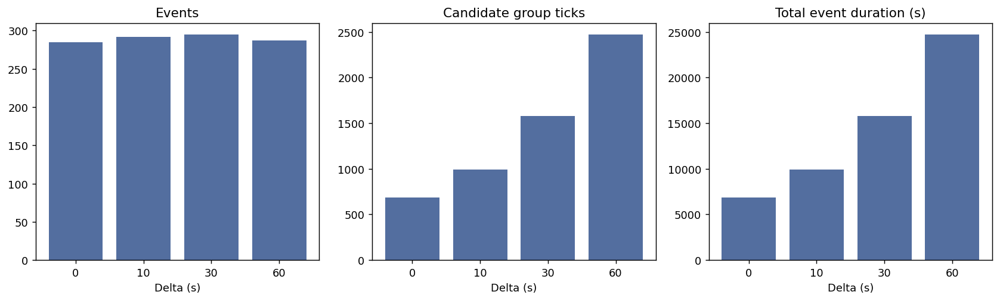
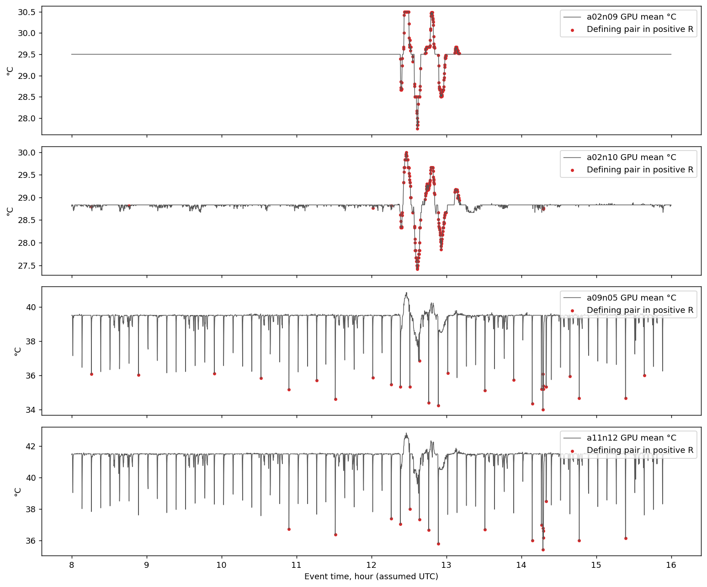
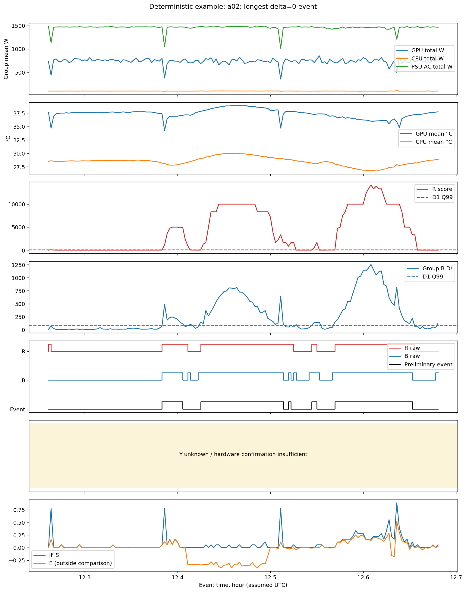
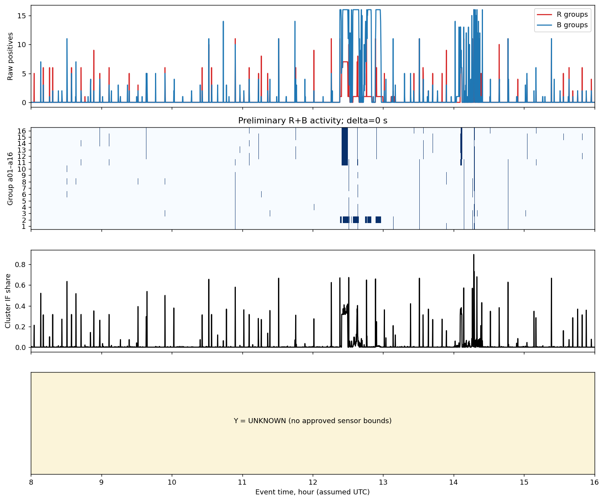
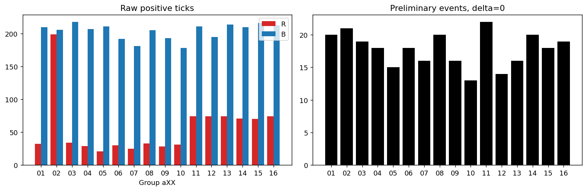

# Реальные результаты группового прототипа Summit D2

18.10.2026. Исполняемый исследовательский прототип `summit-group-research-v1` завершён. Это предварительное статистическое обнаружение, не диагностика подтверждённых аппаратных неисправностей. Решения разрешены новым ТЗ пользователя; согласование научным руководителем не заявляется.

## Входы и замораживание

База main после PR №9: `a55e1fafea8b2ef7256d03457e6a11145709d870`. R/B/Y, CLI, профиль и D1 parity зафиксированы **до первого D2** коммитом `ae0efb8`; `adb5205` закрепил LF для SHA-bound JSON. Первый D2 binary имеет VCS revision `adb5205ed1fec142db12e9dc11447c436588c76d`, modified=false. Профиль, floor, δ grid и пороги не изменялись после просмотра D2.

Group profile SHA-256: `a39a7f63ad7cea88ac0a642ecd1a38c11ef3ea727fe97d654bb4cb7297f77a36`. Входные SHA prepared/manifest/statistical/IF/B1/hardware/contract до и после совпадают в [run-summary.json](group-runtime-v1/d2/run-summary.json). Защищённые исторические файлы дополнительно проверены отдельным manifest.

288 хостов, a01–a16 по 18, F18, 10 s. D1 `[00:00,08:00)`, D2 `[08:00,16:00)` 18.01.2022, UTC — прежнее неподтверждённое допущение. D3 не используется. Все 829440 host states и 46080 group ticks D2 полны. Аппаратное исследование контрольной точки не повторялось.

## Математика и регрессия

Go реализует пять физических каналов хоста и десять group mean/population-spread координат; temporal host median/MAD, second-largest по двум различным хостам одного канала/знака и strict D1 Q99. B: отдельный 10D профиль каждой группы, robust normalization, Welford ddof1, SVD cutoff 1e-12, full rank либо unknown. Существующий узловой Mahalanobis и локальный B1 не изменены.

[D1 parity](group-runtime-v1/d1-parity.json): vectors, host/group median/MAD/scale, covariance, normalized center и R score совпали точно; max pseudoinverse error 5.12e-14, max D² error 1.27e-12. При заранее заданных rtol=atol=1e-8 все 46080 бинарных R/B решений D1 совпали точно.

[Независимый D2 audit](group-runtime-v1/d2/runtime-audit.json) подтвердил R/B, все 184320 causal temporal candidates, сегментацию, duration и IF support. Все 829440 локальных B1 score совпали с прежним экспортом, 14341 positives.

## R/B/Y и зависимость

| R | B | Group ticks | Доля всех известных |
|---|---|---:|---:|
| positive | positive | 682 | 1.480035% |
| positive | negative | 217 | 0.470920% |
| negative | positive | 2578 | 5.594618% |
| negative | negative | 42603 | 92.454427% |

R positives: 899; B positives: 3260. Jaccard=0.196146, phi=0.378435; P(B+|R+)=0.758621, P(R+|B+)=0.209202. Методы связаны, но не тождественны: особенно велик B-only набор. Для a02 phi=0.710639; единая pooled статистика скрывает неоднородность групп. Это описательные числа зависимых временных рядов, не независимые Bernoulli испытания и не оценки fault FPR. Вероятности ошибок не перемножаются.

**Y unknown во всех 46080 group ticks**: `approved_sensor_bounds=[]`. Это отсутствие применимого аппаратного заключения, не отрицательный Y. Полное голосование с доступным Y на реальных данных не оценивается; код device→host→group проверяется искусственными тестовыми bounds. 300 W GPU и 2200 W PSU не использованы как аварийные пороги.

| Группа | R+ | B+ | R&B | R-only | B-only | Phi | R+ с zero-MAD в паре | Events δ0 |
|---|---:|---:|---:|---:|---:|---:|---:|---:|
| a01 | 32 | 210 | 23 | 9 | 187 | 0.263301 | 0 | 20 |
| a02 | 199 | 206 | 148 | 51 | 58 | 0.710639 | 187 | 21 |
| a03 | 34 | 218 | 23 | 11 | 195 | 0.248253 | 0 | 19 |
| a04 | 29 | 207 | 21 | 8 | 186 | 0.254701 | 0 | 18 |
| a05 | 21 | 211 | 16 | 5 | 195 | 0.226502 | 0 | 15 |
| a06 | 30 | 192 | 19 | 11 | 173 | 0.233074 | 0 | 18 |
| a07 | 25 | 181 | 19 | 6 | 162 | 0.268811 | 0 | 16 |
| a08 | 33 | 205 | 23 | 10 | 182 | 0.262026 | 0 | 20 |
| a09 | 28 | 193 | 19 | 9 | 174 | 0.242338 | 28 | 16 |
| a10 | 31 | 178 | 16 | 15 | 162 | 0.196807 | 0 | 13 |
| a11 | 74 | 211 | 63 | 11 | 148 | 0.484928 | 18 | 22 |
| a12 | 74 | 195 | 54 | 20 | 141 | 0.427905 | 0 | 14 |
| a13 | 74 | 214 | 58 | 16 | 156 | 0.439305 | 0 | 16 |
| a14 | 71 | 210 | 62 | 9 | 148 | 0.489379 | 0 | 20 |
| a15 | 70 | 216 | 59 | 11 | 157 | 0.460124 | 0 | 18 |
| a16 | 74 | 213 | 59 | 15 | 154 | 0.448854 | 0 | 19 |

## Время и предварительные события

Все события имеют `mode=preliminary`, `criteria_incomplete=true`, `hardware_confirmation=insufficient_criteria`. Raw R/Y/B, temporal occurrence, общее vote2 и preliminary intersection разделены. Причинный TTL использует только предыдущие/текущий ticks. Unknown R/B или gap прерывает событие; известный отрицательный tick закрывает на текущем времени с сохранением предыдущего last_positive. Нет gap merging и повторов ID на длинном событии.

| δ, s | Candidate ticks | Events | Сумма group duration, s | Max duration, s | IF supported / none | Zero-MAD pair events | Max pair delay, s | Jaccard temporal |
|---:|---:|---:|---:|---:|---:|---:|---:|---:|
| 0 | 682 | 285 | 6820 | 320 | 274 / 11 | 42 | 0 | 0.196146 |
| 10 | 989 | 292 | 9890 | 380 | 277 / 15 | 42 | 10 | 0.218757 |
| 30 | 1576 | 295 | 15760 | 400 | 279 / 16 | 40 | 30 | 0.251356 |
| 60 | 2472 | 287 | 24720 | 570 | 271 / 16 | 37 | 50 | 0.289461 |

Duration суммируется по группам и включает последнюю 10 s ячейку; это не wall-clock длительность одного кластерного инцидента. TTL увеличивает занятость и может соединять близкие срабатывания; число событий не обязано монотонно расти. Основной вариант остаётся δ=0; лучший δ не выбирался. Полная таблица: [events.csv](group-runtime-v1/d2/events.csv), [events.json](group-runtime-v1/d2/events.json).

## Zero-MAD: существенное ограничение интерпретации

В 233 из 899 R-positive ticks (25.92%) определяющая пара содержит zero-MAD канал. При δ=0 это 42 из 285 событий. Хосты не исключались, floor не изменялся.

| Хост | R+ above Q99 | В определяющей паре | Амплитуда min/max, °C | Min / median abs amplitude в паре, °C | Max abs(z) |
|---|---:|---:|---:|---:|---:|
| a02n09 | 180 | 180 | -1.750000 / 1.000000 | 0.016667 / 0.750000 | 17500.000 |
| a02n10 | 187 | 187 | -1.416667 / 1.166667 | 0.016667 / 0.500000 | 14166.667 |
| a09n05 | 28 | 28 | -5.500000 / -2.666667 | 2.666667 / 4.145833 | 55000.000 |
| a11n12 | 54 | 18 | -6.083333 / 1.333334 | 3.000000 / 4.816667 | 60833.333 |

Для a02: 187 из 199 R-positive ticks включают zero-MAD в определяющую пару. Порог R=65.762598 соответствует всего 0.00657626 °C для канала с scale=1e-4 °C. Минимальная наблюдаемая амплитуда в такой паре около 0.016667 °C уже даёт |z|≈166.7. Поэтому большие score здесь нельзя интерпретировать как физически сильный/опасный перегрев. Изменения температуры реальны в данных, но их статистический масштаб определяется численным floor; без модели sensor noise/дискретности это потенциальный блокер физической интерпретации a02. Остальные группы не сводятся к этому случаю: a09/a11 имеют более крупные отклонения, прочие группы не содержат известных zero-MAD каналов в определяющих парах. Это не доказывает их аппаратную природу.

Воспроизводимые значения: [zero-mad-evidence.csv](group-runtime-v1/d2/zero-mad-evidence.csv), [zero-mad-series.csv](group-runtime-v1/d2/zero-mad-series.csv).

Количество δ0 событий по zero-MAD хостам: a02n09 — 11, a02n10 — 12, a09n05 — 16, a11n12 — 14; события могут включать несколько таких хостов, эти числа не складываются. Полный δ grid: [context-analysis.json](group-runtime-v1/d2/context-analysis.json).

## Детерминированный пример и физические величины

Самое длинное δ=0 событие: **a02**, 2022-01-18T12:25:40Z — 2022-01-18T12:30:50Z, закрыто 2022-01-18T12:31:00Z; duration=320 s. Хосты-свидетели: a02n09, a02n10; IF support 11/32 ticks; zero-MAD pair 32/32. Выбран автоматическим правилом longest, затем group/time; здесь наиболее длительный пример как раз демонстрирует ограничение, а не сильнейшее доказательство аппаратной неисправности. На графике мощности и температуры даны в исходных физических единицах после явно указанной групповой агрегации.

## IF и межгрупповое сравнение

S=a/n использует только доступные локальные решения. На реальном D2 все 18 узлов доступны; 274 δ0 события имеют хотя бы один IF-positive tick, 11 событий не имеют такой поддержки. IF не является gate. Индивидуальные score/threshold/hostname сохранены для всех 829440 состояний в raw NDJSON; компактный [r-evidence.ndjson](group-runtime-v1/d2/r-evidence.ndjson) публикует все 899 R-positive строки с физическими свидетелями и локальными IF решениями.

E=S−S_outside вычислен с весами числа доступных хостов и исключением текущей группы; сохранён outside universe. Для 4/8/16 групп outside различен. E не фильтрует событие. Нулевой/отрицательный E не исключает общего изменения режима.

При δ0 union R-witness hosts на событие: 2–13. Из 682 candidate ticks E>0 в 537, E≤0 в 145. Контекст каждого события: [event-context.csv](group-runtime-v1/d2/event-context.csv); непрерывные интервалы совпадения с IF: [if-overlap-intervals.csv](group-runtime-v1/d2/if-overlap-intervals.csv).

При δ0: 119 timestamps с ровно одной активной группой, 87 с 2–15 группами, 1 с 16 группами; 2673 без кандидатов. Это описывает охват. Синхронность не доказывает общий PDU/охлаждение/инцидент; возможны общие изменения нагрузки.

## Производительность

Среда: Windows-11-10.0.26200-SP0, Intel64 Family 6 Model 154 Stepping 3, GenuineIntel, Go 1.27.2, amd64, GOMAXPROCS=16. Последовательные отдельные процессы; 3 повтора на размер, warm OS cache после первого full run, cache eviction не выполнялся. Reader читает общий Parquet всех 16 групп даже для меньшего scoring universe.

| Groups | Process wall median [min,max], s | Analysis median, s | Host states/s median | Peak WS [min,max], MiB | Sampled heap max, MiB |
|---:|---:|---:|---:|---:|---:|
| 4 | 4.4422 [4.3002,4.8153] | 4.0484 | 51220.3 | 40.89–88.74 | 23.07 |
| 8 | 5.8022 [5.7810,5.8216] | 5.5389 | 74874.2 | 40.95–41.16 | 24.28 |
| 16 | 8.6008 [8.5977,8.6233] | 8.3512 | 99320.2 | 41.10–41.91 | 23.57 |

Отдельный **полный materialized 16-group run**: process wall 9.8033 s, analysis 9.5485 s, peak Windows working set 46.18 MiB, sampled heap 27.07 MiB. Peak working set — process-lifetime показатель Windows, не sampled heap и не обещание linux RSS. Heap считывается каждые 30 ticks и может пропускать пики. Полный wall включает загрузку/валидацию/SHA и финальную запись; native analysis не включает подготовку моделей. JSON/reader/outside overhead входит в общий analysis, но не в отдельные kernel timers.

| Стадия полного run | Seconds |
|---|---:|
| features_seconds | 0.329643 |
| r_seconds | 0.077493 |
| b_seconds | 0.008472 |
| y_seconds | 0.036689 |
| if_seconds | 4.880369 |
| temporal_seconds | 0.027694 |

Полные повторы, команды, binary SHA и модели: [performance.json](group-runtime-v1/performance.json), [performance-full.json](group-runtime-v1/performance-full.json). Профили общих групп не переобучались. Улучшение throughput при большем universe частично связано с фиксированным I/O; это не доказательство линейного масштабирования и не задержка будущей Kafka-системы.

## Сложность и воспроизводимость

H=18G, K=5, d=10, F=число IF trees, L=depth. Inference: O(T·H·F·L + T·H·K + T·G·d² + T·G²) — последняя часть есть в текущем прямом outside comparison. Temporal четыре δ — постоянный множитель, память самой temporal части O(G) с тремя latest-positive/unknown состояниями и bounded summaries; сырые свидетельства пишутся потоково. Event witness union ограничен 18 хостами. Полная Go inference память дополнительно содержит group profiles O(H·K+G·d²), существующий лес O(F·sample_size), decoder и audit maps O(T+H) в переиспользованном Source.Scan; поэтому весь runner не объявляется O(1) по длительности окна. Fit хранит O(T1·H·K + T1·G·d), точные medians/quantiles требуют сортировки O((H·K+G·d)·T1 log T1), covariance O(T1·G·d²), SVD O(G·d³), текущая прямая reconstruction diagnostic O(G·d⁴). Python визуализация дополнительно хранит T×G массивы и не является памятью Go inference.

Запуск и форматы: [group-detection-runtime.md](group-detection-runtime.md). Источники графиков: [timeline.csv](group-runtime-v1/d2/timeline.csv), [temporal.csv](group-runtime-v1/d2/temporal.csv), events/zero-MAD CSV/JSON. Каждый график сохранён в PNG и SVG. Полные большие raw/temporal NDJSON остаются в новом `results/group-runtime-d2-v1`, воспроизводятся CLI и не добавлены в Git из-за размера. Все 899 R-positive evidence опубликованы.

## Приёмка и ограничения

Выполнены Go test/build/vet, Python regressions, D1 parity, независимый D2 math/temporal/B1 audit и protected SHA audit. Точные результаты финальной проверки сохранены в [validation.json](group-runtime-v1/validation.json). Аппаратные fault Precision/Recall/F1 не вычисляются: независимой разметки нет. D1 — один автокоррелированный 8h фрагмент; D2 исследовательский, а не независимая итоговая проверка. Число событий — не число отказов. См. [limitations](group-detection-limitations.md).

Фактические роли: Orchestrator GPT-6.1 Sol / High; Implementer GPT-6 Luna / Medium (Y/temporal, исправлено главным при приёмке); Test Writer GPT-6 Luna / Low (контрактные тесты, дополнены главным). Все model/effort — configured по проектным TOML, runtime metadata не подтверждены. Других агентов не было.
