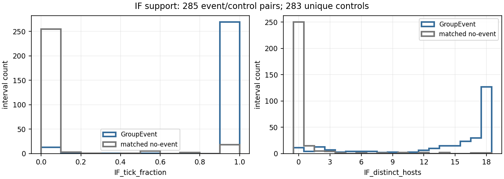
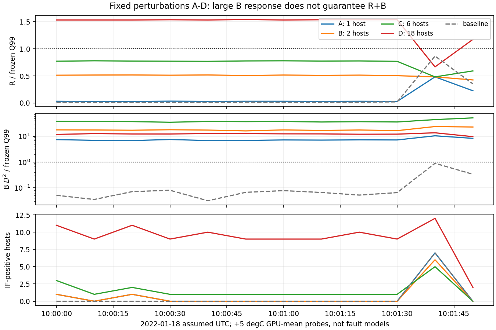
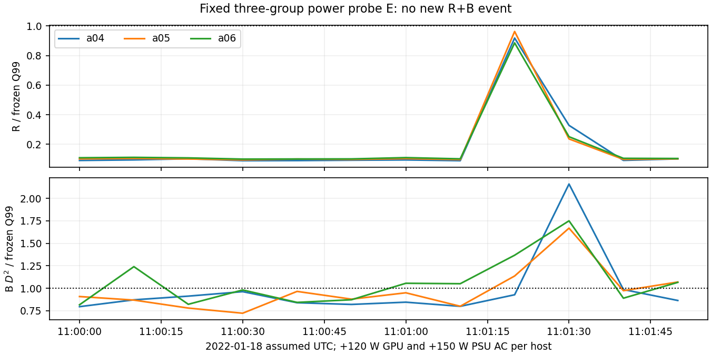

# Результаты зарегистрированного group-validation-v1

Protocol commit `7732621cb5832eb086c6aa7dcde2e6e05b304026`; experiment code `796ff3d77f4a538deecb543ac6f65bf41eefedaa`, dirty=False.
D2 уже исследован: дополнительные разведочные опыты, не независимое подтверждение.

| Метрика | Исходная | Контроли min / median / max |
|---|---:|---:|
| R | 899 | 871 / 992.5 / 1142 |
| B | 3260 | 3513 / 3550.5 / 3629 |
| RB | 682 | 698 / 807.5 / 912 |
| events | 285 | 271 / 308.5 / 327 |
| duration_seconds | 6820 | 6980 / 8075 / 9120 |
| group_event_HHI | 0.0637365 | 0.0639936 / 0.0650222 / 0.0680659 |
| group_event_entropy | 0.996361 | 0.984067 / 0.992631 / 0.995749 |
| multi_5plus_ticks | 64 | 68 / 70 / 72 |
| IF_supported_tick_fraction | 0.90176 | 0.941886 / 0.994605 / 1 |

| Сценарий | R+ | B+ | RB исходные → внесённые | Новые RB | Unknown |
|---|---:|---:|---:|---:|---:|
| A | 0 | 12 | 0 → 0 | 0 | 0 |
| B | 0 | 12 | 0 → 0 | 0 | 0 |
| C | 0 | 12 | 0 → 0 | 0 | 0 |
| D | 11 | 12 | 0 → 11 | 11 | 0 |
| E | 0 | 10 | 0 → 0 | 0 | 0 |
| F | 0 | 0 | 4 → 0 | 0 | 4 |

Величины R/B/RB в таблице сценариев относятся только к изменённым group-ticks.
Полные D2 counts и события — в findings.json/interventions.csv. F даёт фрагментацию, не новые отказы.

Исходные 371 защищённый файл и все коэффициенты v1 сохранены. Никакие отрицательные результаты не исправлялись подбором параметров.

## Все автоматически выбранные многогрупповые интервалы

Условие: не менее пяти одновременных R+B групп на каждом tick. Это интервалы статистической активности, не incident labels.

| Начало UTC | Конец exclusive | Групп за интервал | R&B group-ticks |
|---|---|---:|---:|
| 08:34:30 | 08:34:40 | 5 | 5 |
| 09:38:10 | 09:38:20 | 5 | 5 |
| 10:31:30 | 10:31:40 | 10 | 10 |
| 10:54:00 | 10:54:10 | 10 | 10 |
| 11:31:00 | 11:31:10 | 11 | 11 |
| 12:15:50 | 12:16:00 | 5 | 5 |
| 12:23:10 | 12:23:20 | 11 | 11 |
| 12:24:40 | 12:30:00 | 7 | 217 |
| 12:30:40 | 12:30:50 | 10 | 10 |
| 12:37:50 | 12:38:10 | 7 | 14 |
| 12:38:20 | 12:38:30 | 8 | 8 |
| 12:45:50 | 12:46:00 | 11 | 11 |
| 12:53:30 | 12:53:40 | 11 | 11 |
| 12:54:20 | 12:54:30 | 6 | 6 |
| 13:30:50 | 13:31:00 | 11 | 11 |
| 14:05:50 | 14:07:10 | 6 | 47 |
| 14:08:40 | 14:08:50 | 11 | 11 |
| 14:16:00 | 14:16:10 | 6 | 6 |
| 14:17:10 | 14:17:50 | 16 | 55 |
| 14:19:50 | 14:20:00 | 10 | 10 |
| 14:46:20 | 14:46:30 | 11 | 11 |
| 15:23:20 | 15:23:30 | 11 | 11 |

