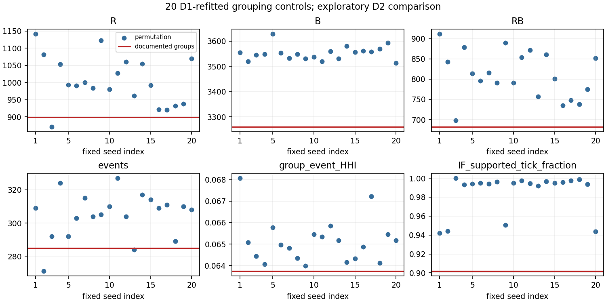
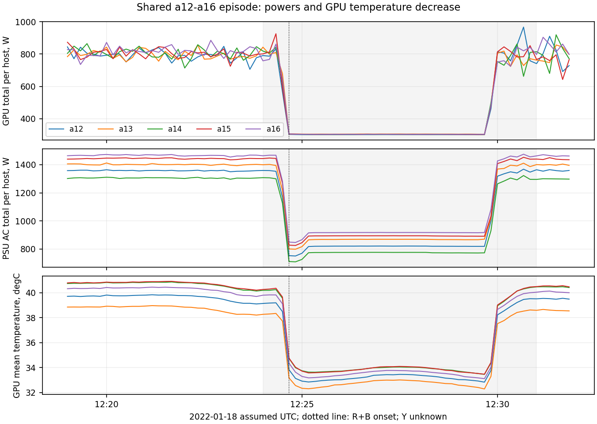

# Для обсуждения с П. А. Паниловым: групповой анализ Summit

18.10.2026. Краткая записка этапа 3. **Решения ниже предлагаются для согласования;
согласование руководителем не заявляется.** Полные формулы и условия —
[научная модель](nir-group-model-scientific-summary.md).

## 1. Что реализовано

Go offline-прототип `summit-group-research-v1`: 288 хостов, 16 групп по 18,
F18 с шагом 10 s. Существующий локальный Isolation Forest B1 дополнен R
(Median/MAD, минимум два разных хоста одного канала/знака), B (Mahalanobis
10D mean/spread), интерфейсом аппаратного Y, причинными временными событиями,
IF-support и сравнением группы с остальным кластером E. Есть CLI, тесты,
профили, реальные графики и SHA. Kafka/Worker/Master пока не реализованы.

## 2. Что подтверждено

На D1 проверено численное совпадение Go/Python; на D2 воспроизведены 899 R+,
3260 B+, 682 совместных групповых отсчёта и **285 предварительных событий**.
241 событие длится 10 s, 18 — 20–30 s, 16 — 40–120 s, 10 — более 120 s.
Все исходные данные, модели и отчёты PR №10 сохранены. Протокол новых опытов
зафиксирован коммитом `7732621` до их запуска, код — `796ff3d`.

Уточнённая IF-поддержка: средняя по событиям доля поддержанных ticks 94.97%,
взвешенная по ticks — 90.18%; у временных контролей той же группы, длины и часа
средняя 8.19%. Median distinct IF-positive hosts: 17 против 0. Для всех 285
событий найден контроль; 283 уникальных интервала, максимум reuse=2. Это
описательное сопоставление, а не доказательство fault-quality.

## 3. Главные ограничения

Y всегда **unknown**: нет совместимых подтверждённых аппаратных пределов.
Нет независимой разметки отказов и job/incident logs. Один день и восемь часов
D1 не подтверждают междневную устойчивость; D2 уже исследовался, D3 не является
чистым holdout. Часть физических связей и timezone не подтверждены.
R/B зависимы (phi≈0.378), их совпадение не даёт двух независимых физических голосов.

Zero-MAD существенен для a02: готовая отдельная D1-диагностика без четырёх
координат дала 899→726 R+, 682→550 R&B, 285→277 событий; a02 — 21→14 событий.
Выбранный длинный a02-эпизод 320 s оставляет один 10 s tick; пять равнодлинных
эпизодов a12–a16 сохраняются. Floor 1e-4 °C — численная защита, не разрешение
датчика. Альтернатива не доказана лучшей и не заменяет рабочую модель.

## 4. Что дали контрольные групповые опыты

20 заранее заданных случайных составов сохраняют тех же хостов/измерения.
Каждый состав получил **собственный D1 R/B-профиль и Q99**, IF не менялся.

| Показатель | Исходные группы | 20 контролей: min / median / max |
|---|---:|---:|
| R&B ticks | 682 | 698 / 807.5 / 912 |
| События | 285 | 271 / 308.5 / 327 |
| B+ | 3260 | 3513 / 3550.5 / 3629 |

Состав групп влияет на статистику, но большее/меньшее число тревог не означает
лучшее обнаружение неисправностей. Смешиваются нагрузка, неоднородность и
zero-MAD; дополнительная диагностическая ценность физической топологии пока
не установлена. Не применялись тесты независимых временных отсчётов.

В 12:24–12:31 a12–a16 показывают синхронное снижение GPU power примерно
на 485–514 W на хост и GPU mean temperature на 5.99–6.82 °C относительно
предшествующих пяти минут. R+B начинается одновременно в 12:24:40.
Это согласуется с гипотезой смены нагрузки, но причина без job/BMC logs неизвестна.

Фиксированные artificial probes проверяют реакцию, **не моделируют реальные отказы**:

| Воздействие | Новые R&B ticks | Наблюдение |
|---|---:|---|
| +5 °C GPU mean: 1 / 2 / 6 хостов | 0 / 0 / 0 | B реагирует, R ниже Q99 |
| +5 °C: вся группа | 11 | задержка 0 s; две новые серии |
| +120 W GPU/+150 W PSU AC: три группы | 0 | общий сдвиг не гарантирует R+B |
| Пропуски внутри a02-события | 0 | 4 unknown; 320 s → 80/50/150 s |

Два изменённых узла не обязательно имеют два z выше Q99. Групповой анализ
добавляет условия коллективности, физических свидетелей и интервалы, а не
гарантию превосходства над IF. B-only сигналы сохраняются: R+B gate имеет
ограниченную чувствительность к некоторым коллективным изменениям.

## 5. Какие решения нужны

1. **Статус R+B:** оставить v1 предварительным статистическим baseline либо
   отложить утверждение полноценной модели до независимых данных. Рекомендуется
   первое, без обозначения событий аппаратными неисправностями.
2. **Статус Y:** сохранить unknown/interface и требование approved bounds;
   отдельно определить, обязателен ли аппаратный критерий для будущего заключения.
3. **Нормализация R:** сохранить v1 для сравнения; возможную constant-channel/noise
   policy проверять как новую версию на отдельном протоколе и данных.
4. **Роль группировки:** оставить документированный inventory операционной
   структурой; для причинной модели нужны facility связи и нагрузочно-сопоставимые
   контроли. Перестановки не доказали топологию отказов.
5. **Независимая проверка:** определить новый неиспользованный день/набор,
   incident/job labels, coverage и правила event matching до просмотра данных.
   Новый большой download требует отдельного разрешения.

## 6. Следующий этап

Перенос **того же** математического ядра в распределённую КР по
[проекту контракта](kr-distributed-detector-contract.md): membership/profile IDs,
event-time barrier/watermark, явные missing/late/duplicate policies,
идемпотентность и восстановление Worker. Критерий приёмки — одинаковые
математические решения с offline после восстановления порядка, а transport
latency измеряется отдельно. Реализация распределённых компонентов требует
нового задания; изменение математических параметров в этот перенос не включается.
