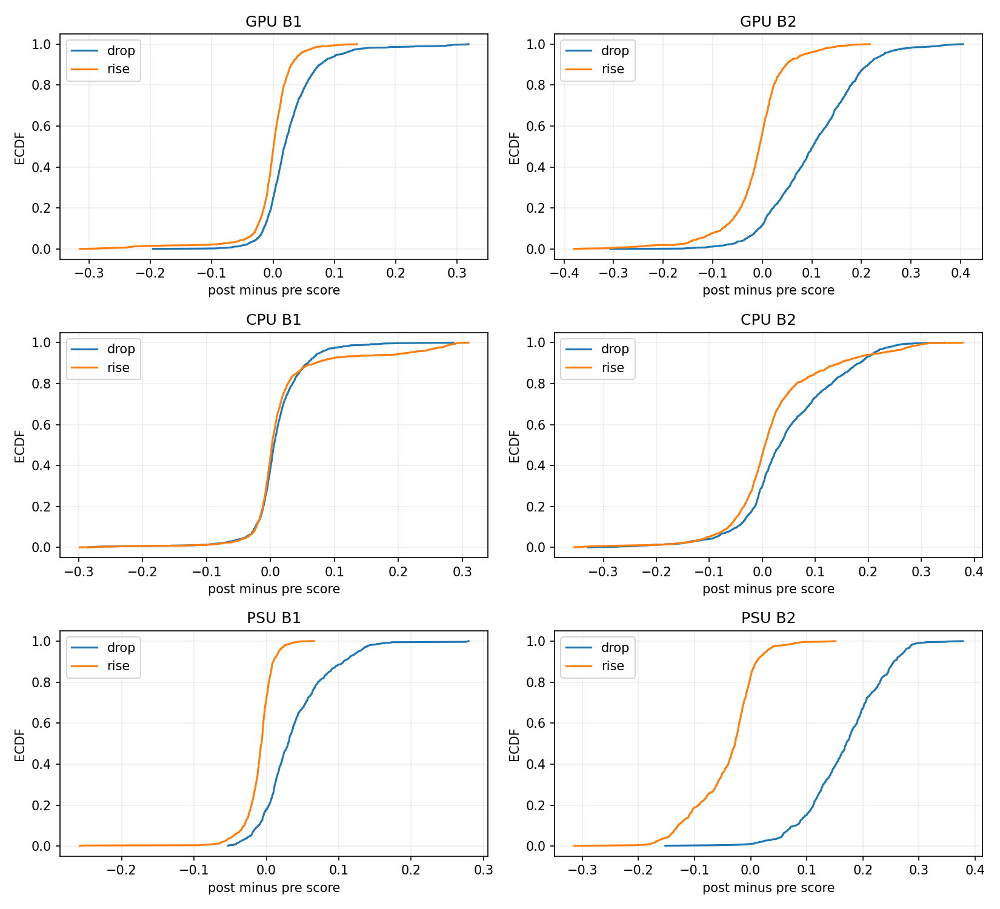
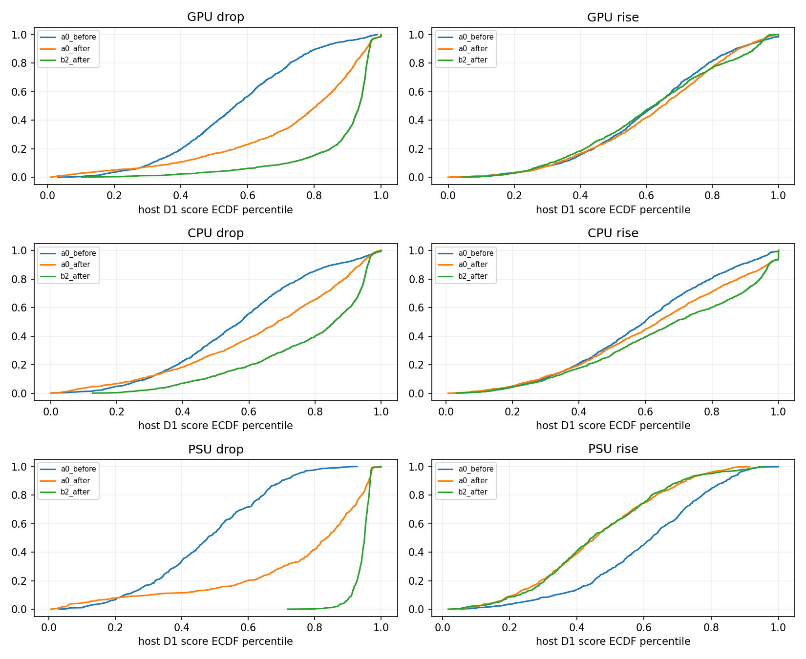
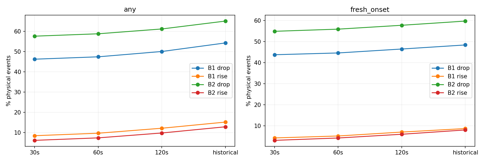

# Этап I: асимметрия мощности и временной оценки

**Асимметрия подтверждена на реальных D2 событиях, но не свидетельствует сама по себе о программной ошибке IF.** При снижении мощности новые состояния чаще получают высокий контекстный score; повышение, особенно PSU, часто возвращает узел из уже отмеченного малого уровня мощности. IF оценивает редкость состояния, а не знак изменения мощности. Увеличивать долю обнаруженных повышений без определения исследуемого состояния нельзя.

Дата 14.10.2026. [Зафиксированный до расчёта протокол](01-analysis-protocol.md); SHA-256 45f170a15f6d6ae28bea077df185a4889b432b9269d6a7bd66675e85f866edc4. D1/D2 и hashes: [этап 0](00-baseline-and-reproducibility.md). D2 исследовательский; независимая итоговая валидация отсутствует.

## Отбор и состояние до/после

6978 прежних событий №4.2, без изменения критериев. t — представитель с максимальным нормированным 60-секундным приращением в объединённом событии. Его направление задаёт доминирующая подсистема: увеличение одной мощности не означает рост всех 18 координат. 273 событий содержат одновременно сильные приращения разных знаков; 106 событий имеют пересекающиеся исходные окна другого события того же хоста. Это число событий, не независимых отказов.

Pre — покоординатная медиана [-120,-60] с; post — медиана [0,+30] с. Температуры CPU/GPU средние по 2/6 компонентам. Температура PSU в F18 отсутствует. Агрегированный median F18 не обязан совпадать с одной реальной строкой: расстояние до D1 ниже является описанием агрегата, а не доказательством существования такого режима.

| Категория | N | pre/post P доминирующей, W (median) | pre/post A0 (median) | pre/post B2 (median) | post D1-host percentile A0/B2 (median) | pre/post nearest D1 |
| --- | --- | --- | --- | --- | --- | --- |
| GPU drop | 1337 | 830.1/727.2 | 0.404622/0.430111 | 0.39519/0.512865 | 0.806597/0.934722 | 0.49529/0.984611 |
| GPU rise | 1447 | 759/861.4 | 0.40861/0.411178 | 0.404381/0.398427 | 0.648958/0.621181 | 0.513171/0.480223 |
| CPU drop | 1430 | 109/107.381 | 0.407407/0.418745 | 0.397634/0.453752 | 0.686806/0.857292 | 0.500545/0.665014 |
| CPU rise | 1490 | 107.8/110.1 | 0.408106/0.413097 | 0.406287/0.408206 | 0.637847/0.689583 | 0.515215/0.528872 |
| PSU drop | 550 | 1453.3/1366.8 | 0.401767/0.444608 | 0.384691/0.554119 | 0.835069/0.950694 | 0.459996/1.35571 |
| PSU rise | 724 | 1412.7/1442.5 | 0.410721/0.400647 | 0.413192/0.382372 | 0.453472/0.445486 | 0.551703/0.452268 |

Nearest D1 — Euclidean расстояние в прежних глобальных F18 scale до каждой шестой D1 строки своего хоста (480 состояний). Не оценка плотности; редкие обучающие состояния могут быть пропущены подвыборкой. ECDF score также не доказывает многомерное совпадение. Полные распределения и квантили всех координат: [приложение](01-distributions.md).

## Что старая метрика называла обнаружением

Any — любой положительный сигнал в указанном закрытом окне. New — false→true после t при отсутствии сигналов последние 60 с до t. Это более строгое определение нового сигнала, а не доказанный аппаратный детектор. Существовавший ранее сигнал может быть содержательным состоянием; его нельзя автоматически отнести к новому переходу.

| Категория | Метод | Any [-30,+180] | Any [0,+120] | New [0,+120] | pre120 | active t−10 | post-onset [0,+120] |
| --- | --- | --- | --- | --- | --- | --- | --- |
| all | B1 | 33.71% | 30.11% | 25.82% | 34.97% | 2.61% | 28.25% |
| all | B2 | 37.62% | 34.16% | 30.64% | 38.65% | 2.94% | 31.70% |
| GPU drop | B1 | 61.18% | 58.56% | 53.48% | 9.80% | 2.69% | 56.47% |
| GPU drop | B2 | 69.78% | 67.46% | 63.50% | 6.73% | 3.44% | 64.32% |
| GPU rise | B1 | 10.71% | 8.36% | 4.91% | 63.58% | 0.55% | 8.29% |
| GPU rise | B2 | 7.19% | 4.63% | 2.76% | 67.86% | 0.28% | 4.56% |
| CPU drop | B1 | 33.64% | 26.36% | 23.29% | 16.85% | 2.24% | 25.94% |
| CPU drop | B2 | 47.13% | 40.28% | 36.71% | 16.92% | 3.29% | 38.46% |
| CPU rise | B1 | 26.24% | 21.34% | 12.62% | 30.74% | 6.78% | 15.17% |
| CPU rise | B2 | 24.43% | 19.46% | 12.15% | 43.83% | 6.85% | 12.95% |
| PSU drop | B1 | 90.73% | 90.55% | 90.00% | 1.09% | 0.73% | 90.00% |
| PSU drop | B2 | 99.82% | 99.82% | 98.73% | 1.09% | 1.09% | 98.73% |
| PSU rise | B1 | 1.10% | 0.55% | 0.00% | 94.48% | 0.14% | 0.55% |
| PSU rise | B2 | 0.14% | 0.00% | 0.00% | 100.00% | 0.00% | 0.00% |

Расширение времени и старые сигналы совместно завышали впечатление чувствительности: B1 33.71% any historical → 25.82% new120; B2 37.62% → 30.64%. Эта разница включает и сокращение окна до 120 с; отдельное сравнение при одинаковом окне [-30,+180] доступно в таблицах ниже. Асимметрия сохраняется в коротких окнах.

| Категория | Метод | Any30/60/120/old, % | New30/60/120/180, % | pre-only old | Latency new/post median/q95, s |
| --- | --- | --- | --- | --- | --- |
| all | A0 historical | 1.19% / 1.25% / 1.33% / 1.58% | 0.39% / 0.42% / 0.49% / 0.50% | 10 | 10/90 |
| all | A0 D1-Q99 | 0.00% / 0.00% / 0.01% / 0.01% | 0.00% / 0.00% / 0.01% / 0.01% | 0 | 90/90 |
| all | B1 | 26.37% / 27.57% / 30.11% / 33.71% | 23.07% / 23.96% / 25.82% / 27.62% | 97 | 0/90 |
| all | B2 | 30.57% / 31.77% / 34.16% / 37.62% | 27.76% / 28.83% / 30.64% / 32.66% | 97 | 0/80 |
| all | Power increment | 100.00% / 100.00% / 100.00% / 100.00% | 70.49% / 70.49% / 70.49% / 70.49% | 0 | 0/0 |
| GPU drop | A0 historical | 1.35% / 1.35% / 1.42% / 1.50% | 0.52% / 0.52% / 0.60% / 0.60% | 1 | 10/90 |
| GPU drop | A0 D1-Q99 | 0.00% / 0.00% / 0.00% / 0.00% | 0.00% / 0.00% / 0.00% / 0.00% | 0 | —/— |
| GPU drop | B1 | 56.17% / 56.99% / 58.56% / 61.18% | 51.91% / 52.36% / 53.48% / 54.82% | 9 | 0/30 |
| GPU drop | B2 | 65.45% / 66.34% / 67.46% / 69.78% | 61.78% / 62.45% / 63.50% / 64.92% | 10 | 0/10 |
| GPU drop | Power increment | 100.00% / 100.00% / 100.00% / 100.00% | 88.78% / 88.78% / 88.78% / 88.78% | 0 | 0/0 |
| GPU rise | A0 historical | 0.00% / 0.00% / 0.07% / 0.21% | 0.00% / 0.00% / 0.07% / 0.07% | 2 | 90/90 |
| GPU rise | A0 D1-Q99 | 0.00% / 0.00% / 0.00% / 0.00% | 0.00% / 0.00% / 0.00% / 0.00% | 0 | —/— |
| GPU rise | B1 | 5.32% / 6.01% / 8.36% / 10.71% | 3.11% / 3.52% / 4.91% / 6.01% | 13 | 0/100 |
| GPU rise | B2 | 0.97% / 1.73% / 4.63% / 7.19% | 0.62% / 1.38% / 2.76% / 4.35% | 14 | 80/120 |
| GPU rise | Power increment | 100.00% / 100.00% / 100.00% / 100.00% | 65.65% / 65.65% / 65.65% / 65.65% | 0 | 0/0 |
| CPU drop | A0 historical | 1.05% / 1.12% / 1.19% / 1.54% | 0.91% / 0.98% / 1.05% / 1.05% | 4 | 10/110 |
| CPU drop | A0 D1-Q99 | 0.00% / 0.00% / 0.00% / 0.00% | 0.00% / 0.00% / 0.00% / 0.00% | 0 | —/— |
| CPU drop | B1 | 19.79% / 21.75% / 26.36% / 33.64% | 18.46% / 20.00% / 23.29% / 26.50% | 51 | 0/110 |
| CPU drop | B2 | 33.92% / 35.80% / 40.28% / 47.13% | 31.68% / 33.43% / 36.71% / 40.00% | 51 | 0/100 |
| CPU drop | Power increment | 100.00% / 100.00% / 100.00% / 100.00% | 81.26% / 81.26% / 81.26% / 81.26% | 0 | 0/0 |
| CPU rise | A0 historical | 2.82% / 3.02% / 3.22% / 3.83% | 0.00% / 0.07% / 0.20% / 0.27% | 3 | 50/110 |
| CPU rise | A0 D1-Q99 | 0.00% / 0.00% / 0.07% / 0.07% | 0.00% / 0.00% / 0.07% / 0.07% | 0 | 90/90 |
| CPU rise | B1 | 15.37% / 17.72% / 21.34% / 26.24% | 7.52% / 9.40% / 12.62% / 15.64% | 22 | 20/120 |
| CPU rise | B2 | 14.09% / 16.38% / 19.46% / 24.43% | 7.11% / 9.13% / 12.15% / 15.64% | 21 | 20/120 |
| CPU rise | Power increment | 100.00% / 100.00% / 100.00% / 100.00% | 55.10% / 55.10% / 55.10% / 55.10% | 0 | 0/0 |
| PSU drop | A0 historical | 1.45% / 1.45% / 1.45% / 1.45% | 1.27% / 1.27% / 1.27% / 1.27% | 0 | 0/10 |
| PSU drop | A0 D1-Q99 | 0.00% / 0.00% / 0.00% / 0.00% | 0.00% / 0.00% / 0.00% / 0.00% | 0 | —/— |
| PSU drop | B1 | 90.55% / 90.55% / 90.55% / 90.73% | 90.00% / 90.00% / 90.00% / 90.00% | 1 | 0/0 |
| PSU drop | B2 | 99.82% / 99.82% / 99.82% / 99.82% | 98.73% / 98.73% / 98.73% / 98.73% | 0 | 0/0 |
| PSU drop | Power increment | 100.00% / 100.00% / 100.00% / 100.00% | 98.36% / 98.36% / 98.36% / 98.36% | 0 | 0/0 |
| PSU rise | A0 historical | 0.00% / 0.00% / 0.00% / 0.00% | 0.00% / 0.00% / 0.00% / 0.00% | 0 | —/— |
| PSU rise | A0 D1-Q99 | 0.00% / 0.00% / 0.00% / 0.00% | 0.00% / 0.00% / 0.00% / 0.00% | 0 | —/— |
| PSU rise | B1 | 0.28% / 0.28% / 0.55% / 1.10% | 0.00% / 0.00% / 0.00% / 0.00% | 1 | 10/100 |
| PSU rise | B2 | 0.00% / 0.00% / 0.00% / 0.14% | 0.00% / 0.00% / 0.00% / 0.00% | 1 | —/— |
| PSU rise | Power increment | 100.00% / 100.00% / 100.00% / 100.00% | 35.64% / 35.64% / 35.64% / 35.64% | 0 | 0/0 |

Latency и duration таблиц относятся ко всем новым post-onsets, включая случаи сигналов ранее в pre60; для строго fresh события доступны индивидуальные записи. Нельзя воспринимать latency относительно представителя t как задержку от начала всего перехода. Продолжительность run включает выход за окно оценки; right censor в конце D2 отмечен. Физическая длительность определяется по возврату через midpoint.

| Категория | Физический режим duration median/q95, s | undefined/censored | B1 onset duration median/q95 | B2 onset duration median/q95 |
| --- | --- | --- | --- | --- |
| GPU drop | 20/50 | 235/0 | 10/10 | 10/20 |
| GPU rise | 20/60 | 224/0 | 10/20 | 10/30 |
| CPU drop | 20/50 | 336/0 | 10/20 | 10/20 |
| CPU rise | 20/240 | 309/0 | 10/20 | 10/20 |
| PSU drop | 20/40 | 17/0 | 10/10 | 10/20 |
| PSU rise | 30/400 | 77/0 | 10/10 | —/— |

## Сопоставимые реальные контроли

Подобрано 6050/6978 (86.70%) пар; 928 unmatched. Тот же host/час, тот же D1-дециль предыдущей мощности, полная доступность; в [-120,+180] нет coverage сильного перехода. IF score при отборе не использован. Контроли не размечены как исправные. Повторные центры запрещены, окна могут пересекаться. Bootstrap целых host, часов и получасов сохраняет совместные пары.

| Категория | Пар | Метод | Event/control new120, % | Δ, п.п. | CI host, п.п. | CI hour, п.п. | CI halfhour, п.п. |
| --- | --- | --- | --- | --- | --- | --- | --- |
| all | 6050 | A0 historical | 0.45%/0.00% | 0.446281 | [0.28, 0.63] | [0.13, 0.78] | [0.11, 0.88] |
| all | 6050 | A0 D1-Q99 | 0.02%/0.00% | 0.0165289 | [0.00, 0.05] | [0.00, 0.05] | [0.00, 0.05] |
| all | 6050 | B1 | 26.55%/7.93% | 18.6116 | [17.14, 20.11] | [16.15, 21.14] | [15.20, 21.84] |
| all | 6050 | B2 | 30.86%/11.85% | 19.0083 | [17.59, 20.59] | [16.63, 21.09] | [16.29, 21.47] |
| all | 6050 | Power increment | 71.98%/0.00% | 71.9835 | [70.81, 73.21] | [65.21, 78.05] | [64.75, 78.27] |
| GPU drop | 1195 | A0 historical | 0.67%/0.00% | 0.669456 | [0.25, 1.14] | [0.16, 1.31] | [0.09, 1.37] |
| GPU drop | 1195 | A0 D1-Q99 | 0.00%/0.00% | 0 | [0.00, 0.00] | [0.00, 0.00] | [0.00, 0.00] |
| GPU drop | 1195 | B1 | 53.81%/8.54% | 45.272 | [41.90, 48.65] | [35.02, 53.57] | [35.65, 53.83] |
| GPU drop | 1195 | B2 | 62.68%/12.47% | 50.2092 | [46.82, 53.32] | [42.27, 57.18] | [42.81, 55.97] |
| GPU drop | 1195 | Power increment | 89.29%/0.00% | 89.2887 | [87.68, 90.95] | [79.67, 96.60] | [77.92, 97.43] |
| GPU rise | 1264 | A0 historical | 0.08%/0.00% | 0.0791139 | [0.00, 0.25] | [0.00, 0.24] | [0.00, 0.24] |
| GPU rise | 1264 | A0 D1-Q99 | 0.00%/0.00% | 0 | [0.00, 0.00] | [0.00, 0.00] | [0.00, 0.00] |
| GPU rise | 1264 | B1 | 5.30%/7.44% | -2.13608 | [-3.96, -0.24] | [-6.34, 2.08] | [-5.62, 1.76] |
| GPU rise | 1264 | B2 | 3.01%/10.52% | -7.51582 | [-9.43, -5.53] | [-10.42, -4.41] | [-9.93, -4.96] |
| GPU rise | 1264 | Power increment | 67.72%/0.00% | 67.7215 | [65.36, 70.19] | [62.61, 72.60] | [61.02, 74.31] |
| CPU drop | 1275 | A0 historical | 0.78%/0.00% | 0.784314 | [0.33, 1.27] | [0.08, 1.81] | [0.00, 1.83] |
| CPU drop | 1275 | A0 D1-Q99 | 0.00%/0.00% | 0 | [0.00, 0.00] | [0.00, 0.00] | [0.00, 0.00] |
| CPU drop | 1275 | B1 | 23.14%/8.00% | 15.1373 | [11.89, 18.33] | [10.17, 19.21] | [10.72, 19.94] |
| CPU drop | 1275 | B2 | 35.76%/10.27% | 25.4902 | [21.93, 29.12] | [20.02, 30.53] | [20.32, 31.08] |
| CPU drop | 1275 | Power increment | 83.53%/0.00% | 83.5294 | [81.55, 85.58] | [73.38, 93.71] | [72.53, 93.68] |
| CPU rise | 1306 | A0 historical | 0.23%/0.00% | 0.229709 | [0.00, 0.52] | [0.00, 0.67] | [0.00, 0.65] |
| CPU rise | 1306 | A0 D1-Q99 | 0.08%/0.00% | 0.0765697 | [0.00, 0.24] | [0.00, 0.20] | [0.00, 0.21] |
| CPU rise | 1306 | B1 | 13.02%/8.58% | 4.44104 | [2.04, 6.88] | [1.80, 6.51] | [0.81, 8.01] |
| CPU rise | 1306 | B2 | 12.02%/11.33% | 0.689127 | [-2.04, 3.40] | [-3.73, 3.83] | [-4.12, 5.47] |
| CPU rise | 1306 | Power increment | 57.20%/0.00% | 57.1975 | [53.95, 60.45] | [48.01, 67.40] | [49.71, 66.36] |
| PSU drop | 470 | A0 historical | 1.06%/0.00% | 1.06383 | [0.22, 2.13] | [0.21, 2.04] | [0.00, 2.59] |
| PSU drop | 470 | A0 D1-Q99 | 0.00%/0.00% | 0 | [0.00, 0.00] | [0.00, 0.00] | [0.00, 0.00] |
| PSU drop | 470 | B1 | 91.70%/7.02% | 84.6809 | [80.17, 88.69] | [77.61, 90.55] | [75.52, 90.08] |
| PSU drop | 470 | B2 | 99.36%/18.72% | 80.6383 | [77.00, 84.13] | [71.93, 87.95] | [72.28, 86.74] |
| PSU drop | 470 | Power increment | 98.51%/0.00% | 98.5106 | [97.38, 99.55] | [96.98, 99.59] | [96.91, 99.76] |
| PSU rise | 540 | A0 historical | 0.00%/0.00% | 0 | [0.00, 0.00] | [0.00, 0.00] | [0.00, 0.00] |
| PSU rise | 540 | A0 D1-Q99 | 0.00%/0.00% | 0 | [0.00, 0.00] | [0.00, 0.00] | [0.00, 0.00] |
| PSU rise | 540 | B1 | 0.00%/6.85% | -6.85185 | [-9.37, -4.50] | [-13.98, -2.54] | [-12.73, -3.09] |
| PSU rise | 540 | B2 | 0.00%/12.59% | -12.5926 | [-16.14, -9.19] | [-22.03, -7.66] | [-21.31, -7.33] |
| PSU rise | 540 | Power increment | 29.07%/0.00% | 29.0741 | [24.95, 33.09] | [18.37, 37.79] | [16.76, 42.86] |

Для GPU rise у B1 интервалы по времени включают ноль; для CPU rise у B2 — также. Для PSU rise новые сигналы отсутствуют, тогда как в реальных контролях возникают. Эти наблюдения согласуются с возвращением в обычный режим, а не с недостаточным временным окном. Нельзя объявить причинность или точность по такой выборке.

Bootstrap: PCG64 seed4301, 1999 повторов. Всего 8 общих часовых блоков; CI описательные, не одновременные по всем категориям, без окончательных p-values. Отдельный host-bootstrap не учитывает общие временные шоки, time-bootstrap не решает полностью зависимость одних host между блоками. Приведены оба и sensitivity 30 мин; полноценное многомерное/многоуровневое подтверждение требует новых дней.

Проверка граничных контролей выявила, что coverage прежних событий не включает сырые сильные приращения, чьи представители исключены краями D2. Исправлено объединением coverage с сырыми D1-калиброванными превышениями, в том числе первым 60-секундным lookback из D1. Это исправление условия контроля, без изменения порогов, событий и new-onset. Окончательные результаты — research43-v4; прежние v2/v3 сохранены отдельно как промежуточные.

Дополнительные ограничения: пары по мощности могут иметь большой разрыв внутри широкого дециля; различается доля исходных pre-сигналов, поэтому вероятность fresh зависит от возможности начать новый run. Контрольный результат относится ко всем парам, а не к одинаковому risk set нормального оборудования.

| Качество сопоставления |Δpre P|, W | n | q50 | q95 | max |
| --- | --- | --- | --- | --- |
| Все matched | 6050 | 0.199997 | 9.5 | 474.35 |

## Простой физический baseline и информация IF

Power increment: любое |Δ60 P_j|>D1 Q99.5_j; пороги GPU/CPU/PSU 568.8/10.1/513 W. Any-signal отмечает все 6978 событий **по конструкции их отбора**. Это не 100% чувствительность к отказам. Контроли специально исключают сильные переходы, поэтому нулевая частота физического baseline в них также задана отбором.

Для определения именно этих крупных приращений необходимость IF не доказана: простого порога достаточно. IF добавляет оценку редкости получившегося состояния в F18, сохранение абсолютных экстремумов и устойчивых режимов; это другие свойства, а не подтверждённое преимущество в обнаружении отказов. B1/B2 дают ненулевые сигналы и в окнах без сильных переходов.

| Категория | A0 без crossing, но Δscore | B1 без crossing, но Δscore | B2 без crossing, но Δscore |
| --- | --- | --- | --- |
| all | 6977 | 4877 | 4594 |
| GPU drop | 1337 | 554 | 435 |
| GPU rise | 1447 | 1326 | 1380 |
| CPU drop | 1430 | 1053 | 854 |
| CPU rise | 1489 | 1172 | 1200 |
| PSU drop | 550 | 52 | 1 |
| PSU rise | 724 | 720 | 724 |

Ненулевой Δscore не имеет независимого порога значимости: эта таблица показывает информацию, которую бинаризация скрывает, а не новые успешные detections.

## Диагностическое дополнение: непосредственная пара t−60/t

После основного расчёта добавлен описательный разбор непосредственно тех двух реальных строк, по которым выделялось Δ60. Первоначальный протокол, события, пороги, контроли и primary метрики не изменены. Это дополнение после просмотра результатов, а не заранее зарегистрированная отдельная гипотеза.

| Категория | P(t−60)/P(t), W median | B2(t−60)/B2(t) median | t−start median/q95, s | Оба знака доминирующей подсистемы внутри merged event |
| --- | --- | --- | --- | --- |
| GPU drop | 1044.1/377 | 0.470927/0.72676 | 0/260 | 256/1337 |
| GPU rise | 373.4/1049.2 | 0.730703/0.47124 | 0/270 | 327/1447 |
| CPU drop | 113.1/99.5 | 0.436102/0.573348 | 0/440 | 605/1430 |
| CPU rise | 99/113.2 | 0.611847/0.436554 | 0/500 | 705/1490 |
| PSU drop | 1457.56/912.9 | 0.379788/0.762888 | 0/0 | 454/550 |
| PSU rise | 902.3/1445.7 | 0.762372/0.377464 | 60/60 | 453/724 |

Эти непосредственные состояния нельзя заменять медианами длинного окна: median сглаживает короткое падение/возврат. Физическая midpoint-duration имеет median 20 с для GPU/CPU и PSU drop, а B2 onset-run обычно 10 с. Часть post medians вообще не меняется в направлении выбранного Δ60: duration тогда undefined. Поэтому утверждение о длительном новом режиме для всех 6978 событий отвергнуто. Частые pre-сигналы у rise могут относиться к краткому минимуму мощности перед возвратом; job completion без журналов остаётся недоказанным объяснением. Отбор максимума в длинном merged событии также влияет на направление и измеренную задержку.

## Причины: подтверждённые связи и оставшиеся гипотезы

1. Подтверждено: после drop B2 score и относительная D1 редкость значительно выше, после rise PSU/GPU они ниже или близки к исходному уровню. Выбор состояния до/после и его представленность на D1 объясняют направление статистической реакции.
2. Подтверждено: rise часто следует за pre-сигналом; широкий any-window смешивал прежнюю нетипичность с новым сигналом. Сокращение окна и new-onset не устраняют асимметрию.
3. Подтверждено: B1 и B2 оба асимметричны, хотя B2 имеет единый порог. Следовательно индивидуальные theta_h не являются достаточным объяснением эффекта. Они меняют абсолютные частоты и категории, см. margins приложения.
4. Следует из реализованной модели: IF работает с одним состоянием, не содержит знака/лага мощности как отдельного признака. Его высокий score — короткий путь изоляции в обученной системе координат, а не индикатор любого физического скачка.
5. Не установлено: что drop — завершение задания, что rise — исправление оборудования, что общая асимметрия — самостоятельное свойство IF на любой популяции. Нужны job logs, независимая временная зона, этап III и другие дни.

## Хосты, группы и реальные примеры

| Категория | Метод | Max group support в [0,+120], q50/q95/max |
| --- | --- | --- |
| GPU drop | B1 | 0.611111/1/1 |
| GPU drop | B2 | 0.833333/1/1 |
| GPU rise | B1 | 0/0.277778/1 |
| GPU rise | B2 | 0/0.166667/1 |
| CPU drop | B1 | 0.0555556/1/1 |
| CPU drop | B2 | 0.0555556/1/1 |
| CPU rise | B1 | 0/1/1 |
| CPU rise | B2 | 0/1/1 |
| PSU drop | B1 | 1/1/1 |
| PSU drop | B2 | 1/1/1 |
| PSU rise | B1 | 0/0.0555556/0.277778 |
| PSU rise | B2 | 0/0/0.111111 |

[Все 288 хостов и 16 групп, drop/rise](01-host-group-breakdown.md). Разбиение подтверждает неоднородность, но не причинную инфраструктурную локализацию. Групповой критерий этапа IV пока не создан. Примеры выбраны фиксированным правилом (max amplitude, первое несогласие B1/B2, первый пропуск), без ручной оптимизации.

| Категория | Host/UTC assumed | Δ60 GPU/CPU/PSU, W | Any120 B1/B2 | New120 B1/B2 | График |
| --- | --- | --- | --- | --- | --- |
| GPU drop | a08n18/2022-01-18T12:30:40.000000 | -1432/12/-558 | 1/1 | 1/1 | [event-3884](figures/event-3884.png) |
| GPU drop | a12n14/2022-01-18T08:02:40.000000 | -676.9/2.4/-438.4 | 0/1 | 0/1 | [event-11](figures/event-11.png) |
| GPU drop | a11n09/2022-01-18T08:03:20.000000 | -695.4/5.8/-23.8 | 0/0 | 0/0 | [event-23](figures/event-23.png) |
| GPU rise | a01n01/2022-01-18T14:18:30.000000 | 1367.75/-7.75/457.75 | 1/1 | 0/0 | [event-5581](figures/event-5581.png) |
| GPU rise | a15n14/2022-01-18T08:19:30.000000 | 871.109/-4.74546/581.855 | 1/0 | 1/0 | [event-286](figures/event-286.png) |
| GPU rise | a08n17/2022-01-18T08:02:00.000000 | 631.2/-4.8/127.1 | 0/0 | 0/0 | [event-0](figures/event-0.png) |
| CPU drop | a02n03/2022-01-18T12:30:40.000000 | -77/-62/-596 | 1/1 | 1/1 | [event-3865](figures/event-3865.png) |
| CPU drop | a16n14/2022-01-18T08:02:30.000000 | -58.1889/-12.9111/-241.933 | 0/1 | 0/1 | [event-6](figures/event-6.png) |
| CPU drop | a10n14/2022-01-18T08:02:20.000000 | 407.7/-10.9/25.9 | 0/0 | 0/0 | [event-3](figures/event-3.png) |
| CPU rise | a13n07/2022-01-18T12:25:50.000000 | -0.444443/71.2222/79.1111 | 1/1 | 0/0 | [event-3759](figures/event-3759.png) |
| CPU rise | a03n17/2022-01-18T08:12:40.000000 | -459.5/11.6/-12.5001 | 1/0 | 1/0 | [event-181](figures/event-181.png) |
| CPU rise | a11n07/2022-01-18T08:02:00.000000 | -2.2/11.3/131.1 | 0/0 | 0/0 | [event-2](figures/event-2.png) |
| PSU drop | a01n18/2022-01-18T12:30:40.000000 | -78/-4/-620 | 1/1 | 1/1 | [event-3864](figures/event-3864.png) |
| PSU drop | a15n13/2022-01-18T08:26:20.000000 | -421.5/2.1/-546.8 | 0/1 | 0/1 | [event-339](figures/event-339.png) |
| PSU rise | a02n04/2022-01-18T11:32:00.000000 | 395.1/2.4/618.8 | 0/0 | 0/0 | [event-2958](figures/event-2958.png) |
| PSU rise | a15n13/2022-01-18T08:51:40.000000 | 438.3/5/535 | 1/0 | 0/0 | [event-798](figures/event-798.png) |
| PSU rise | a11n17/2022-01-18T08:11:30.000000 | 540.3/-6/518.5 | 0/0 | 0/0 | [event-142](figures/event-142.png) |

## Решение контрольной точки №1

Есть основания разделить абсолютную и индивидуальную контекстную оценки и проверить отдельное временное изменение, если задача требует отмечать оба направления. Нет оснований менять F18 или основной IF ради более высокой доли совпадений с заранее выделенными скачками. B1/B2 победителем не назначены; преимуществ сложного IF для самого обнаружения крупных приращений не доказано.

[Протокол H1/H2 и условной H3](02-hypotheses-protocol.md) представлен для согласования. Реализация новых кандидатов остановлена согласно ТЗ §12/§15.

## Проверки и ограничения воспроизводимости

Audit: 260560 независимых проверок закрытых окон, 6050 уникальных контролей, host/hour/decile/coverage совпадают. Исходные SHA до/после совпадают; D3 не scoring. Проверки кода — CHECKS.md. Полный расчёт занял 26.83 с в данной среде; это один запуск, не результат масштабируемости VI. Версии: numpy 2.3.5, matplotlib 3.10.8, pyarrow 26.0.0, pytest 9.1.1.

Подробные JSON в ignored results\research43-v4 восстанавливаются tracked кодом. Сохранённые физические события не являются независимой истинной разметкой.
