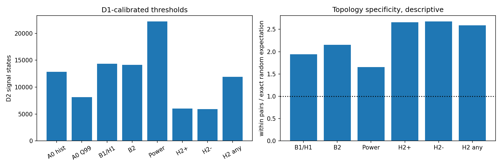
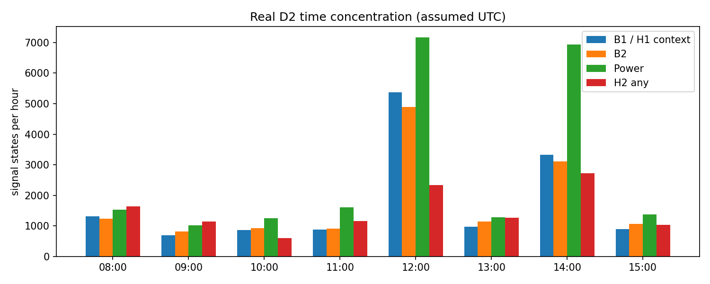
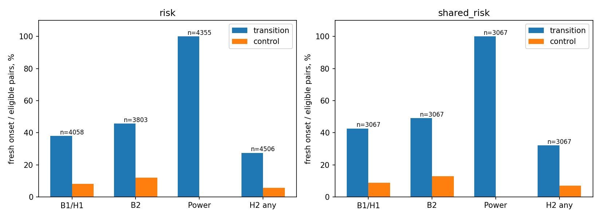
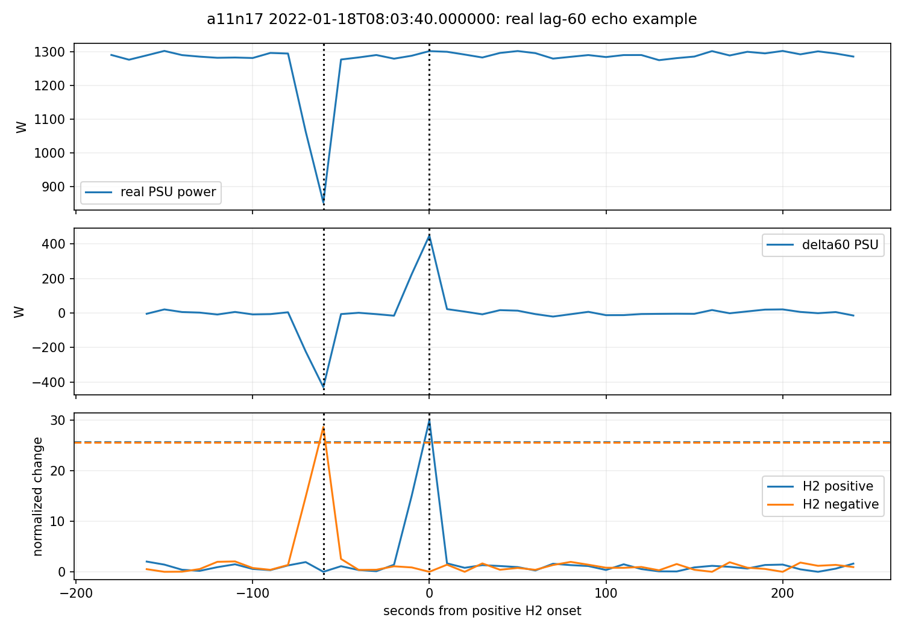
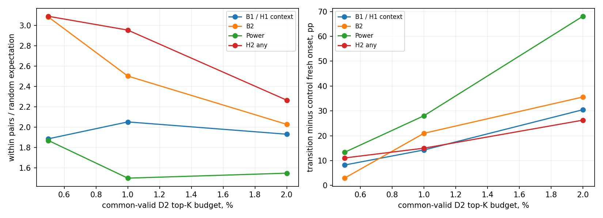

# Этап II: сравнение H1/H2 и контрольных вариантов

**Рекомендация: использовать H1 с контекстным B1 как минимальную основу дальнейшего согласования локальной статистической оценки; H2 в основной локальный и групповой алгоритм сейчас не включать.** B2 остаётся содержательным исследовательским альтернативным вариантом. H1 не новый обученный детектор, а раздельное представление существующих A0/B1. Общего доказательства превосходства по аппаратным отказам нет.

Дата 14.10.2026. Разрешение пользователя: H1 утверждён, один H2 экспериментален, H3 условен. [Исходные формулы](02-hypotheses-protocol.md), [дополнение оценки до расчёта](02-evaluation-protocol.md). D1=[00:00,08:00), D2=[08:00,16:00) 18.01.2022, assumed UTC, по 829440 состояний/288 хостов. D3 не использован; реальные пропуски по этому полностью доступному дню не изучены. Первые 1728 состояний для Δ60 undefined: H2/Power знаменатель 827712. Рабочие thresholds только D1; D2 повторно исследовательский, не независимая валидация.

## 1. Реализованные определения и что сохраняет H1

$$s_{abs}(h,t)=IF_{A0}(z_h(t)),\quad A_{abs}=\mathbf1[s_{abs}>Q_{.99,D1}(s_{abs})],$$
$$\theta_h=Q_{.99,D1}(s_{abs}(h,\cdot)),\quad A_{ctx}=\mathbf1[s_{abs}>\theta_h].$$

Оригинальный score сохранён побитно; A_ctx совпадает с B1 по всем 829440 строкам. H1 выдаёт `(score_abs,A_abs,A_ctx,margin)` отдельно. В групповую диагностику H1 передаётся только A_ctx; никакого OR, переобучения или объявления крайних хостов исправными. Абсолютный канал сохраняет редкость относительно популяции, контекстный отвечает, изменилось ли положение score относительно D1 данного хоста. Даже A_ctx не доказывает физическое изменение или отказ.

| Host | Absolute score median | D1 host theta | A_abs states/rate | A_ctx states/rate | H2+/- states |
| --- | --- | --- | --- | --- | --- |
| a02n09 | 0.74479 | 0.747313 | 2388/82.92% | 59/2.05% | 0/0 |
| a02n10 | 0.746521 | 0.748037 | 2861/99.34% | 77/2.67% | 0/0 |
| a02n11 | 0.713105 | 0.739885 | 24/0.83% | 39/1.35% | 0/0 |
| a02n12 | 0.747313 | 0.749844 | 2880/100.00% | 60/2.08% | 0/0 |

Три a02 сохраняют абсолютные сигналы в большинстве состояний; a02n11 сохраняет высокий количественный score, хотя глобальный Q99 не отмечает большую часть его состояний. Контекстные частоты четырёх —59/77/39/60 состояний (235 всего), без постоянного бинарного вклада. H1 семантически полезен и технически проверен; улучшение независимой точности не заявляется.

## 2. Единственный вариант H2: результат калибровки

$$\Delta P_{h,j}(t)=P_{h,j}(t)-P_{h,j}(t-60s),\quad u_{h,j}=\frac{\Delta P_{h,j}-b_{h,j}}{\max(1.4826MAD_{h,j},\epsilon_j)},$$
$$\epsilon_j=\max(1W,Q_{.50,D1,all\ hosts}|\Delta P_j|),\quad u_h^+=\max_j\max(u_{h,j},0),\quad u_h^-=\max_j\max(-u_{h,j},0).$$

Строгие сигналы `u+>theta+`, `u−>theta−`, pooled D1 Q99.5. theta+=25.7143078901, theta−=25.5542054607; epsilon GPU/CPU/PSU=123/2.2/12.7 W. Host median/MAD обучены только на D1. Масштабы, лаг и thresholds не менялись. H2 any в таблицах — лишь объединение двух направлений H2 для диагностики, не объединение с IF и не окончательный LocalResult.

| Координата | Scale min/median/max, W | Макс u+ D2 | Макс u− D2 | D2 превышений +/− | Хостов с MAD floor |
| --- | --- | --- | --- | --- | --- |
| GPU | 123/184.732/201.411 | 7.6585 | 8.26908 | 0/0 | 3 |
| CPU | 2.2/3.34708/3.85476 | 20.9129 | 19.0084 | 0/0 | 4 |
| PSU | 12.7/19.8668/79.8381 | 39.2873 | 40.5473 | 6012/5895 | 3 |

**Все 6012 положительных и 5895 отрицательных сигналов определяются PSU.** GPU/CPU не пересекают общие thresholds: их максимальные нормированные оценки ниже 25.5. Так фиксированное многокомпонентное max/Q99.5 оказалось практически каналом PSU в D2. Причина подтверждается формулами и диапазонами score, а не является предположением о программной ошибке. Не исправляли это новыми порогами, отдельными компонентными квантилями или другими лагами.

## 3. Полное D2: частоты, длительности, концентрация

| Метод | Signals/valid rate | Runs | Duration median/q95/max,s | 4a02 states | Top4 share | Pair ratio | New-onset pair ratio |
| --- | --- | --- | --- | --- | --- | --- | --- |
| A0 historical | 12847/1.55% | 567 | 40/310/28800 | 11219 | 87.33% | 6.87353 | 3.18177 |
| A0 D1-Q99 | 8153/0.98% | 379 | 40/230/28800 | 8153 | 100.00% | 16.8824 | 16.8824 |
| B1 / H1 context | 14341/1.73% | 10054 | 10/20/320 | 235 | 2.30% | 1.94186 | 1.71811 |
| B2 | 14123/1.70% | 9434 | 10/20/320 | 11 | 3.09% | 2.15132 | 1.97517 |
| Power | 22176/2.68% | 18099 | 10/20/110 | 17 | 2.69% | 1.65696 | 1.67301 |
| H2+ | 6012/0.73% | 4938 | 10/20/60 | 0 | 4.06% | 2.65607 | 2.57613 |
| H2- | 5895/0.71% | 4824 | 10/20/60 | 0 | 4.09% | 2.674 | 2.58839 |
| H2 any | 11907/1.44% | 9761 | 10/20/60 | 0 | 4.06% | 2.58712 | 2.58272 |

A0 Q99 сохраняет длительные состояния четырёх a02 (max28800 с); контекстный H1/B1 не возвращает этот постоянный бинарный эффект. Для H2 median10 с, max60 с: нельзя интерпретировать 11907 строк как 11907 независимых событий. Даже 9761 runs не являются независимыми отказами из-за повторов одного хоста, общего времени и lag-эхо. Полная разбивка по 288 хостам/16 группам сохранена в JSON и приложении таблиц.

## 4. Переходы, контроли и одинаковый risk set

Сохранены 6978 прежних событий,6050 пар и 928 unmatched, без отбора по score и повторного matching. Primary fresh onset — false→true в [t,t+120], pre60 без данного сигнала. Separate already-active, preexisting, all-post-onset и continuous-only приведены в [полных таблицах](02-evaluation-tables.md). Primary этапа I воспроизведён точно.

| Метод | Fresh/all6978 | Primary event/control, N6050 | Own risk N | Own risk event/control | Shared risk N3067 event/control |
| --- | --- | --- | --- | --- | --- |
| A0 historical | 0.49% | 0.45%/0.00% | 5950 | 0.45%/0.00% | 0.36%/0.00% |
| A0 D1-Q99 | 0.01% | 0.02%/0.00% | 6050 | 0.02%/0.00% | 0.00%/0.00% |
| B1 / H1 context | 25.82% | 26.55%/7.93% | 4058 | 37.93%/8.11% | 42.65%/8.80% |
| B2 | 30.64% | 30.86%/11.85% | 3803 | 45.73%/11.99% | 49.07%/12.81% |
| Power | 70.49% | 71.98%/0.00% | 4355 | 100.00%/0.00% | 100.00%/0.00% |
| H2+ | 42.29% | 39.52%/7.09% | 5744 | 38.98%/7.22% | 29.38%/4.04% |
| H2- | 20.34% | 19.70%/6.00% | 4685 | 24.01%/5.17% | 30.68%/6.72% |
| H2 any | 23.23% | 22.55%/6.68% | 4506 | 27.45%/5.70% | 32.05%/7.08% |

Own risk: обе стороны без соответствующего pre60-сигнала; знаменатель зависит от метода. Shared risk — пересечение B1/B2/Power/H2 any (3067 пар), поэтому проценты этих четырёх методов можно непосредственно сопоставлять на одной выборке. Primary и own-risk проценты по разным методам сами по себе не являются честным сравнением одинаковой популяции.

| Категория | Метод | Primary N/event/control | Own risk N/event/control | Shared risk N/event/control |
| --- | --- | --- | --- | --- |
| GPU drop | B1 / H1 context | 1195/643/102 | 1054/615/89 | 939/565/82 |
| GPU drop | B2 | 1195/749/149 | 1089/713/137 | 939/627/127 |
| GPU drop | Power | 1195/1067/0 | 1067/1067/0 | 939/939/0 |
| GPU drop | H2+ | 1195/462/76 | 1161/439/76 | 939/349/43 |
| GPU drop | H2- | 1195/437/77 | 1138/418/70 | 939/352/69 |
| GPU drop | H2 any | 1195/463/82 | 1106/421/75 | 939/373/71 |
| GPU rise | B1 / H1 context | 1264/67/94 | 493/62/37 | 292/41/24 |
| GPU rise | B2 | 1264/38/133 | 440/35/34 | 292/23/24 |
| GPU rise | Power | 1264/856/0 | 856/856/0 | 292/292/0 |
| GPU rise | H2+ | 1264/472/90 | 1190/437/84 | 292/5/2 |
| GPU rise | H2- | 1264/21/50 | 784/19/10 | 292/8/2 |
| GPU rise | H2 any | 1264/50/59 | 757/43/9 | 292/9/3 |
| CPU drop | B1 / H1 context | 1275/295/102 | 1087/284/85 | 875/215/73 |
| CPU drop | B2 | 1275/456/131 | 1062/414/116 | 875/352/102 |
| CPU drop | Power | 1275/1065/0 | 1065/1065/0 | 875/875/0 |
| CPU drop | H2+ | 1275/290/77 | 1216/273/74 | 875/177/35 |
| CPU drop | H2- | 1275/240/70 | 1191/221/61 | 875/176/58 |
| CPU drop | H2 any | 1275/269/80 | 1139/233/68 | 875/194/63 |
| CPU rise | B1 / H1 context | 1306/170/112 | 946/162/81 | 554/107/58 |
| CPU rise | B2 | 1306/157/148 | 783/149/81 | 554/97/54 |
| CPU rise | Power | 1306/747/0 | 747/747/0 | 554/554/0 |
| CPU rise | H2+ | 1306/271/71 | 1223/248/67 | 554/26/7 |
| CPU rise | H2- | 1306/64/62 | 1011/61/37 | 554/36/15 |
| CPU rise | H2 any | 1306/83/69 | 954/74/37 | 554/38/16 |
| PSU drop | B1 / H1 context | 470/431/33 | 452/416/33 | 407/380/33 |
| PSU drop | B2 | 470/467/88 | 429/428/88 | 407/406/86 |
| PSU drop | Power | 470/463/0 | 463/463/0 | 407/407/0 |
| PSU drop | H2+ | 470/404/62 | 461/395/62 | 407/344/37 |
| PSU drop | H2- | 470/430/63 | 444/406/63 | 407/369/62 |
| PSU drop | H2 any | 470/430/67 | 436/398/67 | 407/369/64 |
| PSU rise | B1 / H1 context | 540/0/37 | 26/0/4 | 0/0/0 |
| PSU rise | B2 | 540/0/68 | 0/0/0 | 0/0/0 |
| PSU rise | Power | 540/157/0 | 157/157/0 | 0/0/0 |
| PSU rise | H2+ | 540/492/53 | 493/447/52 | 0/0/0 |
| PSU rise | H2- | 540/0/41 | 117/0/1 | 0/0/0 |
| PSU rise | H2 any | 540/69/47 | 114/68/1 | 0/0/0 |

**Для PSU rise у B2 own-risk N=0, общий risk set также пуст.** Нельзя объявить нулевую вероятность нового сигнала по отсутствующей выборке. H2+ отмечает 673/724 таких переходов, но это не доказательство улучшения: см. эффект лага ниже. Для Power event100%/control0% на risk sets возникает по конструкции отбора переходов и контроля; даже вырожденный bootstrap CI[100,100] не означает идеальный детектор отказов.

| Метод (shared3067) | Δ event−control,п.п. | CI host | CI hour | CI halfhour |
| --- | --- | --- | --- | --- |
| B1 / H1 context | 33.8441 | [31.62, 35.99] | [28.65, 37.94] | [27.59, 39.59] |
| B2 | 36.2569 | [33.92, 38.66] | [31.68, 40.59] | [30.71, 41.02] |
| Power | 100 | [100.00, 100.00] | [100.00, 100.00] | [100.00, 100.00] |
| H2 any | 24.9755 | [22.41, 27.58] | [20.32, 29.92] | [20.52, 29.50] |

CI — описательные percentile bootstrap1999, seed4301, whole host и общие часы (8 блоков),30 мин sensitivity. Не IID строк; host-only и time-only варианты не являются полным двухсторонним cluster-robust доказательством. Нет множественных подтверждающих p-values для risk таблиц; нет независимых отрицательных меток и нет precision/F1 отказов.

## 5. Качество matching и 928 unmatched

Относительное расхождение определяется по прежней мощности доминирующей подсистемы; median=0.06%, q95=1.15%. Страты: <=1%: 5692, 1-5%: 333, >5%: 25. Primary6050 не фильтровался по этим стратам. Полные таблицы primary/risk по качеству и категориям представлены в приложении; >5% содержит всего 25 пар и непригоден для устойчивого отдельного вывода.

| Категория | Matched/Unmatched N | |Δ| median matched/unmatched,W | Pre P median matched/unmatched,W | t−start q95 matched/unmatched,s |
| --- | --- | --- | --- | --- |
| all | 6050/928 | 538.2/539.478 | 731.6/699.636 | 260/470 |
| GPU drop | 1195/142 | 635.6/654.1 | 827.7/882.545 | 210/490 |
| GPU rise | 1264/183 | 637/677.8 | 765.625/669.2 | 240/470 |
| CPU drop | 1275/155 | 11.9/14.5 | 109.1/108.5 | 350/700 |
| CPU rise | 1306/184 | 12.2/15.4 | 108/105.5 | 490/530 |
| PSU drop | 470/80 | 542.8/541.1 | 1453.3/1452.1 | 0/0 |
| PSU rise | 540/184 | 541.4/540.7 | 1429.6/1368.6 | 60/60 |

У unmatched средние |Δ|415.66 против 370.47W в pooled смешанной выборке; состав подсистем влияет на эту величину, поэтому важны строки по категориям. Например GPU rise pre median669.20 против 765.63W, amplitude median677.80 против 637W. Распределения не идентичны; paired результат нельзя безоговорочно переносить на все 6978 событий. Числа fresh для unmatched каждого метода также приведены отдельно.

## 6. Дополнительная информация H2 и временное эхо

H2/Power intersection=7994, Jaccard=0.306413. H2-only3913 состояния, Power-only14182. Поэтому буквальная гипотеза полного дублирования опровергнута. Все H2-only — PSU; median max|Δ|/Power-threshold=0.915291, то есть в основном изменения меньшей амплитуды близко к прежнему порогу. Из 3913 лишь 870 совпадают с B1 и 1780 с B2. Наличие новых строк не доказывает их эксплуатационной полезности.

H2-only within/random ratio=3.10173 (описательно, без дополнительного подтверждающего семейства). Это дополнительная топологически согласованная информация о PSU при выбранной нормировке. Она ещё не является групповым аномальным состоянием, качеством обнаружения отказа или доказательством нормального job completion.

Из 4938 новых H2+ runs у 4412 (89.35%) есть H2− ровно 60 с ранее. Для H2+ medianΔ60 PSU=518.9W, а median фактического изменения между соседними 10 с наблюдениями=2.20001W. Median |adjacent|/|Δ60|=0.0209902. Это наблюдаемое lag-эхо: положительное приращение может возникнуть из-за малого значения P(t−60), хотя текущая мощность почти не меняется. Соседние изменения использованы только как описание реальной траектории, не как второй лаг или новый кандидат H2.

Пример выбран автоматически: первый H2+ onset с H2−60 с ранее, a11n17, 2022-01-18T08:03:40.000000. Без ручного отбора и синтетических значений.

**Не считать отрицательный и положительный отклики лагового оператора двумя независимыми неисправностями или реальными переключениями нагрузки.** Изменение мощности, статистическая нетипичность и подтверждённый отказ сохраняют разные определения. Ни обычность нагрузки, ни отказ без внешних журналов здесь не подтверждены.

## 7. Внутригрупповая и общекластерная активность

| Метод | Within/cross pairs | Signal/onset ratio к случайным | Holm16 signal/onset p | Localized support states | New localized onset states | All16 groups active timestamps |
| --- | --- | --- | --- | --- | --- | --- |
| A0 historical | 22515/32785 | 6.87353/3.18177 | 0.008/0.008 | 3087 | 55 | 0 |
| A0 D1-Q99 | 7701/0 | 16.8824/16.8824 | 0.008/0.0605 | 2862 | 2 | 0 |
| B1 / H1 context | 87963/676780 | 1.94186/1.71811 | 0.008/0.008 | 1222 | 984 | 4 |
| B2 | 100056/685126 | 2.15132/1.97517 | 0.008/0.008 | 1007 | 754 | 8 |
| Power | 78338/719829 | 1.65696/1.67301 | 0.008/0.008 | 2529 | 2413 | 77 |
| H2+ | 44437/238011 | 2.65607/2.57613 | 0.008/0.008 | 395 | 326 | 1 |
| H2- | 42918/228046 | 2.674/2.58839 | 0.008/0.008 | 396 | 329 | 1 |
| H2 any | 87387/482861 | 2.58712/2.58272 | 0.008/0.008 | 785 | 655 | 3 |

$$S_g=K_g/N_g,\quad E_g=S_g-S_{\neg g}.$$

Диагностическое localized state: K_g≥2 и E_g>0; новое синхронное изменение — минимум 2 onset и положительный onset-контраст. Длительности и распределения S/E в приложении. Это не окончательный GroupEvent и не калибровка рабочего группового порога. Отсутствующая доступность имеет undefined S/E; реальные missing data здесь отсутствуют, корректность проверена отдельными fixtures.

1999 общих перестановок хостов по 18, seed4202; ряды, частоты, общая активность сохранены. Семейство 8 методов×2 статистики=16, Holm. Signal draws A0/B1/B2 совпали с прежними сохранёнными draws №4.2: новое вычисление не создаёт нового независимого реального испытания. Pair ratio A0 завышен четырьмя устойчивыми a02: высокая статистическая локализация не равнозначна временному групповому событию. H2 ratio≈2.59 превосходит Power≈1.66 в этой выборке, но реагирует только на PSU и лаговое эхо. Поэтому H2 не выбран для основной групповой агрегации. Перспектива — исследовать S/E от A_ctx с отдельным абсолютным контекстом, после нового согласования.

## 8. Равный бюджет и устойчивость

Общий eligible набор 827712 определённых Δ60 D2; бюджеты 0.5/1/2% дают 4138/8277/16554 состояний. B1 ранжируется по margin к hostθ, B2 по score, Power по нормированному приращению, H2 по max(u+,u−). Stable ties сохраняют порядок timestamp/host. Это исследовательский top-K, **не рабочие пороги D2**. Own-risk sets опять могут различаться.

| Бюджет | Метод | N signals | Pair ratio | Own risk N | Event/control new120 | Δ,п.п. |
| --- | --- | --- | --- | --- | --- | --- |
| 0.50% | A0 D1-Q99 | 4138 | 16.8824 | 6050 | 0.00%/0.00% | 0 |
| 0.50% | B1 / H1 context | 4138 | 1.88655 | 5454 | 9.04%/0.83% | 8.21415 |
| 0.50% | B2 | 4138 | 3.08312 | 5809 | 2.98%/0.03% | 2.94371 |
| 0.50% | Power | 4138 | 1.87038 | 5727 | 13.32%/0.00% | 13.3229 |
| 0.50% | H2 any | 4138 | 3.08986 | 5541 | 11.32%/0.25% | 11.063 |
| 1.00% | A0 D1-Q99 | 8277 | 16.8824 | 6050 | 0.02%/0.00% | 0.0165289 |
| 1.00% | B1 / H1 context | 8277 | 2.05257 | 4990 | 16.69%/2.40% | 14.2886 |
| 1.00% | B2 | 8277 | 2.50277 | 4706 | 23.86%/2.87% | 20.9945 |
| 1.00% | Power | 8277 | 1.50032 | 5485 | 28.04%/0.00% | 28.0401 |
| 1.00% | H2 any | 8277 | 2.95418 | 4974 | 18.09%/3.10% | 14.998 |
| 2.00% | A0 D1-Q99 | 16554 | 3.81575 | 5453 | 7.67%/0.94% | 6.73024 |
| 2.00% | B1 / H1 context | 16554 | 1.93177 | 4020 | 38.71%/8.23% | 30.4726 |
| 2.00% | B2 | 16554 | 2.02893 | 3582 | 52.04%/16.44% | 35.5946 |
| 2.00% | Power | 16554 | 1.54893 | 4932 | 68.07%/0.00% | 68.0657 |
| 2.00% | H2 any | 16554 | 2.26623 | 3958 | 35.47%/9.20% | 26.2759 |

Топологическое отношение зависит от бюджета: H2≈3.09/2.95/2.27; B2≈3.08/2.50/2.03; B1≈1.89/2.05/1.93. Это не универсальная победа H2: разные физические состояния, lag-эхо и разные risk sets. Не выбирали вариант по одному показателю или F1_ref.

| Seed | Метод | Signals | Fresh120/all | Pair ratio |
| --- | --- | --- | --- | --- |
| 42 | A0 D1-Q99 | 8153 | 0.01% | 16.8824 |
| 42 | B1 / H1 context | 14341 | 25.82% | 1.94186 |
| 42 | B2 | 14123 | 30.64% | 2.15132 |
| 43 | A0 D1-Q99 | 8151 | 0.00% | 16.8824 |
| 43 | B1 / H1 context | 15416 | 25.68% | 1.87096 |
| 43 | B2 | 13842 | 30.47% | 2.15323 |
| 44 | A0 D1-Q99 | 7653 | 0.01% | 16.8824 |
| 44 | B1 / H1 context | 14341 | 26.21% | 1.92595 |
| 44 | B2 | 13210 | 28.98% | 2.196 |

Seeds42/43/44 — ранее сохранённые парные леса, без переобучения; H1/H2/Power детерминированы. Статистическое преимущество B2 на переходах сохраняется описательно, но систематическая rise-асимметрия и отсутствие независимой разметки остаются. Восемь часовых блоков и один день ограничивают устойчивость вывода.

## 9. Вычислительные затраты и воспроизводимость

Платформа: Windows-11-10.0.26200-SP0; 12th Gen Intel(R) Core(TM) i7-12650H, 16 logical processors, RAM=15.6296GiB. Go go1.27.2, GOMAXPROCS=1; NumPy OPENBLAS_NUM_THREADS=1. Один прогрев и 5 последовательных повторов. CPU/RAM получены registry/WinAPI; CIM в sandbox недоступен.

| Расчёт полного D2/D1 | Median,s | Min/max,s | Комментарий |
| --- | --- | --- | --- |
| A0 saved forest D2 score | 4.63551 | 4.52436/4.9914 | нормализация, score и проверка expected; no fit |
| B2 saved forest D2 score | 4.44016 | 4.39832/4.59041 | включает host adaptation; no fit |
| H1_fit | 0.0317928 | 0.0296225/0.0331297 | Python; cached IF score or precomputed delta as named |
| H1_apply_cached_score | 0.0292148 | 0.0281306/0.0295665 | Python; cached IF score or precomputed delta as named |
| H2_fit | 0.236867 | 0.234617/0.261083 | Python; cached IF score or precomputed delta as named |
| H2_apply_delta | 0.0772761 | 0.0751153/0.0856376 | Python; cached IF score or precomputed delta as named |
| physical_preprocess_D2 | 0.0866897 | 0.0854014/0.105978 | Python; cached IF score or precomputed delta as named |
| delta_D2 | 0.200649 | 0.198056/0.208248 | Python; cached IF score or precomputed delta as named |
| power_fit | 0.0453138 | 0.0427102/0.048518 | Python; cached IF score or precomputed delta as named |
| power_apply_delta | 0.0154583 | 0.0146618/0.0164731 | Python; cached IF score or precomputed delta as named |
| group_aggregation | 0.0023323 | 0.0022666/0.0023722 | Python; cached IF score or precomputed delta as named |

H1 дополнительных деревьев не обучает; получение abs score имеет стоимость A0. H1 profile — 12012 bytes; H2 profile — 82973 bytes. Python peak working set=781.8MiB; это весь research-процесс (включая JSON, memmaps, результаты и bootstrap), не отдельная модель. Go reserved Sys=358.9MiB — не peak RSS. Input/hash/load=1.869s; preprocessing=0.507s; profiles fit=0.267s; apply=0.112s; initial NPZ writing=2.522s; полный research=91.72s. Эти тайминги не являются масштабированием VI; повторения scoring были в одном последовательном порядке, без рандомизации A0/B2. Разница их нескольких процентов не объявляется преимуществом производительности.

Сложность: H1 threshold nearest-rank O(N) expected / O(NlogN) при сортировке; margin/flags O(N), хранение O(H) сверх исходного IF. H2 fixed3 coordinates/lag: O(N), профиль O(3H), потоковый буфер O(6·3H); основной offline audit хранит массивы O(N). Групповая агрегация O(N+LG). IF scoring O(NTd), norm O(NF). Без нового эмпирического бенчмарка обучения IF по этим измерениям нельзя оценить полную цену переобучения B2.

| Артефакт | SHA256 |
| --- | --- |
| H1-profile.json | 2edac1d242beada98611c3e1a4765cd30422104756c15ae0ac5aae69473b2cb0 |
| H2-profile.json | 1db873059339b76857ca781d4cb81fbb70963e5cb4255de9a7a6894be6326299 |

[Все SHA входов](02-evaluation-tables.md), [команды](../../tools/research43/README.md), [фактические проверки](02-CHECKS.md). Независимый audit: точные H1/H2 параметры и все определённые score;416896 temporal checks; 80 direct permutation counts; Holm16;15 lexsort budget checks. Новый Go benchmark повторно вычислил A0/B2 по всему D2, max error0. Основные профили, F18, production, PostgreSQL, Kafka, архитектура и РПЗ не изменены.

## 10. Ответы и решение контрольной точки №3

1. **Что улучшилось:** H1 сохраняет абсолютную редкость и индивидуальную интерпретацию без изменения score/B1. Исправлена оценка risk sets и отдельно раскрыты качество matching и unmatched. H2 даёт дополнительные PSU изменения ниже прежнего абсолютного порога и их топологическую согласованность. Это новые диагностические свойства, не доказанная точность обнаружения аппаратных неисправностей.
2. **Что осталось:** D2 reuse, одна assumed UTC дата, непроверенная физическая топология, зависимые/перекрывающиеся переходы, несопоставленные окна, пустые risk sets, отсутствие эксплуатационной разметки. IF не обязан сигнализировать каждое изменение мощности.
3. **Польза H2 сверх простого порога:** буквальное дублирование отвергнуто; проверенная добавка —3913 PSU состояний и ratio3.10 для этой разности. Однако GPU/CPU канал подавлен общим threshold, около 89% новых H2+ имеют отрицательный отклик 60 с ранее. Практическое улучшение основной методики не подтверждено.
4. **H2 для групповой агрегации:** сейчас не включать. Более высокий pair ratio не устраняет подмену групповой аномалии синхронным изменением/эхом PSU. Сохранить отдельно исследовательскую диагностику, без LocalResult/GroupEvent и без OR с H1.
5. **H1+B1 или более сложное:** H1+B1 — минимальная обоснованная основа локальной статистической оценки для следующего согласования. B2 лучше согласуется с частью переходов и имеет больший pair ratio, но не доказана его универсальная практическая необходимость. Окончательную локальную модель и рабочий групповой критерий пока не зафиксировали; дальнейшие этапы требуют нового разрешения.
6. **Формулы для будущей РПЗ:** сохранить F18/global normalization/IF; добавить раздельные s_abs,A_abs,theta_h,A_ctx и margin; явно определить статистическую нетипичность, изменение режима и подтверждённый отказ. S_g,E_g с фактической доступностью — основа последующей спецификации, не окончательные пороги. H2 представить как эксперимент с отрицательным результатом основной интеграции и правилом лагового эха. Не добавлять H2 в утверждённый детектор автоматически; РПЗ сейчас не редактируется.
7. **Гипотезы:** H1 техническое/семантическое разделение подтверждено; его независимое улучшение качества отказов не проверено. H2 вычислительная реализуемость и дополнительная PSU-информация подтверждены; полное дублирование отвергнуто; польза как общего трёхподсистемного канала аномалий и основания основной групповой интеграции не подтверждены. H3 не реализована, не проверена и остаётся условной до отдельного согласования после III.

**Остановка после этапа II.** Этап III, физическая доработка, окончательный GroupEvent и D3 не начаты. Ветка исследования основана на этапе I; при будущей интеграции №4.1→№4.2→№4.3 использовать один tracked набор statistical helpers, новые копии зависимости не добавлены. Merge самостоятельно не выполняется.
